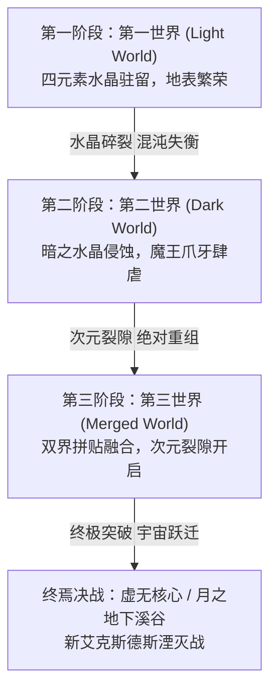

# 01. 全域世界观圣经与叙事总纲白皮书 (World Bible & Narrative Master Spec)

## 1. 世界观本源与双月宇宙学体系

### 1.1 双月世界观与原初水晶神话
本游戏世界建立在双月并立的宇宙学拓扑之上：
- **青之月（The Pale Moon / Crystal Moon）**：孕育了原始的大地生命、四元素以太（地、水、火、风）与光之意志。原初水晶作为稳定地脉秩序的引力核心，坐落于星球的四极节点。
- **红之月（The Vermilion Moon / Void Moon）**：沉睡着远古高维意识与“虚无”（The Void）的引力潮汐。当光之秩序过载或被贪欲扰乱，红之月的重力锁链将拉扯原初水晶产生共振崩解。
- **光暗双极宿命**：光之战士（Sol、Sarah、Aigis、Glaive）与暗之战士（Nacht 及暗阵营同伴）并非正邪对立，而是双月引力在人间的两种具象投射。水晶破碎不是终结，而是光与暗跨越世界隔阂、重建宇宙平衡的必由试炼。

### 1.2 世界的三阶段演变历程（Three-Phase World Progression）



1. **第一世界（光之世界）**：
   - 繁华的城镇、四座元素神殿（风之神殿、沃鲁斯水之塔、卡尔纳克火之船、朗卡浮空土之遗迹）。
   - 水晶逐渐出现裂痕并依次粉碎，每一次粉碎均伴随地貌巨变与职业晶石碎片觉醒。
2. **第二世界（暗之世界）**：
   - 水晶粉碎后的对极镜像世界。艾克斯德斯城堡拔地而起，穆亚大森林遭遇火海，封印之树破裂，暗之战士与光之战士遭遇命运交汇。
3. **第三世界（融合世界 / Merged World）**：
   - 两界合二为一，产生大规模地貌断裂拼接。曾经被大海阻隔的区域出现陆桥，曾经的深海海沟浮现古遗迹，中央出现通往“次元之隙”（Dimensional Rift）的虚无风暴。

---

## 2. 全 12 章 96 节拍主线剧情战役大纲

主线剧情分为四大篇章（序章+12个正传章节），共 96 个叙事节拍（Beats），严格绑定地图 ID、剧情 NPC、任务目标与 Boss 掉落：

### 篇章一：水晶异变与破碎之声（Chapters 1 ~ 3）
- **Chapter 1: 始源微风与碎裂之兆（Beats 01~08）**
  - 地点：宁静村（`village_quiet`） -> 始源神殿（`shrine_origin`） -> 风之神殿（`wind_shrine`）。
  - 核心事件：国王出巡风之神殿失联；主角队伍遭遇微型大黄蜂与强盗；风之水晶碎裂，初阶职业（战士、武僧、白魔、黑魔、盗贼）觉醒。
  - Boss 战役：翼龙幼龙（Wing Raptor），学会防御阶段反击。
- **Chapter 2: 运河悲歌与沉水之塔（Beats 09~16）**
  - 地点：托尔纳运河（`torna_canal`） -> 海盗密窟（`pirate_cave`） -> 沃鲁斯城（`walse_castle`） -> 沃鲁斯水之塔（`walse_tower`）。
  - 核心事件：海龙西尔多拉为护送主角突破水闸漩涡牺牲；水之塔倒塌倒计时；水之水晶粉碎，时魔道士、狂战士、骑士觉醒。
  - Boss 战役：海兽卡鲁拉博斯（Karlabos）、加鲁拉水象（Garula）。
- **Chapter 3: 蒸汽烈焰与城堡崩塌（Beats 17~24）**
  - 地点：卡尔纳克城镇（`karnak_town`） -> 火力蒸汽船（`fire_ship`） -> 卡尔纳克城堡（`karnak_castle`）。
  - 核心事件：魔导抽取水晶过载；火力船引擎暴走；卡尔纳克城堡 10 分钟限时脱出战；火之水晶碎裂，赤魔道士、魔剑士、魔兽使觉醒。
  - Boss 战役：液态火焰（Liquid Flame）、军曹铁爪（Iron Claw）。

### 篇章二：浮空古代与跨界之桥（Chapters 4 ~ 6）
- **Chapter 4: 知识回廊与大地咆哮（Beats 25~32）**
  - 地点：古代大图书馆（`ancient_library`） -> 泰坦山道（`titan_pass`） -> 遗迹平原。
  - 核心事件：学者伊德借阅魔道禁书；学者职业加入；试炼伊弗利特获得召唤契约；泰坦大地之怒考验。
  - Boss 战役：伊弗利特（Ifrit）、泰坦（Titan）。
- **Chapter 5: 苍穹要塞与土之崩落（Beats 33~40）**
  - 地点：克雷森特黑陆行鸟森林（`crescent_forest`） -> 朗卡浮空遗迹（`ronka_ruins`）。
  - 核心事件：黑陆行鸟越洋捕获；改装飞空艇升空；击破四角防空炮台与要塞主炮；土之水晶碎裂，忍者、游侠、风水师觉醒。
  - Boss 战役：原型防卫者（Archeoaevis）。
- **Chapter 6: 大桥突围与孤军奋战（Beats 41~48）**
  - 地点：大桥（`big_bridge`） -> 巴利亚城堡（`bal_castle`）。
  - 核心事件：跨越两界之桥；吉尔伽美什大桥名场面阻击；战线拉锯撤回巴利亚城。
  - Boss 战役：吉尔伽美什第一战（Gilgamesh I）。

### 篇章三：暗之森林与双子分歧（Chapters 7 ~ 9）
- **Chapter 7: 树海死斗与光之传承（Beats 49~56）**
  - 地点：穆亚大森林（`moore_forest`） -> 长老之树（`elder_tree`）。
  - 核心事件：艾克斯德斯点燃树海；加拉夫 0 HP 孤身抵挡魔王四封印必死狂暴；光之意志传承予克露露。
  - Boss 战役：树海四封印魔晶（Seal Crystals）。
- **Chapter 8: 幻象破除与要塞决裂（Beats 57~64）**
  - 地点：艾克斯德斯城堡（`exdeath_castle`）。
  - 核心事件：狼人凯鲁卡舍生破除幻象掩护全队；攀登黑石塔；艾克斯德斯二阶段对决；世界引力彻底失衡。
  - Boss 战役：吉尔伽美什第二战、艾克斯德斯本体（Exdeath）。
- **Chapter 9: 双塔极限与深海熔岩（Beats 65~72）**
  - 地点：双子分歧之塔（`fork_tower`） -> 大海沟（`great_sea_trench`）。
  - 核心事件：分歧之塔黑白分队（黑塔纯法禁用物理，白塔纯武禁用魔法）；潜艇深海巡航突入大海沟。
  - Boss 战役：全知之神（Omniscient）、加戈亚巨兽（Gargoyles）。

### 篇章四：世界重组与终焉湮灭（Chapters 10 ~ 12）
- **Chapter 10: 沉没秘宝与失落神殿（Beats 73~80）**
  - 地点：沉没沃鲁斯塔（`sunken_walse_tower`） -> 金字塔（`pyramid_ruins`） -> 孤岛神殿（`island_shrine`）。
  - 核心事件：7 分钟水下闭气获得模仿师晶石；四大远古石板收集与封印神兵解封仪式。
  - Boss 战役：石板守护兽梅露吉奴（Melusine）、温迪戈（Wendigo）。
- **Chapter 11: 双月溪谷与神兵试炼（Beats 81~88）**
  - 地点：天空要塞（`flying_fortress`） -> 月之地下溪谷（`lunar_subterrane`）。
  - 核心事件：飞空艇宇宙航行改造；双月登陆；击破自律防卫 CPU；拔出王者之剑、诸神之黄昏。
  - Boss 战役：防卫 CPU、巴哈姆特百万核爆试炼、白龙与暗黑巴哈姆特。
- **Chapter 12: 次元之隙与终焉虚无（Beats 89~96）**
  - 地点：幻影之村（`mirage_village`） -> 次元之隙（`dimensional_rift`） -> 虚无核心（`void_core`）。
  - 核心事件：幻影之村补给禁忌法术；突破次元沙海与钟楼；吉尔伽美什自爆救主；终极魔王新艾克斯德斯湮灭决战。
  - Boss 战役：死灵法师、欧米茄/神龙（可选）、新艾克斯德斯（Neo Exdeath）。

---

## 3. 全局 NPC 交互网络与行为树架构

### 3.1 NPC 状态机与生命周期
全域 NPC 依据主线节拍（Current Beat）动态切换其物理位置、外观贴图与对话分支：
1. **常驻型 NPC（Resident）**：商店老板、旅店前台、教会神父。始终响应基础交互。
2. **时序演进型 NPC（Progressive）**：如学者伊德、希德工程师、海盗头子法利斯部下。随章节推进在不同城镇间位移。
3. **伏笔型 NPC（Foreshadowing）**：如酒馆角落的黑衣人、幻影之村的神秘老人。在特定章节前保持沉默，触发特定事件后开启隐藏商道。

### 3.2 NPC 交互防卡死与视野规则
- **碰撞体交互热区**：NPC 周围设置 $48 \times 48$ 像素的交互检测框。主角正对 NPC 并在 1 格距离内按下确认键即可触发。
- **朝向自适应**：交互开始时，NPC 转向主角当前方位；交互结束 3 秒后恢复巡逻路线或原朝向。

---

## 4. 剧情演出系统（Cutscene & Visual Novel Engine）

```
[镜头平滑推进: 目标 (640, 480), 耗时 1.2s, 缓动 EASE_IN_OUT]
[主角走位补间: 节点 Sol 向前移动 64px, 步频 120px/s]
[打字机台词输出: "风……停止了。大地深处的水晶正在悲鸣。"]
[气泡表情提示: "!" 弹出于头顶, 播放 SFX alert.mp3]
[音轨交叉淡化: 环境风声淡出，战役危机 BGM 在 0.8s 内切入]
```

- **视口与输入锁定**：演出触发期间，`WorldInputResolver` 禁用常规摇杆移动，摄像机脱离主角绑定。
- **对话框规格**：底部跨度 1280 视口，高度 220px，采用经典蓝色羊皮纸边框，左侧放置 160×160 精致角色像素肖像。
- **防文本溢出机制**：中文字符每行上限 36 字，英文字符每行上限 70 字母，超长自动触发二次点击翻页标记（闪烁金箭）。

---

## 5. 世界地图物理碰撞层与防穿模安全算法

### 5.1 地图层级物理阻挡掩码（Layer Bitmask）
| 地形类型 | Tile 编码 | 步行通行 | 陆行鸟通行 | 帆船通行 | 潜水艇通行 | 飞空艇通行 |
|---|---|---|---|---|---|---|
| 深海（Deep Sea） | `0x01` | 否 | 否 | 是 | 是 | 是 |
| 浅滩（Shallow Reef） | `0x02` | 否 | 否 | 是 | 否 | 是 |
| 平原与草原（Plains） | `0x04` | 是 | 是 | 否 | 否 | 是 |
| 密林（Dense Forest） | `0x08` | 是 | 黑陆行鸟 | 否 | 否 | 是 |
| 陡峭山脉（Mountains） | `0x10` | 否 | 黑陆行鸟越过 | 否 | 否 | 是 |
| 高峰裂隙（High Peaks） | `0x20` | 否 | 否 | 否 | 否 | 是 |
| 毒沼与熔岩（Hazard Marsh）| `0x40` | 扣血扣状态 | 否 | 否 | 否 | 是 |

### 5.2 防卡死安全区自动回弹算法（Safe Landing Algorithm）
当玩家在飞空艇、黑陆行鸟着陆或从地下城脱出（使用传送脱离魔法 Teleport）时：
1. 射线检测目标落脚点 $(X, Y)$ 的 Tile 属性。
2. 若为不可通过碰撞体（如山峰或海面），启动以 $(X, Y)$ 为中心的曼哈顿距离网格向外发散搜索。
3. 锁定距离最近且属于 `0x04`（平原）或安全路面 Tile，将主角坐标无损矫正回弹，严防玩家卡死于世界边缘。
