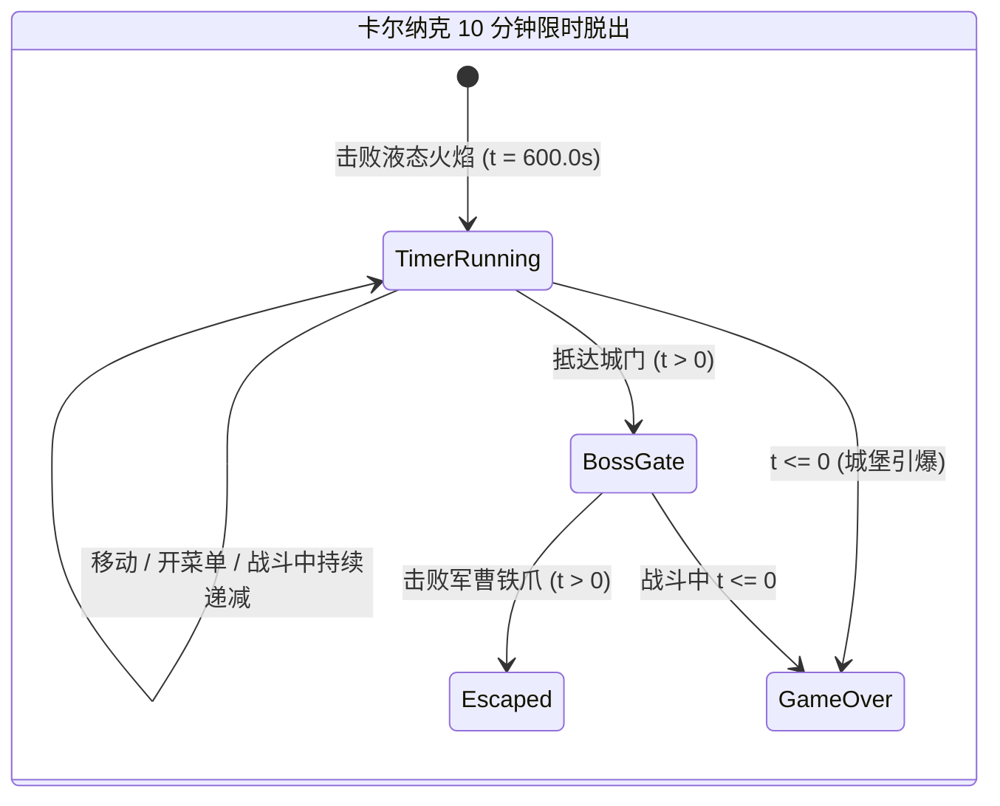

# 02. 全域地宫拓扑与探险战役白皮书 (Dungeon Topology & Global Locations Master Spec)

## 1. 全球 18 大核心地下城空间拓扑矩阵

本游戏地下城架构纵贯地表、深海、苍穹高空、地狱冥界、宇宙双月与虚无异界六大维度：

```mermaid
graph TB
    subgraph 苍穹与宇宙层 (Sky & Space Tier)
        DF["天空要塞 浮游城<br/>(Flying Fortress)"]
        LM["月之地下溪谷 12层<br/>(Lunar Subterrane)"]
        RR["朗卡浮空遗迹<br/>(Ronka Ruins)"]
    end
    subgraph 地表层 (Overworld Tier)
        WS["风之神殿<br/>(Wind Shrine)"]
        WT["沃鲁斯水之塔<br/>(Walse Tower)"]
        KC["卡尔纳克城堡与火力船<br/>(Karnak Castle & Fire Ship)"]
        AL["古代大图书馆 封印回廊<br/>(Ancient Library)"]
        FT["双子分歧之塔<br/>(Fork Tower)"]
        MF["穆亚大森林与长老之树<br/>(Elder Tree & Moore Forest)"]
        EC["艾克斯德斯要塞<br/>(Exdeath's Castle)"]
    end
    subgraph 深海与海沟层 (Abyssal Ocean Tier)
        TC["托尔纳水闸运河<br/>(Torna Canal)"]
        SWT["沉没沃鲁斯塔<br/>(Sunken Walse Tower)"]
        GST["大海沟熔岩地宫<br/>(Great Sea Trench)"]
    end
    subgraph 地狱与冥界层 (Netherworld & Hell Tier)
        JP["翡翠冥河通道<br/>(Jade Passage)"]
        PD["万魔殿 潘地曼尼南<br/>(Pandemonium Keep)"]
        AV["奈落地狱 虚无裂隙<br/>(Abyssal Void Chamber)"]
    end
    subgraph 终局虚无层 (Void & Dimensional Rift)
        DR["次元之隙 复合地宫<br/>(Dimensional Rift)"]
        VC["终焉虚无核心<br/>(Void Core)"]
        OI["鬼子岛 八岐神殿<br/>(Oni Isle Yamata)"]
        ST["封印神殿 EX隐藏地宫<br/>(Sealed Temple EX)"]
    end

    WS --> TC --> WT --> KC --> AL --> RR --> EC --> MF --> FT --> GST --> SWT --> JP --> PD --> AV --> DF --> LM --> DR --> VC
```

---

## 2. 标志性地下城机制与实装规格

### 2.1 沃鲁斯塔水之水晶防卫战 (Walse Tower)
- **空间结构**：共 5 层垂直螺旋水梯，背景伴有高压涌泉喷溅。
- **环境交互**：水流推动机制（按特定方向强制滑行 2 格）、第 4 层水闸开关可反转水流流向。
- **Boss 战役**：加鲁拉水象（Garula），反击冲撞机制。战后水之水晶粉碎，掉落碎片觉醒：时魔道士、骑士、狂战士。

### 2.2 卡尔纳克城堡 10 分钟限时脱出战 (Karnak Castle Escape)
- **时序触发**：击败火力船引擎 Boss 液态火焰后，火之水晶因魔导过载过热引爆，卡尔纳克城堡启动 10 分钟毁灭倒计时。
- **极限制约**：
  - 屏幕右上角常驻显示红色发光倒计时 HUD：`09:59:99`。
  - 倒计时在开菜单与战斗过程中**继续计时**，极度考验玩家的战斗抉择效率与逃跑果断性。
  - 沿途分布 15 处隐藏宝箱（包含丝带、精灵斗篷、火之杖等神器），每个宝箱均潜伏强力宝箱怪（Gigantoad / Sorcerer）。
  - 脱离城堡大门时触发关卡终极 Boss“军曹铁爪”（Iron Claw）截杀，必须在倒计时归零前将其击败。

### 2.3 古代大图书馆与移动书架谜题 (Ancient Library)
- **空间结构**：地下回廊共有 4 个书架矩阵区域。
- **机关题型**：按下墙面机关，巨型古代魔导书架发生横向位移，拼接出隐藏书梯与秘宝储藏室。
- **禁书怪物**：书架中的敌人 Page 32/Page 64/Page 128 会根据等级施展“等级5即死”（Level 5 Death）与“等级4缩小”，青魔法师研习的最佳圣地。

### 2.4 朗卡浮空遗迹与空战攻坚 (Ronka Ruins)
- **攻坚阶段一（飞空艇空战拦截）**：
  - 飞空艇围绕浮空要塞机动，消灭左舷火箭炮（Rocket Launcher）、右舷火炎炮（Flame Thrower）及要塞主炮（Soul Cannon）。
  - 主炮蓄力“波动炮”倒计时，需在 3 回合内使用雷属性攻击灌伤使其瘫痪。
- **攻坚阶段二（要塞核心迷宫）**：
  - 5 层浮空机械回廊，包含浮空浮桥、传送激光带。
  - 击败土之水晶守卫原型防卫者（Archeoaevis），土之水晶碎裂，游侠、忍者、风水师觉醒。

### 2.5 双子分歧之塔两翼分队战役 (Fork Tower)
- **分队机制**：进入塔前，玩家必须将 8 人阵容分为两支 4 人分队，分别进入黑之塔（左）与白之塔（右）。
- **规则绝对制约**：
  - **黑之塔（纯魔法之塔）**：**严禁使用任何物理攻击指令**（若选择“攻击”或物理战技，直接触发全塔反噬警报扣除 9999 HP）；必须全员配备黑魔法师、召唤士、时魔道士等施法职业，Boss 为“全知之神”（Omniscient），施展物理攻击会立刻触发其无敌咏唱并重置战斗。
  - **白之塔（纯物理之塔）**：**严禁使用任何魔法指令与 MP 技能**；必须全员配备狂战士、骑士、武僧、忍者，Boss 为“加戈亚”（Minotaur），受到魔法会触发反圣光即死惩罚。
- **同步通关判定**：两座塔的 Boss 必须在同一步骤被击败，若黑塔击败而白塔团灭，两座塔均发生虚空湮灭重置。

### 2.6 沉没沃鲁斯塔水下 7 分钟闭气与模仿师试炼 (Sunken Walse Tower)
- **水下氧气系统**：队伍潜水进入水下 300 米的沉没水塔，全员头顶显示氧气量表（420 秒）。
- **模仿师高托（Gogo）的禅宗试炼**：
  - 核心机制：**绝对不动（Do Nothing）**。
  - 战斗开始后，高托会声明“你能模仿我的一切吗？”。若玩家攻击、施法、甚至喝药，高托会以双倍圣光、流星群反击灭队。
  - **破解方案**：全员静置等待 2 分钟不进行任何操作，高托会感叹“真乃高深的模仿之道”，主动退让并赠予最终终极职业——**模仿师（Mime）水晶**。

### 2.7 大海沟熔岩迷宫与三种族 Boss 连携 (Great Sea Trench)
- **环境危害**：迷宫全域覆盖熔岩流，未装备风水师特性“轻步（Light Step）”时，全队走一步扣减 50 点 HP 并附加灼烧异常。
- **矮人王国**：迷宫深处坐落着古矮人锻造所，可消耗远古矿石重铸矮人重斧。
- **三巨头连战**：三种族石板守护兽（Phobos, Nereid, Triton），拥有地、水、火三种属性吸收，且死后 3 回合未全灭会相互无限复活，必须使用全体多属性复合魔法同一回合集体清场。

### 2.8 月之地下溪谷 12 层终极探索 (Lunar Subterrane)
- **拓扑规格**：直通双月核心的 12 层终焉深渊，隐藏着历代最凶险的守护兽与十二封印终极神兵：
  - B5F：白龙守护“村雨”（Murasame）。
  - B7F：暗黑巴哈姆特守护“诸神之黄昏”（Ragnarok）。
  - B9F：水龙与风暴守卫“圣枪”（Holy Lance）。
  - B12F：虚妄之镜与塞姆斯/泽罗姆斯（Zeromus）终焉决战，必须使用“水晶之光”破除虚妄真实形态。

### 2.9 地狱与冥界·万魔殿与奈落深渊 (Netherworld & Pandemonium)
- **拓扑规格**：对标 FF2 翡翠通道与地狱魔宫潘地曼尼南，以及 FFD 奈落地狱与虚无圣所：
  - **翡翠冥河 (Jade Passage)**：生者渡河，全境禁止逃跑，忘川暗流与吸魂结界（每回合汲取 MP）。
  - **万魔魔宫 (Pandemonium)**：反重力阶梯与镜面传送阵，潜伏着铁巨人冥界将、红莲魔神别西卜与地狱三头犬。
  - **奈落深渊 (Abyssal Void)**：冥皇·哈迪斯（三形态对决），守护着吸血神兵【血之剑 (Blood Sword)】与 8 阶终极黑魔法【至高核爆 (Flare Tier 8)】。
  - **超度法则**：亡灵系魔物被常规击杀会留下魂火在 3 回合内复活，需使用白魔法【转生 (Life/Arise)】或圣属性神圣攻击超度净化。
- **详见专规**：[`NETHERWORLD_AND_PANDEMONIUM_HELL_SPEC.md`](../olds-world/NETHERWORLD_AND_PANDEMONIUM_HELL_SPEC.md)（`game/world` 有同步副本）。

---

## 3. 地宫机关题型与环境陷阱系统

### 3.1 三大核心机关题型
1. **重力踏板机关（Weight Switches）**：地宫地面存在 2~4 个重力石台，需要推动石像或调动队伍站位同时激活，方能开启升降石门。
2. **镜面光线折射（Light Reflectors）**：旋转四个角落的棱镜台，将中央魔导水晶射出的光束正确折射到四极水晶凹槽中，破解暗影屏障。
3. **时钟齿轮齿合（Clockwork Gears）**：根据墙面古希腊铭文线索，拨动大型古钟的时针与分针指向“3点45分”，打开古代大图书馆禁书库。

### 3.2 陷阱与危害防护矩阵
| 陷阱类型 | 地貌表现 | 触发效果 | 免疫对策 |
|---|---|---|---|
| 隐形落穴（Pitfalls） | 视觉与普通地块无异 | 跌入下层地宫，全员损失当前 HP 的 20% | 风水师被动“洞悉陷阱”或盗贼“警惕” |
| 熔岩与毒沼（Lava/Poison） | 翻滚气泡的红/紫地块 | 移动扣血 50/步，概率中毒 | 风水师“轻步”（Light Step）或全员浮空（Float） |
| 尖刺翻板（Spike Floors） | 周期性伸缩的铁刺 | 被刺穿造成中量物理伤害并硬直 1 秒 | 抓住尖刺收回间歇按节拍跨步 |
| 传送魔方（Warp Cubes） | 虚空漂浮的发光立方体 | 随机打乱队伍落脚点至迷宫入口或怪物巢穴 | 依照特定颜色序列依次触摸 |


---

## 4. 地宫分阶与站点拓扑数据源对照 (Dungeon Tiers & Progression Sheet)

> 门户站点 `src/vble/config/dungeonProgression.ts` 共收录 **32 个节点**（含 18 座主战地宫与 14 处安全观览 / 研习子区），按四大世界阶段（T1~T4）编排：

### 4.1 18 座核心战斗地宫参数总表

| 阶位 | 站点 ID | 地宫名称 | 推荐等级 | 层数 / 分区 | 特殊环境机制 | 守关首领 |
| :---: | :--- | :--- | :---: | :---: | :--- | :--- |
| T1 | `wind-shrine` | 风之神殿 | 1 ~ 5 | 3F | 旋风升降台 | 翼龙 (Wing Raptor) |
| T1 | `torna-canal` | 托尔纳运河 | 6 ~ 9 | 水道 3 段 | 单向水流涡旋 | 噬船海妖 (Karlabos) |
| T1 | `worus-water` | 沃鲁斯水之塔 | 12 ~ 15 | 5F | 高压水流滑行（2 格）+ 水闸反转 | 加鲁拉水象 (Garula) |
| T1 | `karnak-castle` | 卡尔纳克城堡 | 16 ~ 20 | B2F ~ 4F | **10 分钟毁灭倒计时** + 15 宝箱怪 | 液态火焰 / 军曹铁爪 |
| T1 | `ancient-library` | 古代大图书馆 | 20 ~ 23 | B3F ~ 2F | 横向位移书架 + 3:45 时钟齿轮 | 伊弗利特 / 拜布罗斯 |
| T2 | `ronka-ruins` | 朗卡浮空遗迹 | 25 ~ 30 | 空战 + 5F | 飞空艇舷炮拦截 + 传送激光带 | 灵魂主炮 / 原型防卫者 |
| T2 | `moore-forest` | 穆亚大森林 | 32 ~ 36 | 外林 + 长老树内 | 迷雾视距收缩 + 森林大火过场 | 四封印晶石使徒 |
| T2 | `exdeath-castle` | 艾克斯德斯要塞 | 36 ~ 40 | 13F | 幻象伪装层（第 5 层需吉尔伽美什触发真貌）+ 熔岩地板 | 吉尔伽美什 / 艾克斯德斯 |
| T2 | `fork-tower` | 双子分歧之塔 | 42 ~ 46 | 左右各 6F | **8 人分两队**：黑塔禁物理 / 白塔禁魔法 + 同拍击败 | 全知之神 / 加戈亚 |
| T3 | `great-trench` | 大海沟熔岩地宫 | 45 ~ 50 | B6F | 全域熔岩（50 HP/步）+ 矮人锻造所 | 三种族石板守护兽 |
| T3 | `sunken-worus` | 沉没沃鲁斯塔 | 45 ~ 50 | 5F（水下） | **420 秒氧气量表** + 静置 120 秒禅宗试炼 | 模仿师高托 (Gogo) |
| T3 | `emerald-river` | 翡翠冥河通道 | 50 ~ 55 | 冥河 4 段 | 全境禁止逃跑 + 每回合吸魂扣 MP | 冥河渡神 |
| T3 | `pandemonium` | 万魔殿 | 55 ~ 60 | 6F | 反重力阶梯 + 镜面传送阵 | 红莲魔神别西卜 |
| T3 | `naraku-abyss` | 奈落地狱 | 60 ~ 68 | B8F | 亡灵 3 回合魂火复生（需转生/神圣超度） | 冥皇·哈迪斯（三形态） |
| T3 | `floating-city` | 天空要塞浮游城 | 58 ~ 65 | 5F | 高空强风带 + 重力踏板 | 提亚马特 |
| T3 | `lunar-valley` | 月之地下溪谷 | 65 ~ 78 | B12F | 神兵祭坛守护战 + 虚妄之镜 | 白龙 / 暗黑巴哈姆特 / 泽罗姆斯 |
| T4 | `rift-void` | 次元之隙 | 75 ~ 90 | 7 复合区 | 沙漠/森林/洞窟/图书馆/塔/城/水晶跨空间拼接 | 欧米茄 / 神龙 / 灾厄众魔 |
| T4 | `void-core` | 终焉虚无核心 | 85 ~ 99+ | 核心 4 阶 | 无逃跑 + 存档点稀有 | 新·艾克斯德斯 |

> **站点未收录的 2 座隐藏地宫**：§1 拓扑图中的 `鬼子岛 八岐神殿 (Oni Isle Yamata)` 与 `封印神殿 EX (Sealed Temple EX)` 尚未写入 `dungeonProgression.ts`；反之，站点中的 14 处安全观览 / 研习子区（如 `longqi-inner` 飞龙巢内巢、`mermaid-trench` 珊瑚海沟、`mysidia-*` 米西迪亚四区等）无随机遇敌与首领战，不计入 18 座战斗地宫。

---

## 5. 特殊地宫机制状态机

### 5.1 卡尔纳克城堡 10 分钟倒计时与双子分歧之塔同步机制



| 机制项 | 规则细节 |
| :--- | :--- |
| **卡尔纳克倒计时暂停条件** | 仅在过场对白演出（Cutscene）期间暂停；打开主菜单、整理装备、宝箱怪战斗、军曹铁爪战斗期间**一律继续跳秒** |
| **双子分歧之塔违规惩罚** | 黑之塔执行 `Attack` 或物理战技 → 立即触发全塔警报扣除施放者 9999 HP（无视护盾）；白之塔执行任何魔法或消耗 MP 指令 → 立即触发反圣光即死 |
| **双子分歧之塔同步窗口** | 一侧分队击败首领后，自动切换至另一侧分队；另一侧必须在 **3 回合内**完成击杀，否则若另一侧逃跑或团灭，两塔同时重置回分队前存档点 |
| **沉没水塔高托试炼** | 进入高托战后启动 120 秒静置计时器；任意队员执行攻击、魔法、特技、道具、防御、换排均视为「破戒」，清零静置计时并招致双倍反击 |
| **亡灵魂火超度（奈落地狱）** | 亡灵系敌人 HP 归零时进入 `Soulfire` 倒计时状态（3 回合，不可被普攻选中）；期间对其施放 `Life / Arise / Holy` 则彻底消灭，否则 3 回合后以 50% HP 复活 |

---

## 6. 跨卷一致性说明

| 编号 | 关联点 | 说明 |
| :--- | :--- | :--- |
| DNG-C01 | 水晶解锁职业归属与 04 卷存在差异 | 本卷 §2.1 写沃鲁斯水之塔觉醒「时魔道士、骑士、狂战士」，§2.4 写朗卡遗迹觉醒「游侠、忍者、风水师」；而 04 卷 §7（对齐 `jobsConfig.ts`）中骑士属风之水晶、猎人(游侠)/忍者/风水士属火之水晶。以 `jobsConfig.ts` 为准或待策划统一 |
| DNG-C02 | 诸神之黄昏守护地点 | 本卷 §2.8 写月之地下溪谷 B7F 由「暗黑巴哈姆特」守护诸神之黄昏；05 卷 §1.1 写「次元之隙（神龙守护）/ 月之溪谷 B7F」双途径，需明确是唯一掉落还是两处各一把 |

---

## 7. 验收标准 (Acceptance Criteria)

| 编号 | 验收项 | 判定方式 |
| :--- | :--- | :--- |
| DNG-AC-01 | 卡尔纳克倒计时在菜单与战斗中不停止 | 打开菜单停留 10 秒，HUD 倒计时减少 10 秒 |
| DNG-AC-02 | 卡尔纳克倒计时归零立即触发团灭 | 在地图或铁爪战中令 `t = 0`，立即进入 Game Over |
| DNG-AC-03 | 双子分歧之塔黑塔禁物理、白塔禁魔法 | 黑塔选「攻击」扣 9999 HP；白塔选任意魔法触发反圣光 |
| DNG-AC-04 | 沉没水塔 420 秒氧气耗尽触发团灭，静置 120 秒通过高托战 | 高托战全员不操作满 120 秒，战斗直接胜利并获得模仿师水晶 |
| DNG-AC-05 | 大海沟熔岩地板每步扣 50 HP，装备「轻步」或「浮空」后扣 0 HP | 无被动走 10 步扣 500 HP；有被动走 10 步扣 0 HP |
| DNG-AC-06 | 奈落地狱亡灵未超度 3 回合后复活 | 普通击杀亡灵后等待 3 回合，目标以 50% HP 复活；用神圣/转生则直接消灭 |
