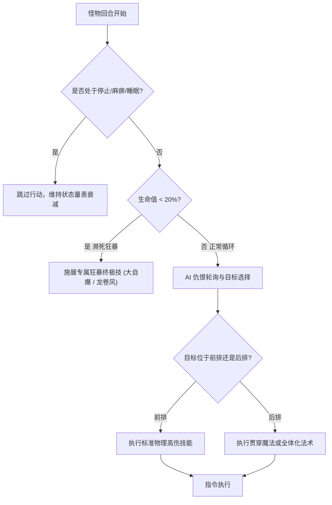

# 03. 首领机制战役与魔物全书白皮书 (Boss Tactics & Bestiary Encyclopedia Master Spec)

## 1. 核心首领机制与阶段战役全解 (Core Boss Strategy Guide)

本白皮书统一规范了游戏全流程 14 场核心战役的阶段转换（Phase Shift）、反击机制、伤害公式与克制要诀：

### 1.1 翼龙幼龙 (Wing Raptor) — 风之神殿
- **阶段转换机制**：
  - **开翼形态（Open Wings）**：物理防御低，受到攻击正常受创。主要释放单体爪击与风刃。
  - **闭翼形态（Closed Wings）**：展开双翼包裹躯体，物理/魔法防御提升 1000%，**任何受到攻击均会触发必杀反击“爪击风暴”（Claw Storm）反噬打残攻击者**。
- **战术破法**：闭翼形态全员执行“防御”或喝药，待其展开双翼后集火弱点火魔法与重击。

### 1.2 海兽卡鲁拉博斯 (Karlabos) — 托尔纳运河
- **战术机制**：拥有高水属性吸收，周期性施展“尾针缠绕”（触电麻痹状态）与“水流大喷射”。
- **雷电弱点**：雷属性受到 3 倍弱点伤害。黑魔法师雷电术（Thunder）与雷之魔法剑可在 2 回合内将其破防击溃。

### 1.3 液态火焰 (Liquid Flame) — 卡尔纳克蒸汽火力船
- **三形态轮转机制**：
  - **人形（Human Form）**：施展单体强力火拳；受到物理攻击后概率变为手掌形。
  - **手掌形（Hand Form）**：物理防御极高，常驻反射魔法（Reflect），施展“指火点燃”与“治疗自身”；受到攻击后变为龙卷形。
  - **龙卷形（Tornado Form）**：防御归零，但受到攻击必反击“吸血”或全体火炎风暴；受到冰属性攻击必定切换回人形。
- **战术破法**：冰属性（Blizzard）全面克制，手掌形态使用无视反射的时空魔法或物理技能，龙卷形态立刻以冰魔法制导。

### 1.4 原型防卫者 (Archeoaevis) — 朗卡浮空遗迹
- **五形态属性连击**：
  - Form 1 (风属性) -> Form 2 (黄沙地属性) -> Form 3 (火属性) -> Form 4 (冰属性) -> Form 5 (不死复活形态)。
  - 每转换一次形态，清除所有弱化 Debuff，并改变弱点与吸收属性。
  - 最终复活形态免疫一切常规异常，施展全屏“灼热吐息”。需依靠圣属性白魔法与药师生体突破快速斩杀。

### 1.5 艾克斯德斯 (Exdeath) — 第二世界城堡决战
- **阶段一（魔人形态）**：常驻“真空波”（即死/狂暴附带），周期性施展四属性高阶魔法（三级火/冰/雷）。
- **阶段二（虚无召唤形态，HP < 30%）**：蓄力“连续魔”（Dualcast），一回合打出两次终极魔法或施展“黑洞”直接放逐一名队员离开战场。
- **战术克制**：必须装备卡邦库尔（Carbuncle）赋予全队反射结界，将魔王的高阶法术全额弹回。

### 1.6 新艾克斯德斯 (Neo Exdeath) — 终焉虚无核心
- **四部位多目标独立判定**：
  - **右上部位（魔法核心）**：施展流星群（Meteor）、至高核爆（Flare）。
  - **左上部位（物理核心）**：施展真空裂斩、狂暴冲击。
  - **右下部位（异常核心）**：施展三角封印（即死/石化/缩小）、大震荡。
  - **左下部位（虚无核心）**：施展终极湮灭光束“Grand Cross”（全宇宙随机赋予全员混乱/石化/盲目/濒死等致命状态）。
- **战术制胜法**：全员必须配备“缎带”（Ribbon）完全免疫状态异常；利用游侠“乱打”（Rapid Fire）配合魔法剑核爆或二刀流，优先集火摧毁施展 Grand Cross 的下部位。

---

## 2. 吉尔伽美什宿命战役全录 (Gilgamesh Encounters & Genji Series)

传奇武人吉尔伽美什是横跨全流程的关键战术宿命对手，贯穿 8 次战役：

| 战役场次 | 遭遇地点 | 核心机制与台词演出 | 关键掉落与偷盗秘宝 |
|---|---|---|---|
| 第一战 | 卡尔纳克地牢阻击 | 初次试探，HP 扣减 50% 后逃跑 | 偷盗：源氏之护手（Genji Glove） |
| 第二战 | 大桥之战 (Big Bridge) | 战意激昂，半血触发“金刚不坏”四重增益（加速/物防/魔防/加速） | 偷盗：英雄之药；BGM《决战在即之大桥》名曲 |
| 第三战 | 泽萨舰队袭击船舷 | 召唤助手“恩奇都”（Enkidu）协同攻击，风与白魔法互助 | 偷盗：源氏之盔（Genji Helm） |
| 第四战 | 艾克斯德斯要塞 8 楼 | 伪石中剑事件！拔出“Excalipoor”砍向主角仅造成 1 点伤害，被艾克斯德斯放逐次元裂隙 | 掉落：伪石中剑 Excalipoor |
| 第五战 | 次元之隙 钟楼 | 与主角化敌为友前夕的切磋，展示剑舞与跳跃 | 偷盗：源氏之盾（Genji Shield） |
| 第六战 (决战) | 虚无深渊魔王护法战 | **宿命自爆救主！** 当主角面对不可战胜的死灵法师时，吉尔伽美什突入战场，自爆同归于尽破除结界 | 偷盗：源氏之铠（Genji Armor，凑齐源氏四件套） |

---

## 3. 至尊超级隐藏首领 (Superboss Encounters)

### 3.1 欧米茄 (Omega) — 机械杀戮兵器
- **属性与机制**：
  - 物理防御 254，魔法防御 150，常驻反射结界。
  - 每回合行动 2 次，首回合施展“波动炮”（Wave Cannon），按全员最大 HP 的 50% 造成真实伤害，并伴随剧毒。
  - 受到物理攻击必定反击“火箭飞拳”（濒死混乱）；受到雷电以外魔法攻击反击核爆。
- **战术终极解法**：装备“火焰之戒”吸收火属性；使用吟游诗人“爱之歌”或诱导其停止；二刀流魔法剑·雷电乱打连续穿甲斩杀。

### 3.2 神龙 (Shinryu) — 封印宝箱中的龙神
- **属性与机制**：
  - 开局先制行动（无论玩家速度多高），必定打出全屏“大海啸”（Tidal Wave），造成 7000~8000 水属性灭顶伤害。
  - 后续行动包含“吹雪”、“原子射线”、“毒气吐息”与“轮盘赌”（即死）。
- **战术终极解法**：**入场前全员必须装备“珊瑚之戒”（Coral Ring）将大海啸全额转化为生命吸收**；使用龙骑士飞龙神枪（对龙 3 倍伤害）配合龙剑与连续狂暴战斧终结战斗；胜利必掉终极神兵“诸神之黄昏”（Ragnarok）。

### 3.3 八岐大蛇 (Yamata-no-Orochi) — 鬼子岛九层深渊
- **机制**：八个头颅轮流苏醒，分别掌控：火、冰、雷、毒、地、风、光、暗八大属性。当前苏醒头颅对本体赋予对应属性 100% 伤害吸收，同时对对极属性呈现 4 倍致命弱点。必须按属性轮转矩阵逐一破头。

---

## 4. 怪物 AI 决策树与反击堆栈规范

- **反击反应熔断堆栈（Counter Loop Breaker）**：
  - 为防止“玩家攻击 -> 怪物反击 -> 玩家白刃取反击 -> 怪物再次反击”产生死循环崩溃，引擎层设置单回合反击堆栈上限为 **3 深度**。超过 3 层直接熔断当前序列。

---

## 5. 剧情首领限回合决算与宝箱怪三回合绝杀法则

为强化高阶战术压迫感与破局输出效率，所有剧情 Boss 战与宝箱怪战均纳入严格的回合时限控制：
1. **剧情 Boss 战限回合与等级压制递减**：
   - 设定最低默认为 **2 回合**、最高上限为 **9999 回合** 的刚性边界。
   - 若玩家队伍等级过高，系统将根据超出等级的阶梯动态削减挑战回合数，最低保底 2 回合。
   - 达到规定回合上限若未击败 Boss，**直接判定游戏失败（Game Over）**。
2. **全域宝箱怪 3 回合绝杀**：
   - 全游戏所有宝箱怪物战统一定格为 **3 回合**。
   - 3 回合内未完成击杀，宝箱怪触发时空吞噬，**直接判定游戏失败（Game Over）**。
3. **详细计算公式与状态面板表现**：详见专项白皮书 [`11_BOSS_AND_CHEST_TURN_LIMIT_SPEC.md`](./11_BOSS_AND_CHEST_TURN_LIMIT_SPEC.md)。

---

## 6. 战斗突发随机事件、生死猜拳、软泥怪克制与全局闪避身法

在第 6 章至第 30 章的特定地下城与精英战场中，引入深度情境交互与物理特化机制：
1. **敌方怪物致命问答（四选一）**：由敌怪发起 4 选 1 试炼，选错将遭受当前 HP/MP 折半、全属性削弱 50%、即死处决或严重混乱/剧毒惩罚，但战斗不强制中断，继续决战。
2. **生死剪刀石头布（三局两胜）**：我方获胜可直接斩杀敌怪或造成瘫痪重创；敌方获胜我方承受等同问答失败的极刑削弱。
3. **软泥怪谱系（黑/黄/红/紫）特化克制**：软泥怪具备非牛顿流体特性，普通物理攻击除非达到超高穿透阈值，否则 99% 概率强制 MISS；必须使用专属弱点魔法才能实现伤害最大化。
4. **全局 MISS 浮字与朝向后撤闪避身法**：未命中时跳出 MISS 浮字与音效；目标角色根据自身在战场中的站位方位与朝向，自适应执行向身体“后方”后撤再复位的身法补间动画。
5. **详细数据结构与表现算法**：详见专项白皮书 [`12_BATTLE_EVENTS_CHOICE_RPS_SLIME_AND_MISS_EVASION_SPEC.md`](./12_BATTLE_EVENTS_CHOICE_RPS_SLIME_AND_MISS_EVASION_SPEC.md)。
