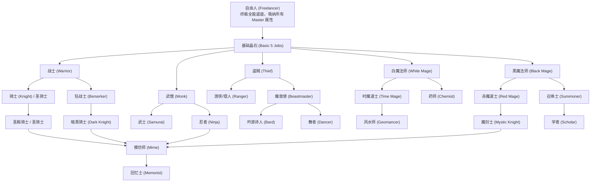

# 04. 全职业进阶与数值成长白皮书 (Job System & Growth Architecture Master Spec)

## 1. 48 类职业进阶分支与转职拓扑 (Job Progression Tree)

本体系融合了《最终幻想5》(FFV) 与《最终幻想：传奇/时空之轮》(FFD) 的职业精髓，采用光之水晶与暗之水晶阵营对立演进模型：

---

## 2. 核心特技、被动继承与槽位机制

### 2.1 槽位配置规则（Ability Slot Architecture）
- **自由人（Freelancer）**：拥有 2 个自由特技槽位，并默认继承所有已达成 Master（职业满级）职业的被动特性（如二刀流、白刃取、轻步、药学等）。
- **模仿师（Mime）**：拥有 3 个自由特技槽位，默认附带指令“模仿”（以 0 消耗复刻上一个队友的任意行动）。
- **常规特化职业**：拥有本职固定指令（如黑魔法、跳跃、偷盗）+ 1 个通用衍生槽位。

### 2.2 核心终极特技列表与结算算式
1. **二刀流（Dual Wield - 忍者 Master）**：
   - 允许左右手各装备一把单手武器，普通攻击与特技连续挥动两次。
   - 伤害判定两次独立计算护甲与暴击率。
2. **乱打（Rapid Fire - 游侠 Master）**：
   - 连续打出 4 次单体物理突击。
   - 特性：**100% 必定命中，且完全无视目标的物理防御力（Def = 0 计算）**；每次伤害系数为常规攻击的 50%。
3. **连续魔（Dualcast - 赤魔 Master）**：
   - 单回合内连续引导并释放两门魔法。可组合“白魔法+黑魔法”、“召唤+时空魔法”。
4. **魔法剑（Spellblade - 魔剑士）**：
   - 将黑魔法（火/冰/雷/核爆/即死/生物）附魔于剑刃，持续整场战斗。击中弱点目标触发 **3.0 倍** 暴击乘区。
5. **神圣跳跃（Holy Jump - 龙骑士）**：
   - 跃升至半空绝对滞空无敌 1 回合，下落造成 2.5 倍贯穿贯刺伤害；配合神圣长枪对龙族目标造成 **5.0 倍** 真实杀伤。

---

## 3. 跨职业融合技全谱系（Fusion Abilities Matrix）

当特定职业达到指定等级并在战斗中同时触发特定技能时，将自动觉醒终极融合技：

| 融合技名称 | 激活职业与技能前置 | 消耗 | 技能效果与伤害乘区 |
|---|---|---|---|
| **魔法剑·核爆乱打** | 魔剑士 L4 + 游侠“乱打” | 40 MP | 连续 4 发无视防御的无属性核爆利刃，单体总倍率 8.0x |
| **至高终焉核爆 (Grand Flare)** | 黑魔法师 L6 + 时魔“重力” | 64 MP | 引爆全屏空间坍塌，敌全员受到无属性特大真伤并附带 100% 减速 |
| **天使圣灵洗礼 (Angel's Grace)** | 白魔法师 L6 + 诗人“英雄歌” | 50 MP | 全员满血复活，恢复 100% HP/MP 并附加 3 回合自动回血与护盾 |
| **虚空百裂居合 (Void Slash)** | 武士“居合斩” + 忍者“影分身” | 0 MP | 8 个分身全屏拔刀，对全场目标进行 70% 概率即死判定，不死免疫者受 9999 物理贯穿伤 |
| **龙王破灭击 (Dragon's Ruin)** | 龙骑士“跳跃” + 召唤士“巴哈姆特” | 75 MP | 化身巨龙自九天直击，造成全场火与光复合 5.5x 爆裂伤害 |
| **神丹破限 (Limit Break Potion)** | 药师“调合” + 武僧“查克拉” | 1 圣水 + 1 龙牙 | 单体队员 HP 上限永久翻倍至 99999，攻击力提升 100%，持续 5 回合 |

> 官网觉醒条件与倍率伤害推演台对照（非引擎运行时）见本卷 **§12.1**。

---

## 4. 青魔法研习体系（Blue Magic Learning System）

### 4.1 研习三大金科玉律
1. **亲身受击**：队伍中必须有装备“学习（Learning）”特性的队员被该法术命中。
2. **生还判定**：受击队员在当前行动结算完毕后必须**存活**（若被直接击杀则无法领悟）。
3. **魔兽操纵（Control）诱导**：对于自残或辅助类青魔法（如“白风”、“强力守护”、“生体突破”），必须依靠魔兽使使用“操纵”控制怪物并令其对主角团队释放。

### 4.2 核心 30 门青魔法精选代表
- **白风（White Wind）**：恢复全员等同于施法者当前 HP 的生命值（无视魔防与减伤）。
- **千针刺（1000 Needles）**：固定造成 1000 点绝对真实伤害。
- **强力守护（Mighty Guard）**：全员同回合附加物防盾（Protect）、魔防盾（Shell）与浮空（Float）。
- **等级5即死（Level 5 Death）**：对全场等级为 5 的倍数的敌人一击必杀。
- **黑之冲击（Black Shock）**：使目标的当前等级减半，可使非 5 倍数敌人强制降至 5 倍数以配合等级即死。

> 官网研习三规则验证器与等级链推演对照（经 v2.2.377 按本节原文校正）见本卷 **§12.2**。

---

## 5. 回忆士与无界属性分配 (Memorist System)

- **回忆士定义**：失忆战士纳哈特（Nacht）的专属终极职业，不依赖常规等级数值矩阵。
- **世界记忆碎片（Memory Fragments）**：全域隐藏 128 枚记忆碎片（分布于古战场、墓碑、密室宝箱、高难任务）。
- **自由点数池**：每收集 1 枚碎片，获得 5 点自由分配点（Strength, Agility, Stamina, Spirit, Magic）。玩家可打造纯敏捷瞬杀流或纯精神超频法师。

---

## 6. 等级突破 255 级与数值不截断平滑成长模型

在最新战斗内核中，本引擎突破了传统 JRPG 255 级的硬上限：
- **Lv 1 ~ Lv 255 成长区间**：
  按照 S 型平滑曲线递增，满级 255 级基础属性标称值为 9999，满血标称值为 65535。
- **Lv > 255 超限成长区间（Post-255 Uncapped Growth）**：
  - 彻底废除 9999 clamp 强制截断。
  - 采用末步线性延伸推算公式：
    $$\text{Stat}(L) = \text{Stat}(255) + \max(1, \Delta_{\text{last}}) \times (L - 255)$$
    其中 $\Delta_{\text{last}} = \text{Stat}(255) - \text{Stat}(254)$。
  - 无论 HP、MP 还是攻防精神，数值均随着超限等级平滑跃升，无断崖崩溃，为通关后 EX 隐藏深渊与八岐大蛇连战提供坚实支撑。

---

## 7. 水晶解锁批次与站点数据对照 (Crystal Unlock Batches)

> ⚠️ **口径差异待裁定**：本卷 §1 标题写「48 类职业」，门户站点数据源 `src/vble/config/jobsConfig.ts` 当前实际录入 **21 个职业**（文件头注释写「26 大」）。下表以站点数据源为准列出；§1 拓扑图中的圣骑士、暗黑骑士、吟游诗人、学者、回忆士等尚未进入数据源。在策划裁定统一口径前，UI 文案不得出现「48 职业」字样。

| 批次 | 解锁来源 | 职业（站点 id） | 数量 |
| :--- | :--- | :--- | :---: |
| 初始 | 开局 | 自由人 `freelancer` | 1 |
| 第一批 | 风之水晶 | 骑士 `knight`、武僧 `monk`、盗贼 `thief`、白魔导士 `white-mage`、黑魔导士 `black-mage`、青魔导士 `blue-mage` | 6 |
| 第二批 | 水之水晶 | 时空魔导士 `time-mage`、召唤士 `summoner`、魔法剑士 `mystic-knight`、狂战士 `berserker`、红魔导士 `red-mage` | 5 |
| 第三批 | 火之水晶 | 忍者 `ninja`、魔兽使 `beastmaster`、猎人 `hunter`、风水士 `geomancer` | 4 |
| 第四批 | 土之水晶 | 武士 `samurai`、龙骑士 `dragoon`、舞者 `dancer`、药剂师 `chemist` | 4 |
| 特殊 | 深渊沉没塔 | 模仿士 `mime` | 1 |
| **合计** | | | **21** |

---

## 8. 熟练度 (AP) 与职业等级表

战斗胜利后，队伍中每名存活角色获得该场战斗的 AP，计入**当前职业**的熟练度。

### 8.1 AP 获取规则

| 来源 | AP |
| :--- | ---: |
| 普通杂兵战 | 1 ~ 3（按区域档位） |
| 迷宫深层杂兵战 | 4 ~ 6 |
| 首领战 | 10 ~ 30 |
| 逃跑 / 团灭 | 0 |
| 战斗不能（K.O.）的角色 | 0 |

### 8.2 职业等级阈值（标准职业）

| 职业等级 | 累计 AP | 本级解锁 |
| :---: | ---: | :--- |
| Lv 1 | 0 | 本职固定指令 |
| Lv 2 | 10 | 第 1 个可装配特技 |
| Lv 3 | 30 | 第 2 个可装配特技 |
| Lv 4 | 60 | 被动特性 1 |
| Lv 5 | 100 | 第 3 个可装配特技 |
| Lv 6 | 160 | 被动特性 2 |
| Lv 7 | 250 | 第 4 个可装配特技 |
| Lv 8 (Master) | 400 | 职业精通：属性加成写入自由人 / 模仿士继承池 |

- 青魔导士、模仿士、自由人不使用本表：自由人无职业等级；模仿士 Lv 8 门槛为 999 AP；青魔导士技能来自 §4 研习，不由 AP 解锁。
- AP 超出 Master 门槛后继续累计但不再产生收益，UI 显示「★MASTER」。

### 8.3 Master 继承规则

1. 某职业达成 Master 后，其 `masteryBonus` 中的属性加成写入全队共享的继承池。
2. 自由人 / 模仿士的基础属性 = 各属性在继承池中的**最大值**（不叠加）。
3. 被动特性（二刀流、白刃取、持盾格挡等）在自由人 / 模仿士上常驻，但仍须满足装备前置（例如二刀流需空置盾槽）。

> 说明：本款只规定「继承后的被动仍须满足装备前置」。真双持首版四武器白名单、`offhand_weapon` 与盾互斥、逐手 `1.0x` 独立结算的完整合同见《15_NINJA_TEACHING.md》§3 / 附录 A.2。官网配装推演台对照见本卷 §11。

---

## 9. 转职规则与边界

| 规则 | 说明 |
| :--- | :--- |
| 转职时机 | 仅在非战斗状态下，于菜单「职业」页切换 |
| 转职代价 | 无金币代价；已装配特技中与新职业不兼容的将被卸下 |
| 装备兼容 | 新职业不可装备的武器 / 防具自动卸入背包，不丢失 |
| HP/MP | 按新旧上限**比例**换算，不回满，不低于 1 |
| AP 保留 | 各职业 AP 独立保存，转回后继续累计 |
| 剧情锁定 | 部分剧情段落强制锁定职业，菜单入口置灰并提示原因 |

---

## 10. 验收标准 (Acceptance Criteria)

| 编号 | 验收项 | 判定方式 |
| :--- | :--- | :--- |
| JOB-AC-01 | 四块水晶依次解锁对应批次职业 | 每获得一块水晶，可选职业数按 6 / 5 / 4 / 4 递增 |
| JOB-AC-02 | 职业等级按 §8.2 阈值提升 | 注入 AP 至 9 / 10 / 399 / 400，等级分别为 1 / 2 / 7 / 8 |
| JOB-AC-03 | K.O. 角色不获得 AP | 战斗中 K.O. 一名角色，结算 AP = 0 |
| JOB-AC-04 | 继承池取最大值不叠加 | 骑士 Master（力量 +42）+ 狂战士 Master，自由人力量加成 = 两者较大值 |
| JOB-AC-05 | 转职后不兼容装备回背包 | 骑士持巨盾转黑魔导士，巨盾出现在背包 |
| JOB-AC-06 | 转职 HP 按比例换算 | 50% HP 转职后仍为新上限的 50%（向下取整，≥1） |
| JOB-AC-07 | UI 不出现未裁定的职业总数 | 全站检索「48 职业」，0 处命中（裁定前） |

---

## 11. 门户站点对照：真双持与转职推演台（非引擎运行时）

> **口径必须分开**：本节只记录官网文档站已交付的**规则推演台**，用于对照本卷 §8.3 / §9 / §10 与《15_NINJA_TEACHING.md》§3。它**不是** Godot / 引擎战斗运行时，也不能替代忍者传承 v1 在引擎侧的隔离实现（该实现状态以 VOL.15 文首与附录 A 为准）。

### 11.1 条款出处（避免章节号误引）

官网更新日志与推演台标题曾把「二刀流须空置盾槽」写成「VOL.04 §8.3」。准确出处如下，后续引用应写清款次，不要把 §8.3 整节当成双持专章。

| 读者看到的规则 | 权威出处 | 说明 |
| :--- | :--- | :--- |
| 二刀流等被动在自由人 / 模仿士上常驻，但仍须空置盾槽 | 本卷 **§8.3 第 3 款** | §8.3 标题是「Master 继承规则」，盾槽只是装备前置示例 |
| 转职仅限非战斗；不兼容装备卸入背包不丢失；HP/MP 按比例换算、向下取整且 ≥1；剧情锁定入口置灰；无金币代价；AP 按职业独立保存 | 本卷 **§9**，验收 **JOB-AC-05 / JOB-AC-06** | 推演台以骑士持巨盾转黑魔导士为默认案例 |
| 主副手均须位于 `2003 / 2004 / 2005 / 2053`；`offhand_weapon` 与盾互斥；普攻逐手 `1.0x`、两刀攻击力不加总 | **VOL.15 §3 / 附录 A.2** | 这是首版政策，不是所有 `two_hand=false` 的单手武器都已开放双持 |

### 11.2 已实现（官网推演台，v2.2.378）

- **入口**：配装模拟器 [`/vble/armory#vol04-vol15-dualwield-jobswitch-studio`](https://mhxy13867806343.github.io/game-ffs-main/#/vble/armory#vol04-vol15-dualwield-jobswitch-studio)
- **实现位置**：`src/vble/views/ArmorySimulatorView.vue`（锚点 `vol04-vol15-dualwield-jobswitch-studio`）
- **发布记录**：站点更新日志 v2.2.378（2026-11-07）

| 模块 | 官网已交付的对照能力 | 对应合同 |
| :--- | :--- | :--- |
| 双持装配校验 | 须同时满足：已习得【二刀流】、盾槽空置、主副手都在四 ID 白名单内；任一项失败则拒绝装配、维持单持 | VOL.15 §3；本卷 §8.3 第 3 款 |
| 白名单与反例 | 四件首版武器名称 / 攻击力与 VOL.15 一致：`2003` 秘银匕首 10、`2004` 波刃匕首 24、`2005` 空气匕首 26、`2053` 短剑 7；提供「其他单手武器」与 `2010`（`two_hand=true`）作为拒绝样例，不得凭名称、类型或 `two_hand=false` 自动纳入 | VOL.15 §3 |
| 逐手展示 | 校验通过后分别展示主手 ATK 与副手 ATK，并写明两刀**不加总**为单一攻击力；各手倍率按 `1.0x` 文案展示 | VOL.15 §3「两手结算与行动」 |
| 转职时机与剧情锁 | 勾选「处于战斗中」则拒绝，提示仅可在非战斗状态下于菜单「职业」页转职；勾选「剧情段落锁定职业」则入口置灰并提示原因 | 本卷 §9 |
| 装备卸入背包 | 默认案例：骑士穿戴巨盾、骑士剑、`2003` 秘银匕首、布衣 → 转黑魔导士时，巨盾与骑士剑卸入背包且不丢失，匕首与布衣保留 | 本卷 §9、JOB-AC-05 |
| HP 比例换算 | 按 `floor(当前HP × 新上限 / 旧上限)` 且结果 ≥ 1，不回满。默认 50%：骑士上限 1800（900/1800）→ 黑魔导士上限 1100（550/1100） | 本卷 §9、JOB-AC-06 |
| 代价与 AP | 成功转职后提示：无金币代价，各职业 AP 独立保存 | 本卷 §9 |

> 职业 HP 上限与装备可用职业是推演示例数据（界面已注明），用于演示 JOB-AC-05 / JOB-AC-06 与 VOL.15 `job_limit` 为空的 `2003`，**不是**全量职业数值表。

### 11.3 未纳入本推演台（仍属设计或引擎合同，勿当成官网已可玩）

下列条款在白皮书或引擎隔离实现中有效，但 **v2.2.378 官网推演台尚未覆盖**。读者或后续批次不得把它们写成「门户已实装」。

| 条款 | 权威出处 | 当前官网状态 |
| :--- | :--- | :--- |
| MP 按新旧上限比例换算、向下取整且 ≥ 1 | 本卷 §9 | 推演台目前只提供 HP 比例滑杆，**未提供独立 MP 推演** |
| 副手从背包实扣 1、同 ID 双持需 2 份实体；满 9999 堆叠放不回则整笔拒绝；读档不重复扣减或补发 | VOL.15 §3 / A.2 | 未做库存记账 |
| 封存态：缺二刀流严格 `true` 旗时保留副手实体、可卸下，但提供 0 攻击 / 0 元素 / 0 被动，且仍与盾互斥 | VOL.15 A.2 | 未做封存态开关 |
| 普攻中途停止：主手 MISS 可出副手；目标已死、施术者反弹倒地或资格失效时停止副手 | VOL.15 §3 / A.2 | 仅展示通过校验后的 ATK 数字，无战斗时序 |
| 授课窗口、六个严格 `bool` 旗、五门永久忍术 90 / 18 | VOL.15 §2 / §4 / A.1 / A.3 | 本推演台不涉及教学与忍术 |
| 真实全量职业 HP/MP 上限与装备兼容总表 | 本卷 §1 / 站点 `jobsConfig.ts` | 仅 4 个示例职业（骑士、黑魔导士、忍者、白魔法师） |

### 11.4 门户推演验收对照

| 编号 | 验收项 | 判定方式（针对官网推演台，而非引擎） |
| :--- | :--- | :--- |
| JOB-PORTAL-01 | 四 ID 白名单拒绝名单外武器 | 主手或副手选「其他单手武器」或 `2010`，装配校验失败 |
| JOB-PORTAL-02 | 盾槽与副手互斥 | 勾选「盾槽已装备盾牌」后，即使四 ID 合法且已习得二刀流，仍拒绝双持 |
| JOB-PORTAL-03 | 未习得二刀流不可副手 | 取消「已习得【二刀流】」后拒绝装配 |
| JOB-PORTAL-04 | 两刀攻击力不加总 | 默认主手 `2005`(26) / 副手 `2004`(24) 通过校验时，分别显示 26 与 24，而不是 50 |
| JOB-PORTAL-05 | 战斗中不可转职 | 勾选「处于战斗中」后转职被拒绝 |
| JOB-PORTAL-06 | 剧情锁入口置灰 | 勾选「剧情段落锁定职业」后提示入口置灰 |
| JOB-PORTAL-07 | 骑士巨盾转黑魔导士卸入背包 | 默认骑士 → 黑魔导士时，巨盾与骑士剑显示「卸入背包」，匕首与布衣「保留装备」 |
| JOB-PORTAL-08 | HP 50% 向下取整不回满 | 骑士 1800 的 50%（900）转为黑魔导士 1100 后为 550 / 1100，不是 1100 / 1100 |

---

## 12. 门户站点对照：跨职业融合技与青魔法研习推演台（非引擎运行时）

> **口径必须分开**：本节只记录官网已交付的规则推演台，用于对照本卷 §3 / §4。它们**不是**战斗引擎运行时。调合配方双源与 ECO-C03 已在《05_EQUIPMENT_ECONOMY.md》§9 交代，此处不重复。同页更早的「跨职业羁绊融合技」展台不属于本条 §3 对照。

### 12.1 已实现：融合技 6 式觉醒与倍率推演（v2.2.377）

- **入口**：召唤兽页 [`/vble/summons#vol04-fusion-sq01-studio`](https://mhxy13867806343.github.io/game-ffs-main/#/vble/summons#vol04-fusion-sq01-studio)
- **实现位置**：`src/vble/views/SummonsView.vue`（`vol04FusionAbilities` / `fusionVerdict`）

六式名称、前置、消耗与效果文案与 §3 表一致。觉醒判定为：前置 A、前置 B（界面标明「同场战斗触发」）均勾选，且资源足够。

| 编号 | 融合技 | 资源检查（源码） | 倍率伤害推演 |
| :--- | :--- | :--- | :--- |
| FUS-01 | 魔法剑·核爆乱打 | 当前 MP ≥ 40（滑杆 0～120，默认 80） | **有**：`round(基准 × 8.0)`。基准滑杆 100～9,999，步进 100，默认 2,000 → 显示 16,000 |
| FUS-02 | 至高终焉核爆 | 当前 MP ≥ 64 | **无**：白皮书未给数值倍率，只展示效果文案 |
| FUS-03 | 天使圣灵洗礼 | 当前 MP ≥ 50 | 无数值倍率，只展示效果文案 |
| FUS-04 | 虚空百裂居合 | `mpCost` 为 0，走 MP 滑杆；`当前 MP < 0` 永假，故只要前置成立即通过 | 无数值倍率，只展示效果文案 |
| FUS-05 | 龙王破灭击 | 当前 MP ≥ 75 | **有**：`round(基准 × 5.5)`。默认 2,000 → 显示 11,000 |
| FUS-06 | 神丹破限 | 不走 MP，改为勾选「背包持有 圣水 ×1 + 龙牙 ×1」 | 无数值倍率，只展示效果文案 |

界面注明：推演值 = 基准伤害 × 白皮书倍率，**未计入**防御、属性抗性与伤害上限；也未把 8.0x 拆成 4 段逐击。

同工坊底部有 VOL.07 §5 SQ-01「海龙西尔多拉」数据卡，合同在《07_SIDEQUESTS_SECRETS.md》，本卷不展开。

### 12.2 已实现：青魔法研习规则与等级链（v2.2.375，经 v2.2.377 按 §4 原文校正）

- **入口**：道具与炼金页同一工坊的后半段 [`/vble/items#vol04-vol05-alchemy-bluemagic-studio`](https://mhxy13867806343.github.io/game-ffs-main/#/vble/items#vol04-vol05-alchemy-bluemagic-studio)（前半调合账本见 VOL.05 §9，不在此重复）
- **实现位置**：`src/vble/views/ItemsView.vue`（`blueMagicCoreSpells` / `blueLearnValidation` / `blueComboResult`）
- **校正要点**（v2.2.377）：研习规则改为「装备学习的队员亲身受击 + 当前行动结算后存活 + 辅助类须魔兽使操纵」；效果名称对齐 §4.2；去掉无出处的来源怪物与「吸血」条目

精选 5 门（不是 §4.2 所说的全部 30 门）与白皮书代表技一致：`白风`、`强力守护` 为辅助类，须勾选「魔兽使【操纵】诱导」才能形成受击；`千针刺`、`黑之冲击`、`等级5即死` 为常规受击。§4.1 举例的「生体突破」未出现在本推演台。

开关与源码判定顺序：

1. 未装备【学习】→ 失败（对应 §4.1 第 1 款的装备前提）
2. 若该术 `requiresControl` 且未勾选【操纵】→ 「无法触发受击」（对应 §4.1 第 3 款）
3. 未被该法术亲身命中 → 失败（§4.1 第 1 款的受击）
4. 当前行动结算后未存活 → 失败（§4.1 第 2 款）
5. 以上均满足 → 习得成功

界面把「装备学习」与「亲身命中」分成两个开关，是推演拆分，不是把 §4.1 改写成四条合同。

等级链推演（默认初始 Lv.62、龙之力 1 次、黑之冲击 1 次）：

| 项目 | 源码行为 | 说明 |
| :--- | :--- | :--- |
| 初始等级 | 滑杆 10～99，默认 62 | 仅用于本推演，不是敌人官方等级表 |
| 药师【龙之力】 | 0～2 次，每次 +20 | 引用 VOL.05 §2 的 +20，配方对照见该卷 §9 |
| 【黑之冲击】 | 0～3 次，每次 `max(1, floor(Lv / 2))` | 「向下取整且不低于 1」是推演约定；§4.2 只写「减半」，未规定取整 |
| **实际计算顺序** | **先**按次数做龙之力 +20，**再**按次数做黑之冲击减半 | 默认轨迹为 `62 → 82 → 41`（41 mod 5 = 1，不触发必杀）。界面导语先写黑之冲击再写龙之力，但轨迹以源码顺序为准 |
| 必杀判定 | `最终 Lv % 5 === 0` | 对齐 §4.2「等级为 5 的倍数」 |

§4.2 并未规定「先加 20 再减半」或相反顺序是战斗合同；不得把上述源码顺序写成已裁定的引擎规则。

### 12.3 未纳入本批推演台（勿当成官网已可玩或已裁定）

| 条款或对象 | 权威出处 | 当前状态 |
| :--- | :--- | :--- |
| 战斗中「同时触发技能即自动觉醒」、真实 MP/道具扣除、防御与抗性、即死概率、HP 上限永久翻倍至 99999 等运行时 | §3 | 官网只做条件勾选与倍率乘法，无战斗时序 |
| 其余约 25 门青魔法、以及 §4.1 举例但未列入 §4.2 精选的「生体突破」 | §4.1 / §4.2 | 未进入本验证器 |
| 黑之冲击「减半」的取整方式，以及与龙之力的施放顺序 | §4.2；龙之力在 VOL.05 §2 | 仅有推演实现，尚未裁定为合同 |
| SQ-01 西尔多拉支线步骤与验收 | VOL.07 §5 | 本卷只指出同工坊有数据卡，不在此扩写 |

### 12.4 门户推演验收对照

| 编号 | 验收项 | 判定方式（针对官网推演台，而非引擎） |
| :--- | :--- | :--- |
| FUS-PORTAL-01 | 六式名称、前置与消耗与 §3 一致 | 六张卡片可对上 §3 表，含 40 / 64 / 50 / 0 / 75 MP 与「1 圣水 + 1 龙牙」 |
| FUS-PORTAL-02 | 仅 8.0x 与 5.5x 做伤害乘法 | 核爆乱打、龙王破灭击显示倍率结果；其余四式提示白皮书未给数值倍率 |
| FUS-PORTAL-03 | 缺前置或资源不足则不觉醒 | 取消前置 A/B，或 MP 低于消耗，或神丹破限未持有素材，均显示未觉醒 / 资源不足 |
| BLUE-PORTAL-01 | 辅助类无【操纵】不能形成受击 | 选白风或强力守护，取消「操纵」后提示无法触发受击 |
| BLUE-PORTAL-02 | 结算后死亡不能领悟 | 装备学习且已受击，但取消「结算后存活」，提示习得失败 |
| BLUE-PORTAL-03 | 默认等级链按源码顺序计算 | 默认 62、+20 一次、减半一次，轨迹为 62→82→41，判定为尚未命中 5 的倍数 |

