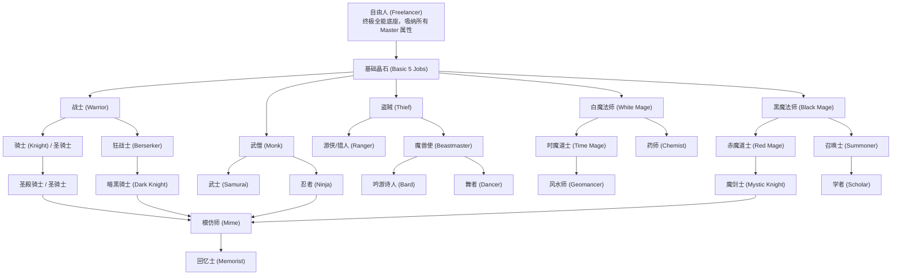

# 04. 全职业进阶与数值成长白皮书 (Job System & Growth Architecture Master Spec)

## 1. 48 类职业进阶分支与转职拓扑 (Job Progression Tree)

本体系融合了《最终幻想5》(FFV) 与《最终幻想：传奇/时空之轮》(FFD) 的职业精髓，采用光之水晶与暗之水晶阵营对立演进模型：

---

## 2. 核心特技、被动继承与槽位机制

### 2.1 槽位配置规则（Ability Slot Architecture）
- **自由人（Freelancer）**：拥有 2 个自由特技槽位，并默认继承所有已达成 Master（职业满级）职业的被动特性（如二刀流、白刃取、轻步、药学等）。
- **模仿师（Mime）**：拥有 3 个自由特技槽位，默认附带指令“模仿”（以 0 消耗复刻上一个队友的任意行动）。
- **常规特化职业**：拥有本职固定指令（如黑魔法、跳跃、偷盗）+ 1 个通用衍生槽位。

### 2.2 核心终极特技列表与结算算式
1. **二刀流（Dual Wield - 忍者 Master）**：
   - 允许左右手各装备一把单手武器，普通攻击与特技连续挥动两次。
   - 伤害判定两次独立计算护甲与暴击率。
2. **乱打（Rapid Fire - 游侠 Master）**：
   - 连续打出 4 次单体物理突击。
   - 特性：**100% 必定命中，且完全无视目标的物理防御力（Def = 0 计算）**；每次伤害系数为常规攻击的 50%。
3. **连续魔（Dualcast - 赤魔 Master）**：
   - 单回合内连续引导并释放两门魔法。可组合“白魔法+黑魔法”、“召唤+时空魔法”。
4. **魔法剑（Spellblade - 魔剑士）**：
   - 将黑魔法（火/冰/雷/核爆/即死/生物）附魔于剑刃，持续整场战斗。击中弱点目标触发 **3.0 倍** 暴击乘区。
5. **神圣跳跃（Holy Jump - 龙骑士）**：
   - 跃升至半空绝对滞空无敌 1 回合，下落造成 2.5 倍贯穿贯刺伤害；配合神圣长枪对龙族目标造成 **5.0 倍** 真实杀伤。

---

## 3. 跨职业融合技全谱系（Fusion Abilities Matrix）

当特定职业达到指定等级并在战斗中同时触发特定技能时，将自动觉醒终极融合技：

| 融合技名称 | 激活职业与技能前置 | 消耗 | 技能效果与伤害乘区 |
|---|---|---|---|
| **魔法剑·核爆乱打** | 魔剑士 L4 + 游侠“乱打” | 40 MP | 连续 4 发无视防御的无属性核爆利刃，单体总倍率 8.0x |
| **至高终焉核爆 (Grand Flare)** | 黑魔法师 L6 + 时魔“重力” | 64 MP | 引爆全屏空间坍塌，敌全员受到无属性特大真伤并附带 100% 减速 |
| **天使圣灵洗礼 (Angel's Grace)** | 白魔法师 L6 + 诗人“英雄歌” | 50 MP | 全员满血复活，恢复 100% HP/MP 并附加 3 回合自动回血与护盾 |
| **虚空百裂居合 (Void Slash)** | 武士“居合斩” + 忍者“影分身” | 0 MP | 8 个分身全屏拔刀，对全场目标进行 70% 概率即死判定，不死免疫者受 9999 物理贯穿伤 |
| **龙王破灭击 (Dragon's Ruin)** | 龙骑士“跳跃” + 召唤士“巴哈姆特” | 75 MP | 化身巨龙自九天直击，造成全场火与光复合 5.5x 爆裂伤害 |
| **神丹破限 (Limit Break Potion)** | 药师“调合” + 武僧“查克拉” | 1 圣水 + 1 龙牙 | 单体队员 HP 上限永久翻倍至 99999，攻击力提升 100%，持续 5 回合 |

---

## 4. 青魔法研习体系（Blue Magic Learning System）

### 4.1 研习三大金科玉律
1. **亲身受击**：队伍中必须有装备“学习（Learning）”特性的队员被该法术命中。
2. **生还判定**：受击队员在当前行动结算完毕后必须**存活**（若被直接击杀则无法领悟）。
3. **魔兽操纵（Control）诱导**：对于自残或辅助类青魔法（如“白风”、“强力守护”、“生体突破”），必须依靠魔兽使使用“操纵”控制怪物并令其对主角团队释放。

### 4.2 核心 30 门青魔法精选代表
- **白风（White Wind）**：恢复全员等同于施法者当前 HP 的生命值（无视魔防与减伤）。
- **千针刺（1000 Needles）**：固定造成 1000 点绝对真实伤害。
- **强力守护（Mighty Guard）**：全员同回合附加物防盾（Protect）、魔防盾（Shell）与浮空（Float）。
- **等级5即死（Level 5 Death）**：对全场等级为 5 的倍数的敌人一击必杀。
- **黑之冲击（Black Shock）**：使目标的当前等级减半，可使非 5 倍数敌人强制降至 5 倍数以配合等级即死。

---

## 5. 回忆士与无界属性分配 (Memorist System)

- **回忆士定义**：失忆战士纳哈特（Nacht）的专属终极职业，不依赖常规等级数值矩阵。
- **世界记忆碎片（Memory Fragments）**：全域隐藏 128 枚记忆碎片（分布于古战场、墓碑、密室宝箱、高难任务）。
- **自由点数池**：每收集 1 枚碎片，获得 5 点自由分配点（Strength, Agility, Stamina, Spirit, Magic）。玩家可打造纯敏捷瞬杀流或纯精神超频法师。

---

## 6. 等级突破 255 级与数值不截断平滑成长模型

在最新战斗内核中，本引擎突破了传统 JRPG 255 级的硬上限：
- **Lv 1 ~ Lv 255 成长区间**：
  按照 S 型平滑曲线递增，满级 255 级基础属性标称值为 9999，满血标称值为 65535。
- **Lv > 255 超限成长区间（Post-255 Uncapped Growth）**：
  - 彻底废除 9999 clamp 强制截断。
  - 采用末步线性延伸推算公式：
    $$\text{Stat}(L) = \text{Stat}(255) + \max(1, \Delta_{\text{last}}) \times (L - 255)$$
    其中 $\Delta_{\text{last}} = \text{Stat}(255) - \text{Stat}(254)$。
  - 无论 HP、MP 还是攻防精神，数值均随着超限等级平滑跃升，无断崖崩溃，为通关后 EX 隐藏深渊与八岐大蛇连战提供坚实支撑。

---

## 7. 水晶解锁批次与站点数据对照 (Crystal Unlock Batches)

> ⚠️ **口径差异待裁定**：本卷 §1 标题写「48 类职业」，门户站点数据源 `src/vble/config/jobsConfig.ts` 当前实际录入 **21 个职业**（文件头注释写「26 大」）。下表以站点数据源为准列出；§1 拓扑图中的圣骑士、暗黑骑士、吟游诗人、学者、回忆士等尚未进入数据源。在策划裁定统一口径前，UI 文案不得出现「48 职业」字样。

| 批次 | 解锁来源 | 职业（站点 id） | 数量 |
| :--- | :--- | :--- | :---: |
| 初始 | 开局 | 自由人 `freelancer` | 1 |
| 第一批 | 风之水晶 | 骑士 `knight`、武僧 `monk`、盗贼 `thief`、白魔导士 `white-mage`、黑魔导士 `black-mage`、青魔导士 `blue-mage` | 6 |
| 第二批 | 水之水晶 | 时空魔导士 `time-mage`、召唤士 `summoner`、魔法剑士 `mystic-knight`、狂战士 `berserker`、红魔导士 `red-mage` | 5 |
| 第三批 | 火之水晶 | 忍者 `ninja`、魔兽使 `beastmaster`、猎人 `hunter`、风水士 `geomancer` | 4 |
| 第四批 | 土之水晶 | 武士 `samurai`、龙骑士 `dragoon`、舞者 `dancer`、药剂师 `chemist` | 4 |
| 特殊 | 深渊沉没塔 | 模仿士 `mime` | 1 |
| **合计** | | | **21** |

---

## 8. 熟练度 (AP) 与职业等级表

战斗胜利后，队伍中每名存活角色获得该场战斗的 AP，计入**当前职业**的熟练度。

### 8.1 AP 获取规则

| 来源 | AP |
| :--- | ---: |
| 普通杂兵战 | 1 ~ 3（按区域档位） |
| 迷宫深层杂兵战 | 4 ~ 6 |
| 首领战 | 10 ~ 30 |
| 逃跑 / 团灭 | 0 |
| 战斗不能（K.O.）的角色 | 0 |

### 8.2 职业等级阈值（标准职业）

| 职业等级 | 累计 AP | 本级解锁 |
| :---: | ---: | :--- |
| Lv 1 | 0 | 本职固定指令 |
| Lv 2 | 10 | 第 1 个可装配特技 |
| Lv 3 | 30 | 第 2 个可装配特技 |
| Lv 4 | 60 | 被动特性 1 |
| Lv 5 | 100 | 第 3 个可装配特技 |
| Lv 6 | 160 | 被动特性 2 |
| Lv 7 | 250 | 第 4 个可装配特技 |
| Lv 8 (Master) | 400 | 职业精通：属性加成写入自由人 / 模仿士继承池 |

- 青魔导士、模仿士、自由人不使用本表：自由人无职业等级；模仿士 Lv 8 门槛为 999 AP；青魔导士技能来自 §4 研习，不由 AP 解锁。
- AP 超出 Master 门槛后继续累计但不再产生收益，UI 显示「★MASTER」。

### 8.3 Master 继承规则

1. 某职业达成 Master 后，其 `masteryBonus` 中的属性加成写入全队共享的继承池。
2. 自由人 / 模仿士的基础属性 = 各属性在继承池中的**最大值**（不叠加）。
3. 被动特性（二刀流、白刃取、持盾格挡等）在自由人 / 模仿士上常驻，但仍须满足装备前置（例如二刀流需空置盾槽）。

---

## 9. 转职规则与边界

| 规则 | 说明 |
| :--- | :--- |
| 转职时机 | 仅在非战斗状态下，于菜单「职业」页切换 |
| 转职代价 | 无金币代价；已装配特技中与新职业不兼容的将被卸下 |
| 装备兼容 | 新职业不可装备的武器 / 防具自动卸入背包，不丢失 |
| HP/MP | 按新旧上限**比例**换算，不回满，不低于 1 |
| AP 保留 | 各职业 AP 独立保存，转回后继续累计 |
| 剧情锁定 | 部分剧情段落强制锁定职业，菜单入口置灰并提示原因 |

---

## 10. 验收标准 (Acceptance Criteria)

| 编号 | 验收项 | 判定方式 |
| :--- | :--- | :--- |
| JOB-AC-01 | 四块水晶依次解锁对应批次职业 | 每获得一块水晶，可选职业数按 6 / 5 / 4 / 4 递增 |
| JOB-AC-02 | 职业等级按 §8.2 阈值提升 | 注入 AP 至 9 / 10 / 399 / 400，等级分别为 1 / 2 / 7 / 8 |
| JOB-AC-03 | K.O. 角色不获得 AP | 战斗中 K.O. 一名角色，结算 AP = 0 |
| JOB-AC-04 | 继承池取最大值不叠加 | 骑士 Master（力量 +42）+ 狂战士 Master，自由人力量加成 = 两者较大值 |
| JOB-AC-05 | 转职后不兼容装备回背包 | 骑士持巨盾转黑魔导士，巨盾出现在背包 |
| JOB-AC-06 | 转职 HP 按比例换算 | 50% HP 转职后仍为新上限的 50%（向下取整，≥1） |
| JOB-AC-07 | UI 不出现未裁定的职业总数 | 全站检索「48 职业」，0 处命中（裁定前） |
