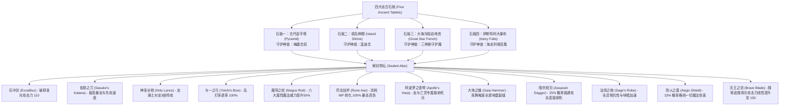

# 05. 神兵矩阵、炼金调合与宏观经济白皮书 (Equipment Matrix, Alchemy & Macro Economy Master Spec)

## 1. 十二传说神兵与四大远古石板解封体系

在封印之城库扎（Kuza Castle）的深处，沉睡着远古时代封印的 12 件终极神兵。它们被四大远古石板的力量牢牢锁闭：

### 1.1 终焉超越神兵系列 (Ultimate Superboss Relics)

超越十二封印神兵之上、由虚无次元深渊超神守护的至高武器矩阵：

| 神器全名 | 武器类别 | 核心获取途径 / 守护兽 | 面板攻击与加成 | 专属特殊机制与实战特效 |
|---|---|---|---|---|
| **诸神之黄昏 (Ragnarok)** | 终极骑士圣剑 / 漆黑大剑 | **次元之隙 隐藏深渊宝箱 (神龙守护)** / 月之溪谷 B7F | 攻击力 **+180**, 全属性 +10, 暴击率 +30% | 圣/暗双属性自由共鸣；平砍 20% 概率触发【圣光核爆 (Flare)】；普通攻击无视敌方 50% 物理防御，对龙族与恶魔造成 300% 灭绝暴击。 |
| **终焉诸神之黄昏·改** | 纳哈特专属暗黑巨剑 | **49层倒序深渊竞技场 终极通关奖励** | 攻击力 **+200**, 敏捷 +15, 吸血 +20% | 纳哈特装备时暗黑战技伤害提升 50%；平砍 100% 附带伤害等量生命汲取，暴击触发【虚无湮灭波】全场冲击。 |
| **诸神之杖 (Rune Staff)** | 传说大魔导师法杖 | 孤岛斗技场 12,000 BP 终极大奖 | 魔法攻击 **+175**, 魔力 +15, 咏唱加速 +30% | 全白魔法与时空禁术效能提升 1.5 倍；普攻消耗 5 MP 自动转化为圣属性穿甲真实伤害。 |
| **诸神之铠 (Ragnarok Armor)** | 终极重装防具 | 次元之隙 机械瀑布宝箱 (欧米茄巡逻区) | 物理防御 **+75**, 魔法防御 +60 | 常驻【永久白刃战减伤 30%】与【全异常状态绝对免疫】；受到火/水/雷/冰伤害吸收 20% 为 HP。 |
| **正宗 (Masamune)** | 传说太刀 | 月之地下溪谷 8F 祭坛守护战 | 攻击力 **+168**, 敏捷 +20 | **战斗先制先攻特权**：装备者在任何战斗中必定开局最先行动（ATB 满格先手）；使用指令自动施放【急速 (Haste)】。 |

### 1.2 五大主角个人专属传说神兵 (Personal Five Ultimate Weapons)

| 对应主角 | 专属神兵名 | 类别 | 试炼地宫 | 专属战斗共鸣与极意 |
|---|---|---|---|---|
| **黎川 (Li Chuan)** | `晨辉圣剑 (Excalibur Prime)` | 单手圣剑 | 晨辉王都始源圣所 | 天翔闪光斩追加破甲贯穿；全属性 +8；攻击不死系与恶魔伤害翻倍。 |
| **纳哈特 (Nacht)** | `终焉诸神之黄昏 (Ragnarok)` | 漆黑大剑 | 始源虚无深渊试炼 | 暗黑战技伤害提升 40%，平砍附带吸魂，攻击必定破除敌方物理护盾。 |
| **卫珩 (Wei Heng)** | `泰空神盾 (Aegis Bastion)` | 巨神之盾 | 泰空古陵墓守关战 | 舍身守护触发时自身减伤 70%，反弹 30% 伤害给攻击者。 |
| **昼隐 (Diana)** | `全知贤者之杖 (Sage Staff)` | 祭祀长杖 | 米西迪亚大魔道院 | 施展治疗魔法时自动向全队施加【神圣护盾】；复活术变为 100% 满血复生。 |
| **艾吉斯 (Aegis)** | `龙王极枪 (Dragon Whisker)` | 双手长枪 | 龙栖岭天界之巅 | 跳跃滞空时间减半，下坠落枪造成 400% 龙属贯穿暴击。 |

> 官网神兵矩阵页对 §1.1 / §1.2 的展示对照见本卷 **§10**。那是卡片陈列，不是战斗或掉落运行时。WLD-C02 命名与 ECO-C01 / C02 仍未裁定，不能把展示页签当成已统一。

---

## 2. 药师禁忌调合配方矩阵 (Chemist Mix Matrix)

药师通过“调合（Mix）”指令，可在战斗中将两件普通道具瞬时融合为逆转战局的生体灵药：

| 调合素材 A | 调合素材 B | 产出终极灵药 | 功效与战斗判定机制 |
|---|---|---|---|
| 回复药 (Potion) | 龙之牙 (Dragon Fang) | **生体龙之灵药** | 单体 HP 上限提升 100%，并瞬时补满全部 HP |
| 圣水 (Holy Water) | 龙之牙 (Dragon Fang) | **龙之力 (Dragon Power)** | 使目标在战斗中当前等级临时提升 20 级（突破攻防极限） |
| 凤凰尾羽 (Phoenix Down) | 圣水 (Holy Water) | **生命祝福 (Life Shield)** | 复活倒地队员，并赋予“自动复活（Reraise）”状态 |
| 以太 (Ether) | 龙之牙 (Dragon Fang) | **法力超频 (Dragon MP)** | MP 上限提升 100%，法术 MP 消耗减半，持续整场 |
| 毒消 (Antidote) | 龟壳 (Turtle Shell) | **生铁硬化 (Iron Wall)** | 物理防御力提升 200%，免疫击飞与打退硬直 |
| 眼药 (Eyedrop) | 龙之牙 (Dragon Fang) | **黑暗之光 (Dark Mist)** | 敌全场 80% 概率赋予盲目、沉默与减速三重压制 |

> 官网推演台对照（非引擎运行时、亦不关闭 §7 ECO-C03）见本卷 **§9**。本节 6 条仍是白皮书配方原文；与 `mixRecipes.ts` 名称、素材均不同的冲突仍待策划裁定，不得把任一表单方面写成已经统一。

---

## 3. 宏观经济循环模型与商店阶梯货架 (Macro Economy & Shops)

### 3.1 货币产销与通胀抑制模型
- **战役掉落收益曲线**：
  $$\text{Gold Drop} = \text{BaseGold} \times \left(1 + \frac{\text{BattleDangerLevel}}{10}\right) \times \text{Multiplier}$$
  普通战斗平均单场金币产出：前中期 20~200 Gil，后期 500~2000 Gil，虚无与 EX 迷宫可达 5000~10000 Gil。
- **全域回购折旧率**：城镇商店回购玩家多余装备统一按原购入价的 **50%** 执行回收，防止刷装无限复利。
- **掷金击消耗对冲（Gil Toss Sink）**：武士“掷金击”以全屏消耗大额金币转化为真实伤害为代价，作为游戏终局最强力的通货紧缩调控阀。

### 3.2 城镇商店进阶货架演变
1. **Tier 1（新手村 / 宁静村）**：短剑、青铜铠甲、回复药、解毒草、1阶白黑魔法（火球、小治疗）。
2. **Tier 2（海港 / 沃鲁斯城）**：秘银剑、铁盾、羽毛帽、以太、凤凰尾羽、2阶魔法（冰冻、加速）。
3. **Tier 3（蒸汽城堡 / 卡尔纳克）**：冰之剑、火之杖、轻量甲、闪避斗篷、3阶魔法（核爆前置、电击）。
4. **Tier 4（帝国都市 / 穆亚森林）**：珊瑚之剑、钻石锁子甲、反射之环、万灵药、4阶中级魔法。
5. **Tier 5（幻影隐秘之村禁忌黑市）**：源氏系列、魔术师之帽、风魔手里剑、5~6阶黑白魔法、至圣神圣与至暗核爆。

---

## 4. 流浪黑市行商与幻影之村探险

### 4.1 幻影之村（Mirage Village）的时空异化暗门
- **空间特征**：表面上是一座被时钟齿轮冻结、居民全是羊与猪的死寂废墟。
- **暗门探索**：从酒馆吧台后方的隐形穿透墙面绕到酒馆老板身后，可开启**禁忌魔导黑市**；从民宅烟囱滑入地下室，可进入**盗贼隐秘黑市**（售卖小偷手套与烟雾弹）。
- **环球长跑挑战**：在村庄地下与神秘学者对话，骑乘黄色陆行鸟完成绕世界一周长跑后返回，可获得“长跑大师之证”与顶级饰品“赫尔墨斯之靴（Hermes Sandals - 常驻加速）”。

---

## 5. 商店价格带与金币产出基准表

### 5.1 五阶商店价格带

| 商店阶 | 代表城镇 | 武器价格带 (Gil) | 防具价格带 (Gil) | 魔法价格带 (Gil) | 常备消耗品 |
| :---: | :--- | :--- | :--- | :--- | :--- |
| T1 | 宁静村 | 50 ~ 300 | 30 ~ 250 | 100 ~ 300 | 回复药 30、解毒草 20 |
| T2 | 沃鲁斯城 / 海港 | 400 ~ 1,500 | 300 ~ 1,200 | 600 ~ 1,500 | 以太 300、凤凰尾羽 500 |
| T3 | 卡尔纳克 | 1,800 ~ 5,000 | 1,500 ~ 4,500 | 2,000 ~ 5,000 | 高级回复药 360 |
| T4 | 穆亚森林 / 帝国都市 | 6,000 ~ 15,000 | 5,000 ~ 12,000 | 6,000 ~ 12,000 | 万灵药 ✘（不出售，仅掉落 / 赌场） |
| T5 | 幻影之村黑市 | 20,000 ~ 60,000 | 18,000 ~ 50,000 | 20,000 ~ 60,000 | 高级以太 1,500 |

> 与 §3.2 冲突提示：§3.2 第 4 条把「万灵药」列入 T4 货架，而 07 卷 §6.3 把万灵药定为赌场兑换品（500 代币）。本表暂按「T4 不出售」处理，待策划裁定。

> 官网 T1～T5 价格带展示对照见本卷 **§10**。推演台未列出魔法价格带列；ECO-C04 仍待裁定，本表「T4 不出售」只是暂处理。

### 5.2 BaseGold 档位（对应 §3.1 公式）

| 区域档 | BattleDangerLevel | BaseGold | 期望单场金币（Multiplier = 1） |
| :--- | :---: | ---: | ---: |
| 序章平原 | 1 | 18 | ≈ 20 |
| 第一世界中期 | 5 | 80 | 120 |
| 第二世界 | 10 | 250 | 500 |
| 第三世界后期 | 15 | 800 | 2,000 |
| 虚无 / EX 迷宫 | 20 ~ 30 | 2,000 ~ 2,500 | 6,000 ~ 10,000 |

- `Multiplier` 默认 1.0；装备「招财猫」类饰品为 2.0；同一战斗多件同类饰品**不叠加**。

> 官网经济页工坊（v2.2.363）**没有**展示本表 BaseGold 档位，也没有招财猫倍率推演；掷金击与 50% 回购对照见本卷 **§11**。ECO-AC-03 / 04 不能据此写成已通过。

### 5.3 回购规则补充

| 规则 | 说明 |
| :--- | :--- |
| 统一回购率 | 原购入价 50%（§3.1） |
| 非卖品 | 无标价的掉落品按「同阶同类武器均价 × 50%」回购 |
| 禁止出售 | 关键道具、十二封印神兵、五大主角专属神兵 |
| 二次确认 | 售出稀有度 ★4 以上道具时弹框确认 |

> 官网 50% 向下取整回购测算对照见本卷 **§11**。非卖品均价回购、禁售列表与 ★4 弹窗在台上只有条文或未实现，不能写成 ECO-AC-01 / 02 已在引擎通过。

---

## 6. 掷金击消耗公式 (Gil Toss Sink)

$$
\text{Damage}_{\text{per target}} = \frac{\text{GilSpent}}{N_{\text{targets}}}, \quad \text{GilSpent} = \text{CasterLevel} \times 50
$$

- 伤害无视防御与属性，不可暴击；上限 9999 / 目标（与 04 卷超限成长无关，本技能单独限幅）。
- 金币不足 `GilSpent` 时指令置灰，不允许按剩余金币打折释放。
- 示例：Lv 80 武士对 3 个敌人掷金 → 消耗 4,000 Gil，每个目标约 1,333 伤害。

> 官网掷金击计算器对照见本卷 **§11**。那是滑杆演示，不是战斗指令运行时，也不能写成 ECO-AC-05 已在引擎通过。

---

## 7. 跨文档一致性待裁定清单

| 编号 | 冲突点 | 位置 A | 位置 B | 建议 |
| :--- | :--- | :--- | :--- | :--- |
| ECO-C01 | 「诸神之黄昏」同时是超越神兵（+180）和纳哈特专属神兵 | §1.1 | §1.2 | 拆分为两件：通用版 Ragnarok / 纳哈特专属「终焉诸神之黄昏·改」 |
| ECO-C02 | 纳哈特专属暗黑战技加成 50% vs 40% | §1.1「终焉诸神之黄昏·改」 | §1.2 纳哈特行 | 统一为一个数值 |
| ECO-C03 | 调合配方与站点数据源完全不同 | §2（6 条） | `src/vble/config/mixRecipes.ts`（6 条，名称与素材均不同） | 合并为一张权威配方表，站点与文档同源 |
| ECO-C04 | 万灵药获取途径 | §3.2 T4 货架 | 07 卷 §6.3 赌场兑换 | 二选一或明确两者并存 |
| ECO-C05 | 「防火之盾」英文写作 Aegis Shield，与主角「艾吉斯 (Aegis)」及其神盾重名 | §1 W11 | §1.2 | 改英文名避免检索混淆 |

> 官网消歧展示对照见本卷 **§10**。页签上的「resolution」是把本节「建议」及部分台上自拟口径拿来陈列，**不是**已裁定；ECO-C01～05 与 ECO-AC-06 仍按本节与 §8 处理。禁忌调合双源对照仍见 **§9**，此处不重复配方表。

---

## 8. 验收标准 (Acceptance Criteria)

| 编号 | 验收项 | 判定方式 |
| :--- | :--- | :--- |
| ECO-AC-01 | 回购价恒为购入价 50%（向下取整） | 抽检每阶商店 10 件，回购价 = floor(价格 × 0.5) |
| ECO-AC-02 | 关键道具 / 封印神兵 / 专属神兵不可出售 | 出售列表中不出现 |
| ECO-AC-03 | 金币产出符合 §5.2 档位 | 每档模拟 500 场，均值误差 ≤ 10% |
| ECO-AC-04 | 招财猫类饰品不叠加 | 装备 2 件，Multiplier 仍为 2.0 |
| ECO-AC-05 | 掷金击金币不足时不可释放 | 金币 < Lv×50，指令置灰 |
| ECO-AC-06 | §7 冲突清单全部关闭前不发布经济数值版本 | 清单状态全部为「已裁定」 |

---

## 9. 门户站点对照：禁忌调合双源账本与战中推演台（非引擎运行时）

> **口径必须分开**：本节只记录官网文档站已交付的**规则对照与数值推演台**，用于展示本卷 §2 六条禁忌调合、以及它们与站点数据源 `src/vble/config/mixRecipes.ts` 的差异。它**不是**战斗引擎中的调合运行时，也**不得**被读成已经关闭 §7 **ECO-C03**（该冲突仍待策划裁定「合并为一张权威配方表」）。

同页另有更早的「药剂师调合大典 / 即时调合反应炉」等工坊，其配方与个别「Lv.255」等表述**不属于**本条 §2 合同对照；读者应以锚点 `vol04-vol05-alchemy-bluemagic-studio` 为准，勿与那些旧工坊混读。

### 9.1 已实现（官网推演台，v2.2.375，并经 v2.2.377 按原文校正）

- **入口**：道具与炼金页 [`/vble/items#vol04-vol05-alchemy-bluemagic-studio`](https://mhxy13867806343.github.io/game-ffs-main/#/vble/items#vol04-vol05-alchemy-bluemagic-studio)
- **实现位置**：`src/vble/views/ItemsView.vue`（常量 `vol05ForbiddenMixes` / `mixSimResult`）
- **站点对照源**：`src/vble/config/mixRecipes.ts`（6 条，与 §2 名称、素材均不同，见 ECO-C03）
- **发布记录**：站点更新日志 v2.2.375（2026-11-07）首次交付；v2.2.377 按本卷 §2 原文校正效果文案，并去掉无出处的 Lv.255、19,998 上限等表述

推演台以白皮书 §2 为卡片主数据，逐条标注与 `mixRecipes.ts` 的关系，**不擅自合并两表**：

| 推演台编号 | 白皮书 §2 产出 | 素材 A + B（与 §2 一致） | 官网对站点源的标注 | 点击后实际改写的数字 |
| :--- | :--- | :--- | :--- | :--- |
| MIX-F01 | 生体龙之灵药 | 回复药 + 龙之牙 | 近似：巨人之药（巨人之血 + 圣水）；效果相近，名称与素材不同，待合并 | 战中 HP 上限 = 基础最大 HP × 2 |
| MIX-F02 | 龙之力 (Dragon Power) | 圣水 + 龙之牙 | 站点无对应条目 | 战中生效 Lv = 基础等级 + 20 |
| MIX-F03 | 生命祝福 (Life Shield) | 凤凰尾羽 + 圣水 | 近似：诸神护佑药剂（万灵药 + 凤凰尾羽）；同为复活系，但效果与素材不同 | 三个数字栏不改写，只保留文案：「复活倒地队员并挂上自动复活」 |
| MIX-F04 | 法力超频 (Dragon MP) | 以太 + 龙之牙 | 站点无对应条目 | 三个数字栏不改写，只保留文案：「MP 上限翻倍、法术 MP 消耗减半，持续整场」 |
| MIX-F05 | 生铁硬化 (Iron Wall) | 毒消 + 龟壳 | 站点无对应条目 | 战中 DEF 倍率显示为 `3.00x (+200%)` |
| MIX-F06 | 黑暗之光 (Dark Mist) | 眼药 + 龙之牙 | 近似：暗影死神毒雾（毒眼泪 + 黑暗之粉；致盲 / 猛毒 / 沉默，与本条不同） | 三个数字栏不改写，只保留文案：敌全场 80% 盲目 + 沉默 + 减速 |

滑动控件与显示范围（以校正后源码为准，不是白皮书公式）：

| 控件 / 显示 | 源码行为 | 说明 |
| :--- | :--- | :--- |
| 受调合目标基础等级 | 滑杆 1～99，默认 52 | 仅 MIX-F02 在显示上 +20；**没有** Lv.255 上限 |
| 基础最大 HP | 滑杆 `min=1,000`、属性 `max=9,999`、步进 250，默认 6,500 | 仅 MIX-F01 在显示上 ×2。步进格子最右为 9,750（翻倍显示 19,500）。9,999 不在 `1,000+250n` 格子上，因而 19,998 不是默认可复现输入；即便个别浏览器把端点拖到 9,999，也只是「当前值×2」的显示，**不是**白皮书规定的 HP 上限。滑杆不能低于 1,000 |
| 基础最大 MP | `Math.round(基础最大 HP × 0.14)`，只读 | 该 0.14 换算只存在于推演台，本卷未给出此公式，不得写成合同 |
| 三个结果栏 | 战中生效 Lv、战中 HP 上限、战中 DEF 倍率 | 只对 F01 / F02 / F05 改数字；F03 / F04 / F06 的复活、MP 减半、80% 三重压制等效果目前只有文案，没有独立数值窗 |

同页该工坊后半还有 VOL.04 §4 青魔法研习验证器与「黑之冲击 ÷2 × 龙之力 +20 → 等级5即死」推演，合同正文在《04_JOB_SYSTEM.md》，不在本卷展开，以免两卷重复维护。

### 9.2 未纳入本推演台或仍待裁定（勿当成官网已可玩或已经统一口径）

| 条款或对象 | 权威出处 | 当前状态 |
| :--- | :--- | :--- |
| 将 §2 与 `mixRecipes.ts` 合并为一张权威配方表 | §7 ECO-C03 | **仍待策划裁定**。推演台只展示差异，不关闭清单；ECO-AC-06 仍要求全部冲突关闭前不发布经济数值版本 |
| 站点源其余 3 条：圣水炸弹（圣水 + 以太）、龙之吐息（龙之牙 + 烈火之卷）、生命灵药（恢复药 + 以太） | `mixRecipes.ts` | 推演台卡片未做反向映射；不得把它们写成 §2 的别名，也不得在裁定前删除或改写任一侧 |
| 「恢复药」与本卷「回复药」用字是否同一道具 | 站点生命灵药 vs §2 回复药 | 未裁定，本对照只按原文照录 |
| 生体龙之灵药「瞬时补满全部 HP」、生命祝福的复活 / Reraise、法力超频的 MP 上限与消耗减半、黑暗之光 80% 判定、生铁硬化的免疫击飞 / 打退硬直 | §2 功效栏 | 官网目前主要是文案对照；数字栏只覆盖 HP 上限翻倍、等级 +20、物防 3.00x |
| 战斗中实际消耗两件素材、成功率、持续回合、能否对敌人施放等战斗时序 | 本卷未另给引擎合同；§2 只写「战斗中将两件普通道具瞬时融合」 | 官网推演台无背包扣减与战斗时序 |
| 同页更早调合工坊中的 Lv.255、其他配方名与「即时反应炉」演示 | `ItemsView.vue` 其他区块 | 不属于本条 §2 对照，不在此追认或改写 |

### 9.3 门户推演验收对照

| 编号 | 验收项 | 判定方式（针对官网推演台，而非引擎，亦不视为关闭 ECO-C03） |
| :--- | :--- | :--- |
| ECO-PORTAL-01 | 六条 §2 配方名称、素材、效果与白皮书一致 | 六张卡片分别显示生体龙之灵药、龙之力、生命祝福、法力超频、生铁硬化、黑暗之光，素材与功效可对上 §2 表 |
| ECO-PORTAL-02 | 双源差异被显式标出且保持「待合并」 | 横幅写明两边各 6 条、名称与素材不同、待合并；F02 / F04 / F05 标注站点无对应；F01 / F03 / F06 标注近似但素材或效果不同 |
| ECO-PORTAL-03 | 生体龙之灵药只把 HP 上限翻倍显示 | 默认基础 6,500 时，战中 HP 上限显示 13,000；切换到其他秘方后回到 6,500 |
| ECO-PORTAL-04 | 龙之力只把战中等级 +20 | 默认基础 Lv.52 时，生效等级为 72；不是 255，也没有截断到 99 |
| ECO-PORTAL-05 | 生铁硬化显示 3.00x（+200%） | 选中 MIX-F05 时 DEF 栏为 `3.00x (+200%)`，其余秘方为 `1.00x (基准)` |
| ECO-PORTAL-06 | 无出处上限不得作为合同出现 | 等级滑杆 1～99。HP 滑杆 `min=1,000`、步进 250，默认 6,500（F01 显示 13,000）；步进最右为 9,750（翻倍 19,500）。属性虽写 `max=9,999`，但该值不在格子上，不得把 9,999 或 19,998 写成可稳定复现的输入，更不能当成白皮书上限 |

---

## 10. 门户站点对照：超越神兵、专属圣器、价格带与 ECO 消歧展示（非引擎运行时）

> 官网神兵矩阵页工坊（v2.2.373，`#vol05-equipment-contract-studio`）对照本卷 §1.1 / §1.2 / §5.1 / §7。它是静态卡片与表格，**不是**掉落、装备或商店购买运行时，也**不能**当作 ECO-AC-01～06 已通过，更**不能**写成 §7 冲突已关闭。禁忌调合双源与战中推演仍以本卷 **§9** 为准，本节不重复配方。

- **入口**：[`/vble/equipment#vol05-equipment-contract-studio`](https://mhxy13867806343.github.io/game-ffs-main/#/vble/equipment#vol05-equipment-contract-studio)
- **实现位置**：`src/vble/views/EquipmentView.vue`（`vol05SuperbossRelics` / `vol05ProtagonistWeapons` / `vol05ShopTiers` / `vol05Disambiguations`）

### 10.1 已实现（官网展示）

| 合同 | 官网行为 | 说明 |
| :--- | :--- | :--- |
| §1.1 五件超越神兵 | 名称、攻击/防御数值、获取途径与机制摘要与表一致（如 Ragnarok ATK+180、「·改」ATK+200、杖 +175、铠 DEF+75 / MDEF+60、正宗 +168） | 正宗先制条多写了「甚至先于神龙大海啸」，并把「使用指令」写成「使用道具指令」。这些是台上措辞，不是对 §1.1 的改写 |
| §1.2 五件专属神兵 | 晨辉圣剑、终焉诸神之黄昏、泰空神盾、全知贤者之杖、龙王极枪的类别、试炼地宫与共鸣摘要可对上 | 昼隐试炼地宫写作「密西迪亚大魔道院」，§1.2 原文是「米西迪亚大魔道院」，只照录差异，不改名。同页下方另有「诸神之黄昏」展台，不属于本工坊 |
| 主角内部 ID | 标注 `sol` / `nahart` / `glaive` / `serah` / `aigis`，标题写「对齐 WLD-C02」 | 这是与英雄传记台账相同的候选 ID，**不是** WLD-C02 已关闭。说明见《01_WORLD_BIBLE.md》§9 |
| §5.1 武器/防具价格带 | T1～T5 上下限与代表城镇一致（如 T1 50～300 / 30～250，T5 20,000～60,000 / 18,000～50,000） | **未列出魔法价格带列**。城镇名带有「新手村」「蒸汽城」「禁忌黑市」等括注；T3 / T5 消耗品行额外写了「3阶魔法」「5～6阶至高黑白魔法」，§5.1 消耗品列没有这些字，不得当作新货架合同 |
| §5.1 万灵药暂处理 | T4 写「不售卖，仅掉落/赌场 500代币」 | 与本节「暂按 T4 不出售」的提示一致，但 ECO-C04 仍待裁定 |

### 10.2 ECO-C01～05：展示建议，不是已裁定

页签标题作「消歧规范」，字段名为 `resolution`，容易被读成已经结案。下列对照必须以 §7 原文为准，**全部仍待策划裁定**（ECO-AC-06 要求全部关闭前不发布经济数值版本）。

| 编号 | 台上 `resolution` 在做什么 | 不得误读为 |
| :--- | :--- | :--- |
| ECO-C01 | 复述 §7「建议」：通用 Ragnarok +180 与纳哈特专属「·改」+200 拆成两件 | 已经完成命名统一。§1.2 纳哈特行仍写 `终焉诸神之黄昏 (Ragnarok)` |
| ECO-C02 | 写成「试炼态 +40%，完成 49 层「·改」后升格 +50%」；专属卡也写「40%～50%」 | **该升格路径只存在于推演台**。§7 的建议只是「统一为一个数值」，白皮书没有这条升级链 |
| ECO-C03 | 写成把 §2 六条禁忌灵药与 `mixRecipes.ts`「合并」 | 冲突仍未关闭。双源差异与合并状态见 **§9**，不在本工坊展开 |
| ECO-C04 | 写成「统一收口」于掉落、斗技场 1→3 置换与 500 代币兑换 | §7 只列 T4 货架 vs 赌场兑换，建议是二选一或并存。「斗技场 1→3 置换」是台上补充，本批不把它写成已裁定的第三来源 |
| ECO-C05 | 把 W11 写成 `Flame/Aegis Ward`，并列出泰空神盾 / `aigis` 以作区分 | `Flame/Aegis Ward` **不是** §1 原文（仍为「防火之盾 (Aegis Shield)」）。这是台上拟名，不是已改名合同 |

### 10.3 未纳入或不得误读

| 对象 | 出处 | 当前状态 |
| :--- | :--- | :--- |
| 十二封印神兵 W1～W12 解封 | §1 正文 | 本工坊不覆盖 |
| BaseGold、回购、掷金击 | §5.2 / §5.3 / §6 | 神兵矩阵工坊不覆盖。掷金击与 50% 回购测算见本卷 **§11**（经济页 v2.2.363）；**BaseGold 档位仍未在任一官网工坊展示** |
| 把本展示写成商店或掉落已验收 | ECO-AC-01～06 | 禁止 |

### 10.4 门户展示验收对照

| 编号 | 验收项 | 判定方式（针对官网神兵矩阵工坊，不是引擎，亦不关闭 §7） |
| :--- | :--- | :--- |
| ECO-PORTAL-07 | 五件超越神兵与五件专属的名称、关键数值可对上 §1.1 / §1.2 | 可见 Ragnarok +180、「·改」+200、杖 +175、铠 75/60、正宗 +168，以及五件专属名称 |
| ECO-PORTAL-08 | T1～T5 武器/防具价格带与 §5.1 一致 | 五阶上下限相符；页面没有魔法价格带列，不得据此补写合同 |
| ECO-PORTAL-09 | 消歧页仍是待裁定清单 | 五项都在，且不能把 C02 升格链或 C05 `Flame/Aegis Ward` 当成已通过的裁定 |

---

## 11. 门户站点对照：掷金击与 50% 回购测算（非引擎运行时）

> 官网经济页工坊（v2.2.363，`#vol05-vol16-contract-studio`）右栏对照本卷 §5.3 / §6。它是滑杆计算器，**不是**战斗指令或商店出售运行时，也**不能**把台上的 ECO-AC-01 / 02 / 05 标签写成验收已通过。左栏 29 件传奇与四石板额度演示见《16_TAIL_EXCHANGE.md》**§11**，本节不重复那张分类卡，也不改写本卷 **§9** 调合或 **§10** 神兵矩阵。ECO-C01～05 仍待裁定。

- **入口**：[`/vble/economy#vol05-vol16-contract-studio`](https://mhxy13867806343.github.io/game-ffs-main/#/vble/economy#vol05-vol16-contract-studio)
- **实现位置**：`src/vble/views/EconomyView.vue`（`gilTossSpent` / `gilTossDamagePerTarget` / `gilTossCanCast` / `shopSamplePrice`）

### 11.1 已实现（官网展示）

| 合同 | 官网行为 | 说明 |
| :--- | :--- | :--- |
| §6 消耗与分摊 | 默认 Lv.80、目标 3，消耗 `80×50=4,000`，单目标 `floor(4000/3)=1,333` | 与本节示例一致。伤害在可释放时才计算，并 `min(9999, floor(GilSpent / N))` |
| §6 金币不足置灰 | `钱包 < Lv×50` 时显示「金币不足置灰」，伤害栏为 0 | 这是台上标签，不是引擎指令置灰。伤害为 0 只表示未释放，**不是**按剩余金币打折 |
| §6 无视防御、不可暴击、单目标上限 9,999 | 标题写明这些规则 | 等级滑杆最大为 99，此时消耗最多 4,950，本计算器**演示不到** 9,999 上限。目标数 1～6、钱包 0～10,000（步进 250）只是台上范围 |
| §5.3 / ECO-AC-01 回购 50% 向下取整 | 默认购入价 45,000 → 回购 22,500；公式为 `floor(购入价 × 0.5)` | 购入价滑杆 15～60,000（步进 15）是台上范围，不是新的价格带合同 |
| ECO-AC-02 禁售与 ★4 确认 | 文案提到关键道具、十二封印神兵 `2100..2110`、五大专属 `2120..2124` 不得出现在出售列表，以及 ★4 以上需二次确认 | **没有**禁售清单或弹窗交互。文案把「十二封印」与区间 `2100..2110` 写在一起，而《16_TAIL_EXCHANGE.md》该区间是 11 件；本批不把 12 与 11 写成已经统一 |

### 11.2 未纳入或不得误读

| 对象 | 出处 | 当前状态 |
| :--- | :--- | :--- |
| BaseGold 档位、招财猫倍率不叠加 | §5.2、ECO-AC-03 / 04 | 本工坊未展示 |
| 非卖品按同阶同类均价 ×50% 回购 | §5.3 | 本计算器只演示有标价的 `floor(价 × 0.5)` |
| 同页后续七色尾巴兑换沙盘、黑市汇率等 | 本页其他区块 | **不属于**本契约工坊 |

### 11.3 门户展示验收对照

| 编号 | 验收项 | 判定方式（针对官网经济工坊右栏，不是引擎，亦不关闭 ECO 清单） |
| :--- | :--- | :--- |
| ECO-PORTAL-10 | 默认示例与 §6 一致 | Lv.80、3 目标时消耗 4,000、单目标伤害 1,333 |
| ECO-PORTAL-11 | 金币不足时不可按余额释放 | 默认钱包 5,000 ≥ 消耗 4,000，可释放。把钱包调到 3,750（步进 250）显示置灰、伤害栏为 0；调到刚好等于消耗 4,000 仍可释放（`钱包 >= Lv×50`）。不得按剩余金币打折 |
| ECO-PORTAL-12 | 回购为购入价 50% 向下取整 | 可见 `floor(价 × 0.5)`；45,000 显示 22,500 |
