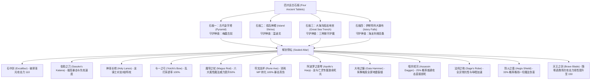

# 05. 神兵矩阵、炼金调合与宏观经济白皮书 (Equipment Matrix, Alchemy & Macro Economy Master Spec)

## 1. 十二传说神兵与四大远古石板解封体系

在封印之城库扎（Kuza Castle）的深处，沉睡着远古时代封印的 12 件终极神兵。它们被四大远古石板的力量牢牢锁闭：

### 1.1 终焉超越神兵系列 (Ultimate Superboss Relics)

超越十二封印神兵之上、由虚无次元深渊超神守护的至高武器矩阵：

| 神器全名 | 武器类别 | 核心获取途径 / 守护兽 | 面板攻击与加成 | 专属特殊机制与实战特效 |
|---|---|---|---|---|
| **诸神之黄昏 (Ragnarok)** | 终极骑士圣剑 / 漆黑大剑 | **次元之隙 隐藏深渊宝箱 (神龙守护)** / 月之溪谷 B7F | 攻击力 **+180**, 全属性 +10, 暴击率 +30% | 圣/暗双属性自由共鸣；平砍 20% 概率触发【圣光核爆 (Flare)】；普通攻击无视敌方 50% 物理防御，对龙族与恶魔造成 300% 灭绝暴击。 |
| **终焉诸神之黄昏·改** | 纳哈特专属暗黑巨剑 | **49层倒序深渊竞技场 终极通关奖励** | 攻击力 **+200**, 敏捷 +15, 吸血 +20% | 纳哈特装备时暗黑战技伤害提升 50%；平砍 100% 附带伤害等量生命汲取，暴击触发【虚无湮灭波】全场冲击。 |
| **诸神之杖 (Rune Staff)** | 传说大魔导师法杖 | 孤岛斗技场 12,000 BP 终极大奖 | 魔法攻击 **+175**, 魔力 +15, 咏唱加速 +30% | 全白魔法与时空禁术效能提升 1.5 倍；普攻消耗 5 MP 自动转化为圣属性穿甲真实伤害。 |
| **诸神之铠 (Ragnarok Armor)** | 终极重装防具 | 次元之隙 机械瀑布宝箱 (欧米茄巡逻区) | 物理防御 **+75**, 魔法防御 +60 | 常驻【永久白刃战减伤 30%】与【全异常状态绝对免疫】；受到火/水/雷/冰伤害吸收 20% 为 HP。 |
| **正宗 (Masamune)** | 传说太刀 | 月之地下溪谷 8F 祭坛守护战 | 攻击力 **+168**, 敏捷 +20 | **战斗先制先攻特权**：装备者在任何战斗中必定开局最先行动（ATB 满格先手）；使用指令自动施放【急速 (Haste)】。 |

### 1.2 五大主角个人专属传说神兵 (Personal Five Ultimate Weapons)

| 对应主角 | 专属神兵名 | 类别 | 试炼地宫 | 专属战斗共鸣与极意 |
|---|---|---|---|---|
| **黎川 (Li Chuan)** | `晨辉圣剑 (Excalibur Prime)` | 单手圣剑 | 晨辉王都始源圣所 | 天翔闪光斩追加破甲贯穿；全属性 +8；攻击不死系与恶魔伤害翻倍。 |
| **纳哈特 (Nacht)** | `终焉诸神之黄昏 (Ragnarok)` | 漆黑大剑 | 始源虚无深渊试炼 | 暗黑战技伤害提升 40%，平砍附带吸魂，攻击必定破除敌方物理护盾。 |
| **卫珩 (Wei Heng)** | `泰空神盾 (Aegis Bastion)` | 巨神之盾 | 泰空古陵墓守关战 | 舍身守护触发时自身减伤 70%，反弹 30% 伤害给攻击者。 |
| **昼隐 (Diana)** | `全知贤者之杖 (Sage Staff)` | 祭祀长杖 | 米西迪亚大魔道院 | 施展治疗魔法时自动向全队施加【神圣护盾】；复活术变为 100% 满血复生。 |
| **艾吉斯 (Aegis)** | `龙王极枪 (Dragon Whisker)` | 双手长枪 | 龙栖岭天界之巅 | 跳跃滞空时间减半，下坠落枪造成 400% 龙属贯穿暴击。 |

---

## 2. 药师禁忌调合配方矩阵 (Chemist Mix Matrix)

药师通过“调合（Mix）”指令，可在战斗中将两件普通道具瞬时融合为逆转战局的生体灵药：

| 调合素材 A | 调合素材 B | 产出终极灵药 | 功效与战斗判定机制 |
|---|---|---|---|
| 回复药 (Potion) | 龙之牙 (Dragon Fang) | **生体龙之灵药** | 单体 HP 上限提升 100%，并瞬时补满全部 HP |
| 圣水 (Holy Water) | 龙之牙 (Dragon Fang) | **龙之力 (Dragon Power)** | 使目标在战斗中当前等级临时提升 20 级（突破攻防极限） |
| 凤凰尾羽 (Phoenix Down) | 圣水 (Holy Water) | **生命祝福 (Life Shield)** | 复活倒地队员，并赋予“自动复活（Reraise）”状态 |
| 以太 (Ether) | 龙之牙 (Dragon Fang) | **法力超频 (Dragon MP)** | MP 上限提升 100%，法术 MP 消耗减半，持续整场 |
| 毒消 (Antidote) | 龟壳 (Turtle Shell) | **生铁硬化 (Iron Wall)** | 物理防御力提升 200%，免疫击飞与打退硬直 |
| 眼药 (Eyedrop) | 龙之牙 (Dragon Fang) | **黑暗之光 (Dark Mist)** | 敌全场 80% 概率赋予盲目、沉默与减速三重压制 |

---

## 3. 宏观经济循环模型与商店阶梯货架 (Macro Economy & Shops)

### 3.1 货币产销与通胀抑制模型
- **战役掉落收益曲线**：
  $$\text{Gold Drop} = \text{BaseGold} \times \left(1 + \frac{\text{BattleDangerLevel}}{10}\right) \times \text{Multiplier}$$
  普通战斗平均单场金币产出：前中期 20~200 Gil，后期 500~2000 Gil，虚无与 EX 迷宫可达 5000~10000 Gil。
- **全域回购折旧率**：城镇商店回购玩家多余装备统一按原购入价的 **50%** 执行回收，防止刷装无限复利。
- **掷金击消耗对冲（Gil Toss Sink）**：武士“掷金击”以全屏消耗大额金币转化为真实伤害为代价，作为游戏终局最强力的通货紧缩调控阀。

### 3.2 城镇商店进阶货架演变
1. **Tier 1（新手村 / 宁静村）**：短剑、青铜铠甲、回复药、解毒草、1阶白黑魔法（火球、小治疗）。
2. **Tier 2（海港 / 沃鲁斯城）**：秘银剑、铁盾、羽毛帽、以太、凤凰尾羽、2阶魔法（冰冻、加速）。
3. **Tier 3（蒸汽城堡 / 卡尔纳克）**：冰之剑、火之杖、轻量甲、闪避斗篷、3阶魔法（核爆前置、电击）。
4. **Tier 4（帝国都市 / 穆亚森林）**：珊瑚之剑、钻石锁子甲、反射之环、万灵药、4阶中级魔法。
5. **Tier 5（幻影隐秘之村禁忌黑市）**：源氏系列、魔术师之帽、风魔手里剑、5~6阶黑白魔法、至圣神圣与至暗核爆。

---

## 4. 流浪黑市行商与幻影之村探险

### 4.1 幻影之村（Mirage Village）的时空异化暗门
- **空间特征**：表面上是一座被时钟齿轮冻结、居民全是羊与猪的死寂废墟。
- **暗门探索**：从酒馆吧台后方的隐形穿透墙面绕到酒馆老板身后，可开启**禁忌魔导黑市**；从民宅烟囱滑入地下室，可进入**盗贼隐秘黑市**（售卖小偷手套与烟雾弹）。
- **环球长跑挑战**：在村庄地下与神秘学者对话，骑乘黄色陆行鸟完成绕世界一周长跑后返回，可获得“长跑大师之证”与顶级饰品“赫尔墨斯之靴（Hermes Sandals - 常驻加速）”。
