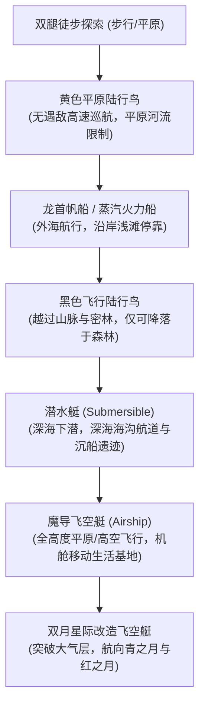

# 06. 全维探索、载具交通与迷宫机制白皮书 (Vehicles, Travel & Exploration Master Spec)

## 1. 全维立体交通与载具矩阵 (Vehicles & Transportation Network)

游戏中玩家的探索半径随剧情推进经历五个维度的跃迁：

---

## 2. 陆行鸟四大生态族群与森林网络

全域分布有 7 处隐秘陆行鸟森林（Chocobo Forests），四大族群各司其职：
1. **黄色陆行鸟（Yellow Chocobo）**：
   - 最基础的陆上坐骑，奔跑速度为主角步行速度的 **2.0 倍**。
   - 特权：**骑乘期间绝对不触发任何野外遇敌战斗**。
   - 限制：下鸟后陆行鸟会自动跑回出生森林，需重新捕捉。
2. **白色陆行鸟（White Chocobo）**：
   - 森林守护神兽，无法骑乘。
   - 交互特权：对话后施展圣光洗礼，**瞬间补满全队所有角色的 MP**（野外最佳法力续航补给点）。
3. **黑色陆行鸟（Black Chocobo）**：
   - 拥有飞翔能力的特殊异种。可低空飞越一般山脉与茂密丛林。
   - 着陆限制：**只能降落在墨绿色的密林（Dense Forest）中**，无法在平原或沙漠强行着陆。
4. **胖陆行鸟（Fat Chocobo）**：
   - 仓库保管员。对森林草丛使用“基萨尔野菜（Gysahl Greens）”后自地下钻出，提供多达 256 格的永久物品仓库管理。

---

## 3. 迷宫探索机制：隐藏暗道与宝箱雷达

### 3.1 半透暗道穿透着色器（Hidden Passages Shader）
- 地宫墙壁中隐藏着不规则的穿透暗道（Secret Paths）。
- **视觉反馈**：当主角靠近暗道入口（1格以内）时，墙壁 Tile 触发渐变透明度（Alpha 从 1.0 衰减至 0.35），露出内部通道轮廓。
- **职业被动感知**：队伍中有盗贼或装备“探查隐藏通道”特技时，全屏隐藏暗道在小地图上常驻高亮显示为金色虚线。

### 3.2 勘探者罗盘与宝箱声光雷达 (Treasure Radar & Compass)
- **HUD 显示**：屏幕右上角配置“探险罗盘”，实时显示当前地下城的两项统计值：
  $$\text{Dungeon Completion} = \frac{\text{Opened Chests} + \text{Discovered Secret Rooms}}{\text{Total Chests} + \text{Total Secret Rooms}} \times 100\%$$
- **雷达声光脉冲**：当玩家距离未开启宝箱在 5 格半径以内，罗盘指针发出急促的微弱金光，并伴随清脆的“嘀——嘀——”声呐脉冲反馈。

---

## 4. 休息与恢复系统（Rest & Recovery System）

### 4.1 城镇宿屋（Inns）
- 各城镇宿屋价格根据地区危险度呈阶梯增长（新手村 10 Gil -> 王都 50 Gil -> 边境要塞 200 Gil -> 幻影之村 1000 Gil）。
- 入睡播放经典《最终幻想》晚安交响短曲，**清除所有死亡（K.O.）、石化、中毒等全量异常，并将 HP 与 MP 补满至 100%**。

### 4.2 野外宿营道具（Tents & Cottages）
- **帐篷（Tent）**：只能在大地图或迷宫内的“闪耀水晶光环安全区（Save Point）”使用。恢复全员 1000 HP 与 100 MP。
- **小屋（Cottage）**：顶级宿营装备，功效等同于高级宿屋，直接全员 100% 满血满蓝满状态恢复。

### 4.3 迷宫安全区晶石（Save Point Crystals）
- 迷宫深处设置有漂浮的白色发光晶石，该区域绝对不会触发遇敌。
- 玩家可在晶石旁打开系统菜单执行主存档（Save）写入，或使用帐篷进行状态休整。
