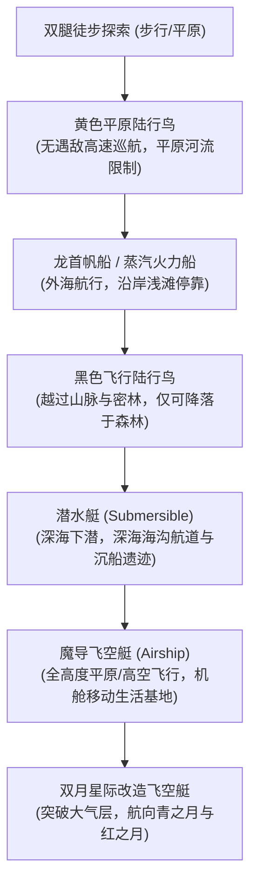
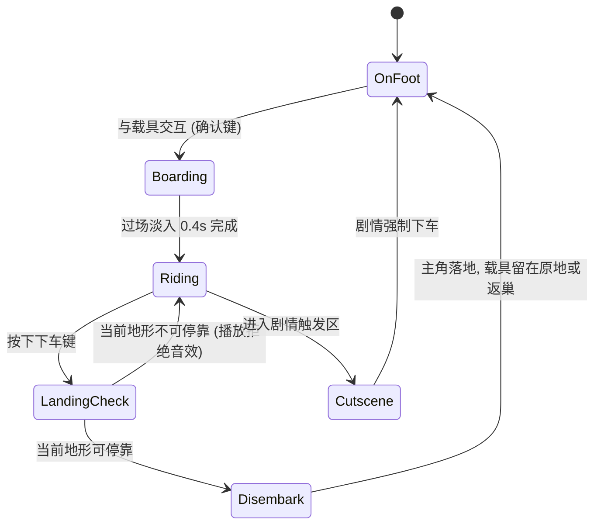

# 06. 全维探索、载具交通与迷宫机制白皮书 (Vehicles, Travel & Exploration Master Spec)

## 1. 全维立体交通与载具矩阵 (Vehicles & Transportation Network)

游戏中玩家的探索半径随剧情推进经历五个维度的跃迁：



---

## 2. 陆行鸟四大生态族群与森林网络

全域分布有 7 处隐秘陆行鸟森林（Chocobo Forests），四大族群各司其职：
1. **黄色陆行鸟（Yellow Chocobo）**：
   - 最基础的陆上坐骑，奔跑速度为主角步行速度的 **2.0 倍**。
   - 特权：**骑乘期间绝对不触发任何野外遇敌战斗**。
   - 限制：下鸟后陆行鸟会自动跑回出生森林，需重新捕捉。
2. **白色陆行鸟（White Chocobo）**：
   - 森林守护神兽，无法骑乘。
   - 交互特权：对话后施展圣光洗礼，**瞬间补满全队所有角色的 MP**（野外最佳法力续航补给点）。
3. **黑色陆行鸟（Black Chocobo）**：
   - 拥有飞翔能力的特殊异种。可低空飞越一般山脉与茂密丛林。
   - 着陆限制：**只能降落在墨绿色的密林（Dense Forest）中**，无法在平原或沙漠强行着陆。
4. **胖陆行鸟（Fat Chocobo）**：
   - 仓库保管员。对森林草丛使用“基萨尔野菜（Gysahl Greens）”后自地下钻出，提供多达 256 格的永久物品仓库管理。

---

## 3. 迷宫探索机制：隐藏暗道与宝箱雷达

### 3.1 半透暗道穿透着色器（Hidden Passages Shader）
- 地宫墙壁中隐藏着不规则的穿透暗道（Secret Paths）。
- **视觉反馈**：当主角靠近暗道入口（1格以内）时，墙壁 Tile 触发渐变透明度（Alpha 从 1.0 衰减至 0.35），露出内部通道轮廓。
- **职业被动感知**：队伍中有盗贼或装备“探查隐藏通道”特技时，全屏隐藏暗道在小地图上常驻高亮显示为金色虚线。

### 3.2 勘探者罗盘与宝箱声光雷达 (Treasure Radar & Compass)
- **HUD 显示**：屏幕右上角配置“探险罗盘”，实时显示当前地下城的两项统计值：
  $$\text{Dungeon Completion} = \frac{\text{Opened Chests} + \text{Discovered Secret Rooms}}{\text{Total Chests} + \text{Total Secret Rooms}} \times 100\%$$
- **雷达声光脉冲**：当玩家距离未开启宝箱在 5 格半径以内，罗盘指针发出急促的微弱金光，并伴随清脆的“嘀——嘀——”声呐脉冲反馈。

---

## 4. 休息与恢复系统（Rest & Recovery System）

### 4.1 城镇宿屋（Inns）
- 各城镇宿屋价格根据地区危险度呈阶梯增长（新手村 10 Gil -> 王都 50 Gil -> 边境要塞 200 Gil -> 幻影之村 1000 Gil）。
- 入睡播放经典《最终幻想》晚安交响短曲，**清除所有死亡（K.O.）、石化、中毒等全量异常，并将 HP 与 MP 补满至 100%**。

### 4.2 野外宿营道具（Tents & Cottages）
- **帐篷（Tent）**：只能在大地图或迷宫内的“闪耀水晶光环安全区（Save Point）”使用。恢复全员 1000 HP 与 100 MP。
- **小屋（Cottage）**：顶级宿营装备，功效等同于高级宿屋，直接全员 100% 满血满蓝满状态恢复。

### 4.3 迷宫安全区晶石（Save Point Crystals）
- 迷宫深处设置有漂浮的白色发光晶石，该区域绝对不会触发遇敌。
- 玩家可在晶石旁打开系统菜单执行主存档（Save）写入，或使用帐篷进行状态休整。


---

## 5. 载具数值参数总表 (Vehicle Parameter Sheet)

> 速度以「主角步行速度 = 1.0x（4 格/秒）」为基准；遇敌率以「步行基准遇敌步数 = 100%」为基准。

| 载具 | 解锁章节 | 移动速度 | 遇敌率 | 可停靠地形 | 可跨越地形 | 存档可用 |
| :--- | :--- | :---: | :---: | :--- | :--- | :---: |
| 徒步 | 序章 | 1.0x | 100% | 全部陆地 | — | 仅存档点 |
| 黄色陆行鸟 | 第 2 章 | 2.0x | 0% | 平原 / 草地 / 沙漠 | 浅滩（不可）、河流（不可） | ✘ |
| 龙首帆船 | 第 4 章 | 2.5x | 60%（海域遇敌） | 港口 / 沿岸浅滩 | 浅海、外海 | ✘ |
| 黑色陆行鸟 | 第 7 章 | 3.0x | 0% | 仅密林 | 山脉（低）、森林、河流 | ✘ |
| 潜水艇 | 第 12 章 | 2.0x | 80%（深海遇敌） | 深海浮标点 | 深海海沟、沉船航道 | ✘ |
| 魔导飞空艇 | 第 15 章 | 4.0x | 0% | 平原 / 草地 | 除「高山禁飞区」外全部 | ✔（舱内存档点） |
| 双月星际飞空艇 | 第 24 章 | 5.0x | 0% | 平原 / 月面着陆场 | 大气层 → 青之月 / 红之月 | ✔ |

### 5.1 地形通行矩阵 (Terrain Passability Matrix)

`●` 可通行并可停靠，`○` 可通行但不可停靠，`✘` 不可通行。

| 地形 \ 载具 | 徒步 | 黄鸟 | 帆船 | 黑鸟 | 潜艇 | 飞空艇 | 星际艇 |
| :--- | :---: | :---: | :---: | :---: | :---: | :---: | :---: |
| 平原 / 草地 | ● | ● | ✘ | ○ | ✘ | ● | ● |
| 沙漠 | ● | ● | ✘ | ○ | ✘ | ○ | ○ |
| 密林 | ● | ✘ | ✘ | ● | ✘ | ○ | ○ |
| 低山 | ✘ | ✘ | ✘ | ○ | ✘ | ○ | ○ |
| 高山禁飞区 | ✘ | ✘ | ✘ | ✘ | ✘ | ✘ | ○ |
| 河流 | ✘ | ✘ | ✘ | ○ | ✘ | ○ | ○ |
| 浅滩 | ● | ✘ | ● | ○ | ✘ | ○ | ○ |
| 外海 | ✘ | ✘ | ○ | ✘ | ● (下潜点) | ○ | ○ |
| 深海海沟 | ✘ | ✘ | ✘ | ✘ | ○ | ✘ | ✘ |

---

## 6. 乘降状态机 (Boarding State Machine)



### 6.1 状态规则

1. **Boarding（上车）**：锁定玩家输入 0.4 秒，切换 BGM 至载具主题，地图遇敌计步器暂停。
2. **LandingCheck（停靠判定）**：读取主角脚下 Tile 的 `terrain_type`，查询 §5.1 矩阵；不可停靠时保持 Riding 并在 HUD 闪烁提示「此处无法降落」。
3. **Disembark（下车）**：
   - 黄色 / 黑色陆行鸟：下车后 3 秒自动跑回 / 飞回出生森林（返巢）。
   - 帆船 / 潜艇 / 飞空艇：留在下车坐标，并在世界地图标记 ⚓ / ✈ 图标。
4. **Cutscene（剧情强制下车）**：载具坐标写入存档 `vehicle_positions` 字典，剧情结束后按原坐标恢复。

### 6.2 存档字段约定

```json
{
  "vehicle_unlocks": ["chocobo_yellow", "ship", "chocobo_black", "submarine", "airship"],
  "vehicle_positions": {
    "ship": { "map": "world_1", "x": 128, "y": 64 },
    "airship": { "map": "world_2", "x": 40, "y": 211 }
  },
  "current_vehicle": "airship"
}
```

---

## 7. 验收标准 (Acceptance Criteria)

| 编号 | 验收项 | 判定方式 |
| :--- | :--- | :--- |
| VH-01 | 骑乘陆行鸟 / 飞空艇期间 0 次随机遇敌 | 连续移动 2000 步，遇敌计数 = 0 |
| VH-02 | 黑色陆行鸟只能在密林降落 | 在其他 8 类地形尝试下车，全部被拒绝 |
| VH-03 | 飞空艇无法飞越高山禁飞区 | 碰撞后停在边缘，不穿模 |
| VH-04 | 存档 / 读档后载具位置一致 | 坐标误差 = 0 格 |
| VH-05 | 剧情强制下车后载具可找回 | 剧情结束后世界地图图标存在且可交互 |
| VH-06 | 陆行鸟下车后返巢 | 3 秒后原坐标无载具，森林中可重新捕捉 |
