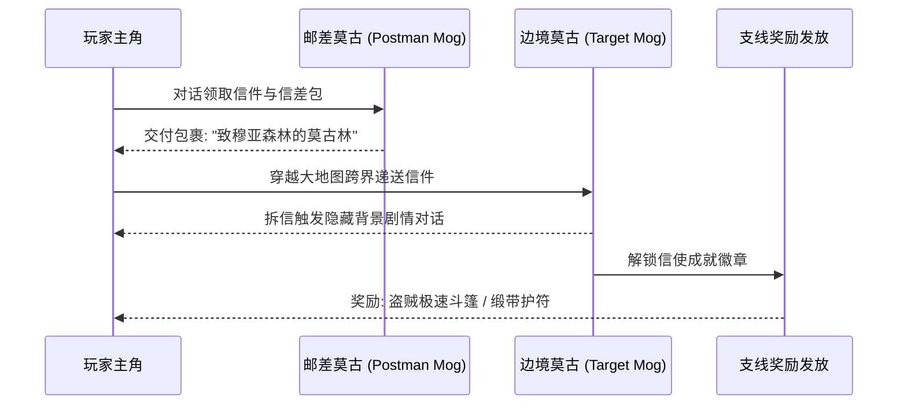
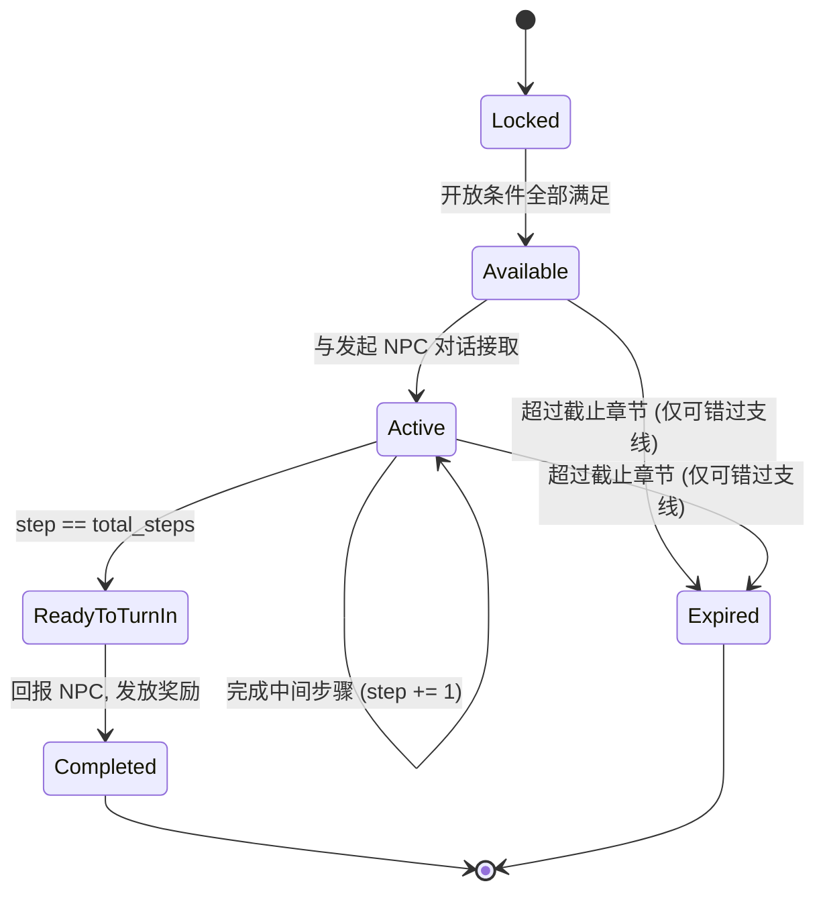

# 07. 沉浸支线、小游戏与世界秘密白皮书 (Sidequests, Minigames & Lore Secrets Master Spec)

## 1. 悬赏讨伐看板与沉浸支线体系 (Bounties & Quest Chains)

### 1.1 全球 10 大史诗剧情支线
1. **海龙西尔多拉的长眠（Dragon's Requiescat）**：在第三世界前往海盗密窟深处吊唁，海龙灵魂显现化为最高阶水属性召唤兽“西尔多拉（Syldra）”。
2. **矮人锻造大师的遗愿（Dwarven Masterpiece）**：收集 4 块远古精金矿石，请矮人铁匠重铸打造无双战斧“符文之斧”。
3. **古代贤者吉多的预言（Sage Ghido's Library）**：潜水打通孤岛洞穴，协助长寿龟贤者整理遗失的四本天文学卷轴，获得时空魔法“流星群（Meteor）”。
4. **飞龙最后的孤雏（The Last Wyvern）**：登上龙之谷采集飞龙草，治愈飞龙使其进化为终极圣白飞龙坐骑。
5. **幻影之村环球马拉松（World Marathon）**：骑乘陆行鸟环游世界一周，赢取极速之靴。
6. **狼人凯鲁卡的故乡誓言（Kelger's Village）**：前往狼人隐居之村，完成 3 场单挑武斗试炼，传承暗黑剑圣心法。
7. **莫古利村庄大营救（Mog Village Rescue）**：地穴深陷营救莫古利，解锁全大陆隐秘通讯通道。
8. **沉睡的欧米茄遗骸（Omega Investigation）**：收集 3 块古代古代电路板碎片，解析欧米茄弱点数据。
9. **神龙封印的真相（Dragon God's Seal）**：探访天空圣所石碑，获得抗水水神项圈。
10. **大图书馆禁断十四卷（Forbidden Volumes）**：击败附身在书页上的远古魔物，解锁学者最终觉醒特技“深度解析”。

---

## 2. 莫古利通信网与邮差信使 (Mognet Post System)



- 全流程共 16 封信件，串联起光暗两界莫古利一族的亲情羁绊。
- 送达全部信件后，莫古利长老将亲自授予“传奇邮差徽章”（逃跑率提升 25%，迷宫中步数遇敌间隔翻倍）。

---

## 3. 全球八大城镇钢琴大师考级 (Piano Mastery)

在世界各大城镇的酒馆或民宅中，摆放着 8 架不同年代的名贵钢琴。主角每弹奏一架钢琴，钢琴造诣提升一阶：
1. **Tier 1 (宁静村)**：断断续续的单音练习曲。
2. **Tier 2 (沃鲁斯王都)**：基础和弦奏鸣。
3. **Tier 3 (卡尔纳克)**：欢快的民间舞曲。
4. **Tier 4 (贾科尔城镇)**：优美的行板小夜曲。
5. **Tier 5 (雷格斯要塞)**：复杂的快板变奏曲。
6. **Tier 6 (穆亚村庄)**：深沉的哀伤挽歌。
7. **Tier 7 (幻影隐秘之村)**：高难度即兴交响华彩。
8. **Tier 8 (海盗密窟深处)**：**达到 Piano Master 最高境界！**

**大师回报**：成为钢琴大师后，前往巴利亚城镇拜访隐退的吟游诗人，他将惊叹于你的琴艺，正式传授吟游诗人的最强绝技——**“英雄之歌”（Hero's Song，战斗中全员攻防精神与等级每轮持续自动递增）**。

---

## 4. 古代斗技场与娱乐城博彩系统 (Coliseum & Casino)

### 4.1 古代斗技场自律天梯 (Ancient Coliseum)
- **下注机制（Item Betting）**：在斗技场柜台投注一件武器或防具（如投注“石中剑”或“火炎盾”）。
- **完全自律单挑（Autonomous 1v1 Battle）**：玩家派遣一名队员出战，战斗全由 AI 托管自动执行，无法手动干预指令。
- **阶梯奖池置换**：获胜后原下注道具升阶置换（如投注“伪石中剑”获胜可置换出真正的“圣剑”；投注“源氏之盔”获胜可置换出“终极缎带”）。失败则下注道具永久消失。

### 4.2 娱乐城博彩小游戏 (Casino Minigames)
- **陆行鸟赛跑竞猜（Chocobo Racing）**：实时演算 4 只不同颜色的陆行鸟绕场障碍赛跑，根据赔率下注。
- **魔法轮盘赌（Magic Roulette）**：下注不同元素法阵，赢取赌场限定代币（Casino Coins）。
- **独占奖品**：赌场代币可在兑换处换取“猫耳帽（Cat-Ear Hood - 魔法防御 500% 提升）”、“赌徒飞镖”与“万灵药（Elixir）”。


---

## 5. 十大史诗支线数据总表 (Quest Data Sheet)

| ID | 支线 | 开放条件 | 推荐等级 | 关键步骤数 | 主奖励 | 可错过 |
| :--- | :--- | :--- | :---: | :---: | :--- | :---: |
| SQ-01 | 海龙西尔多拉的长眠 | 进入第三世界 + 持有帆船 | 38 | 3 | 召唤兽「西尔多拉」 | ✘ |
| SQ-02 | 矮人锻造大师的遗愿 | 第 9 章后 + 精金矿石 ×4 | 30 | 5 | 符文之斧 | ✘ |
| SQ-03 | 古代贤者吉多的预言 | 持有潜水艇 | 42 | 4 | 时空魔法「流星群」 | ✘ |
| SQ-04 | 飞龙最后的孤雏 | 第 10 章后 + 飞龙草 | 35 | 3 | 圣白飞龙坐骑 | ✔（第 18 章前） |
| SQ-05 | 幻影之村环球马拉松 | 黄色陆行鸟 + 幻影之村开放 | 25 | 1（限时） | 极速之靴 | ✘ |
| SQ-06 | 狼人凯鲁卡的故乡誓言 | 凯鲁卡入队记录 | 45 | 3 | 暗黑剑圣心法 | ✘ |
| SQ-07 | 莫古利村庄大营救 | 第 6 章后 | 20 | 4 | 莫古利通信网解锁 | ✘ |
| SQ-08 | 沉睡的欧米茄遗骸 | 电路板碎片 ×3 | 55 | 4 | 欧米茄弱点数据（首领战伤害 +15%） | ✘ |
| SQ-09 | 神龙封印的真相 | 飞空艇 + 天空圣所 | 50 | 2 | 水神项圈（水属性吸收） | ✘ |
| SQ-10 | 大图书馆禁断十四卷 | 学者职业解锁 | 48 | 14（每卷 1 战） | 学者特技「深度解析」 | ✘ |

> 「可错过」=✔ 的支线必须在世界地图 UI 上以红色沙漏图标提示截止章节，避免玩家无感错过。

### 5.1 支线状态机



### 5.2 存档字段约定

```json
{
  "quests": {
    "SQ-04": { "state": "active", "step": 2, "total_steps": 3, "deadline_chapter": 18 },
    "SQ-10": { "state": "active", "step": 9, "total_steps": 14 }
  },
  "mognet_letters_delivered": 11,
  "piano_tier": 6
}
```

---

## 6. 斗技场与赌场数值规则

### 6.1 斗技场下注置换表（节选）

| 下注道具 | 对手（AI 托管） | 胜利置换 | 失败结果 |
| :--- | :--- | :--- | :--- |
| 伪石中剑 | 吉尔伽美什（幻影） | 圣剑 | 道具消失 |
| 源氏之盔 | 铁巨人 | 终极缎带 | 道具消失 |
| 火炎盾 | 炎之巨人 | 冰之盾 | 道具消失 |
| 万灵药 ×1 | 仙人掌王 | 万灵药 ×3 | 道具消失 |
| 精灵之弓 | 黑暗骑士 | 毁灭之弓 | 道具消失 |

规则：
1. 下注前弹出二次确认框，明示「失败将永久失去该道具」。
2. 稀有度 ★5 以上的唯一道具（全游戏仅 1 件）**禁止下注**，柜台直接拒收。
3. 出战角色等级低于对手 15 级以上时，柜台给出红色警告但不阻止。

### 6.2 陆行鸟赛跑赔率公式

每只陆行鸟拥有隐藏属性：速度 $S$、耐力 $E$、状态值 $C$（每场随机 0.8~1.2）。

$$
\text{Power}_i = (0.6 S_i + 0.4 E_i) \times C_i
$$

$$
\text{Odds}_i = \max\left(1.2,\ \frac{\sum_j \text{Power}_j}{\text{Power}_i} \times 0.9\right)
$$

- 0.9 为庄家抽水系数；赔率下限 1.2 倍。
- 单注上限 999 代币；每日（游戏内 24 小时）最多 20 场。

### 6.3 赌场代币兑换表

| 奖品 | 代币价格 | 限购 |
| :--- | ---: | :---: |
| 万灵药 | 500 | 无限 |
| 赌徒飞镖 | 3,000 | 1 |
| 猫耳帽（魔防 +500%） | 30,000 | 1 |

---

## 7. 验收标准 (Acceptance Criteria)

| 编号 | 验收项 | 判定方式 |
| :--- | :--- | :--- |
| SQ-AC-01 | 10 条支线均可从 Locked 走到 Completed | 脚本化跑通，奖励全部入包 |
| SQ-AC-02 | SQ-04 在第 18 章后变为 Expired | 跳章测试，状态 = expired 且 UI 不再显示 |
| SQ-AC-03 | 16 封信全部送达后发放传奇邮差徽章 | 计数 = 16 时触发一次，且只触发一次 |
| SQ-AC-04 | 钢琴等级只能按 Tier 1→8 顺序提升 | 跳过某架钢琴直接弹下一架，等级不变 |
| SQ-AC-05 | 唯一道具无法下注斗技场 | 柜台拒收并提示 |
| SQ-AC-06 | 赛跑赔率不低于 1.2 | 1000 场模拟，最小赔率 ≥ 1.2 |
