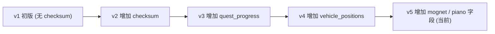

# 08. 系统工程架构、音画交互与持久化白皮书 (System Architecture & Persistence Master Spec)

## 1. 视口规格、UI/UX 规范与经典蓝金主题

### 1.1 分辨率与视口适配架构
- **基准设计视口**：$1280 \times 1080$（像素完美缩放，支持 16:9 与 4:3 边界自适应）。
- **视口缩放模式**：Godot 4.6 `stretch_mode = canvas_items`，`aspect = expand`，保证像素字体与精灵立绘不失真。
- **经典蓝金配色规范**：
  - 底板主色：深海渐变暗蓝 `#0b1a30` 到 `#142d54`。
  - 边框金线：双层发光金 `#d4af37`，内阴影深度 2px。
  - 选中高亮光标：白色闪烁三角指示箭，高亮边框渐变白金光环。

### 1.2 战斗生命值衰减阻尼与伤害数字漂浮
- **血条阻尼双层渲染（HP Damper）**：
  - 顶层瞬间掉落至真实生命值（绿色/黄色）。
  - 底层红白警示缓冲条以 $1.5\text{s}$ 线性阻尼缓动回退，给玩家直观的受创沉浸感。
- **跳字系统**：暴击伤害字体放大 150%，带金黄轮廓；弱点伤害标记“WEAK”标签；受到吸收伤害显示绿色向上浮动。

> 官网跳字徽章推演台对照见本卷 **§9**。2026-10-22 引擎首段实装备忘位于 §4.3 段落后（不是通关评级「徽章」条款），勿把两处「徽章」读成同一对象。

---

## 2. 动态音频系统与场景无缝过渡 (Audio Architecture)

### 2.1 音量分轨与混音总线 (Audio Buses)
```
Master
├── BGM (背景音乐总线) - 音量可调节，支持双音轨 0.8s 交叉淡入淡出 (Crossfade)
├── SFX (音效总线) - UI 点击、挥剑击中、法术爆炸、雷达脉冲
└── Voice/Fanfare (号角与特写总线) - 战斗胜利、夜宿曲、升级全屏特写
```

### 2.2 战斗音轨解耦与首领战独立 BGM
- 普通杂兵遭遇战：播放激昂经典战歌（`BATTLE_BGM_STREAM`）。
- 剧情首领与 Boss 战：**彻底解耦并独立切入终极首领专用曲**（`BOSS_BGM_STREAM`，如 `final_battle_legend_2.mp3`）。
- 战后结算：无缝切入胜利号角，关闭结算弹窗后平滑淡入回原场景环境 BGM。

---

## 3. 多槽位全量持久化与断点自动存档 (Save/Load Architecture)

### 3.1 3 槽位数据结构与校验和
```json
{
  "slot_id": 1,
  "save_time": "2026-09-07T20:30:00",
  "checksum": "a1b2c3d4e5f6...",
  "current_beat": 42,
  "play_time_seconds": 38400,
  "gold": 125000,
  "map_context": {
    "map_id": "res://scene/map/other_cave_scene.tscn",
    "player_position": [440.0, 550.0],
    "facing_direction": "down"
  },
  "party": [
    {
      "id": "sol",
      "level": 255,
      "job_id": "freelancer",
      "hp": 65535,
      "max_hp": 65535,
      "mp": 9999,
      "max_mp": 9999,
      "stats": {"str": 9999, "agi": 9999, "vit": 9999, "spr": 9999, "mag": 9999},
      "equipment": {"r_hand": "excalibur", "l_hand": "genji_shield", "head": "genji_helm", "body": "genji_armor", "acc": "ribbon"}
    }
  ],
  "inventory": {"items": {}, "key_items": []},
  "bestiary_flags": {},
  "quest_progress": {}
}
```

### 3.2 容灾备份与防卡模回弹
- 每次写盘采用“写临时文件 `.tmp` -> 校验完整性 -> 原子重命名覆盖”机制，杜绝断电坏档。
- 读档时若检测到角色坐标处于非法碰撞块内部，自动触发安全区坐标重置（Safe Landing Fallback）。

---

## 4. 全科图鉴、多语言国际化与通关二周目 (Postgame & NG+)

### 4.1 四大图鉴卷轴（The Four Encyclopedias）
1. **魔物图鉴（Bestiary）**：记录 128 种怪物的击败次数、弱点、掉落与偷盗槽位。
2. **职业特技图鉴（Job Codex）**：记录全部 48 职业特技与融合技解锁状态。
3. **装备图鉴（Arsenal）**：已获得的武器、防具与饰品属性。
4. **地理游记（World Atlas）**：全球城镇、迷宫与隐藏森林探索率。

### 4.2 多语言国际化排版规范 (i18n)
- 采用 JSON 字典键值对映射，全面覆盖简体中文（zh_CN）、繁体中文（zh_TW）、英语（en_US）与日语（ja_JP）。
- 文本渲染器内置动态折行（Dynamic Word Wrapping）与多字节字符防截断算法，确保英文长单词不发生中途截断、日文平假名自然换行。

### 4.3 通关评价与二周目继承规则 (New Game+)
- **通关评级结算**：根据主线完成时间、全宝箱收集率、图鉴解锁率与团灭次数，评定 **S / A / B / C** 终极通关徽章。
- **隐藏开发者客房（Dev Room）**：达成 S 级评价后，可在幻影之村后院开启通往开发者彩蛋客房的隐藏通道，与制作团队 NPC 对话并获取纪念神器。
- **二周目继承（NG+）**：
  - 允许继承：全部图鉴进度、成就徽章、累计金币、已领悟的青魔法与回忆士记忆碎片。
  - 可选重置：等级与装备（可勾选“继承”开启无双割草，或“重置”开启硬核限制挑战模式）。

2026-10-22 跳字表现首段接入：现有逐hit正HP结果strict critical放大150%与金轮廓，finite element_multiplier>1附WEAK，同根数字生命周期；calculated显示值不作实伤资格。原数字接口/计时/伤害/AI/ATB/random不改，正伤反击缺原数字及状态/反射/合批放电未扩。新4/4、467与邻域30/31、1026/1027零引擎诊断；旧吸魔结算hits空一项在改前三源baseline仍3/4同败，不称邻域全过。证据 `docs/verification/damage-number-badges-20261022`，未自然战斗或真人视觉验收。

> 说明：上一段是 **2026-10-22 引擎跳字徽章首段接入备忘**，紧接在 §4.3 通关评价条文之后，**不属于**「S/A/B/C 通关徽章」或二周目继承规则。官网推演台对照见 §9；本备忘原文不改。


---

## 5. 存档版本迁移与自动存档触发 (Save Versioning & Autosave)

### 5.1 存档版本号与迁移链

存档根节点新增 `schema_version`（整数，单调递增）。读档时按版本逐级迁移，**禁止跨版本直接映射**：



| 迁移步骤 | 处理规则 | 失败策略 |
| :--- | :--- | :--- |
| v1 → v2 | 计算并补写 checksum | 不可能失败 |
| v2 → v3 | `quest_progress` 缺省为 `{}` | — |
| v3 → v4 | `vehicle_positions` 按已解锁载具写入各载具默认停靠点 | 默认点缺失时写入最近城镇 |
| v4 → v5 | `mognet_letters_delivered = 0`, `piano_tier = 0` | — |

- 迁移前先把原文件复制为 `slot_N.v{old}.bak`，迁移成功后保留最近 1 份备份。
- 存档版本 **高于** 当前客户端支持版本时，拒绝读取并提示「存档来自更新版本」，不得尝试降级解析。

### 5.2 自动存档槽 (Autosave Slot 0)

自动存档独立于 3 个手动槽位，使用 Slot 0，玩家不可手动覆盖。触发时机：

| 触发事件 | 说明 |
| :--- | :--- |
| 进入新地图（城镇 / 迷宫 / 世界地图切换） | 场景加载完成、玩家可操作后 1 帧写入 |
| 首领战开始前 | 进入首领战过场前写入，团灭后可「从首领战前重试」 |
| 主线 Beat 推进 | `current_beat` 变化时写入 |
| 获得关键道具 | `key_items` 新增时写入 |

**节流规则**：两次自动存档间隔不少于 30 秒（首领战前写入不受节流限制）。战斗中、过场动画中、载具 Boarding 状态中**禁止写入**。

---

## 6. 通关评级计分公式 (Clear Rank Scoring)

$$
\text{Score} = 30 \cdot T + 30 \cdot R_{chest} + 30 \cdot R_{codex} + 10 \cdot W
$$

| 分项 | 计算方式 | 取值 |
| :--- | :--- | :--- |
| $T$ 时间分 | $\text{clamp}\left(\frac{60 - \text{hours}}{30}, 0, 1\right)$ | 30 小时内满分，60 小时以上 0 分 |
| $R_{chest}$ 宝箱率 | 已开宝箱 / 总宝箱 | 0 ~ 1 |
| $R_{codex}$ 图鉴率 | 四大图鉴平均完成率 | 0 ~ 1 |
| $W$ 团灭分 | $\max(0, 1 - \text{wipes}/10)$ | 0 次满分，10 次以上 0 分 |

| 评级 | 分数区间 | 奖励 |
| :---: | :---: | :--- |
| S | ≥ 90 | 开启开发者客房 + 纪念神器 |
| A | 75 ~ 89 | 二周目初始金币 ×2 |
| B | 50 ~ 74 | 二周目初始金币 ×1.5 |
| C | < 50 | 无 |

---

## 7. 存档错误码约定

| 错误码 | 含义 | 玩家可见提示 | 处理 |
| :--- | :--- | :--- | :--- |
| SAVE-E01 | checksum 不匹配 | 「存档数据已损坏」 | 尝试读取 `.bak`，失败则标记槽位损坏 |
| SAVE-E02 | 版本过高 | 「存档来自更新版本」 | 拒绝读取 |
| SAVE-E03 | 磁盘写入失败 | 「保存失败，请检查存储空间」 | 保留 `.tmp`，不覆盖原档 |
| SAVE-E04 | 坐标非法 | 无提示 | 触发 Safe Landing Fallback |
| SAVE-E05 | 引用了不存在的地图 / 道具 ID | 「部分数据无法识别」 | 丢弃无效引用并记录日志 |

---

## 8. 验收标准 (Acceptance Criteria)

| 编号 | 验收项 | 判定方式 |
| :--- | :--- | :--- |
| SYS-AC-01 | 写盘过程中强制杀进程不产生坏档 | 1000 次随机时刻中断，原档 100% 可读 |
| SYS-AC-02 | v1 存档可逐级迁移到 v5 | 准备 v1~v4 样本各 1 份，全部读档成功且字段齐全 |
| SYS-AC-03 | 版本过高存档被拒绝 | 构造 `schema_version = 99`，提示 SAVE-E02 且不崩溃 |
| SYS-AC-04 | 自动存档 30 秒节流生效 | 10 秒内连续切换 3 张地图，只产生 1 次写入 |
| SYS-AC-05 | 战斗 / 过场中不触发自动存档 | 在战斗中获得关键道具，存档时间戳不变 |
| SYS-AC-06 | 评级公式边界正确 | 30h / 全收集 / 0 团灭 = 100 分 = S |

---

## 9. 门户站点对照：跳字徽章首段契约推演台（非引擎运行时）

> **必须区分三层**：§1.2 是表现设计；§4.3 段落后的 2026-10-22 备忘是**引擎首段接入记录**（含未扩展范围与测试证据）；官网属性页推演台是对该首段规则的**静态预览与资格判定**，不是自然战斗跳字，也不是把引擎验收改写成「已全部通过」。

### 9.1 已实现（官网推演台，v2.2.376）

- **入口**：属性计算页 [`/vble/attributes#vol08-damage-badge-contract-studio`](https://mhxy13867806343.github.io/game-ffs-main/#/vble/attributes#vol08-damage-badge-contract-studio)
- **实现位置**：`src/vble/views/AttributesView.vue`（`badgeVerdict` / `badgeContractEvidence`）

可切换结果来源（逐 hit / `calculated`）、HP 变化值（正=伤害，负=吸收/回复）、`strict critical`，以及 `element_multiplier`（有限值滑杆 0～2、Infinity、NaN、缺省）。源码判定：

| 条件 | 源码 | 官网表现 |
| :--- | :--- | :--- |
| 徽章资格 | `source === 'hit' && value > 0` | 仅逐 hit 正 HP 可挂徽章；`calculated` 或非正 HP（吸收/回复/0）不挂 |
| CRIT | 具备资格且 `strict critical === true` | 根数字 `scale = 1.5`，金色描边；否则 `scale = 1` |
| WEAK | 具备资格且 `Number.isFinite(m) && m > 1` | 在数字上方显示 `WEAK`；`m ≤ 1`、Infinity、NaN、缺省均不挂 |
| 吸收/回复显示 | `value < 0` | 文案为 `+绝对值`，绿色。这是静态颜色预览，**没有** §1.2 所写的向上浮动动画，也没有 §1.2 血条阻尼 |

预设样例（与源码一致）：暴击+弱点（4820，crit，1.5x）、纯暴击（2610，1.0x）、纯弱点（1740，2.0x）、抗性 0.5x、Infinity 倍率、吸收回复（-650，即使勾选暴击也不挂徽章）、calculated 预估（3300，不挂徽章）。

若挂上 CRIT 或 WEAK，提示「徽章作为根数字子节点，共享浮动计时与销毁，不新增独立计时器」——这是对引擎合同的说明文案，推演台本身是静止预览。

官网同时原样展示 2026-10-22 备忘中的范围与证据，**不夸大结论**：

- 未改动：原跳字接口、浮动计时、伤害公式、敌方 AI、ATB、random
- 尚未扩展：正伤反击缺原数字、状态异常跳字、反射魔法跳字、合批放电跳字
- 证据：新增用例 4/4、回归 467 通过、邻域 30/31 与 1026/1027 未全过、引擎诊断 0 条、旧吸魔结算 hits 空项 3/4（改前 baseline 同败）、自然战斗 / 真人视觉验收未进行；路径 `docs/verification/damage-number-badges-20261022`

### 9.2 未纳入或不得误读

| 对象 | 出处 | 当前状态 |
| :--- | :--- | :--- |
| 吸收伤害绿色向上浮动、血条 1.5s 底层阻尼 | §1.2 | 官网只有负值绿色 `+N` 静态字，无浮动与血条阻尼 |
| 反击 / 状态 / 反射 / 合批放电徽章 | 2026-10-22 备忘 | 引擎标明未扩展；官网也不模拟这些路径 |
| 邻域套件与吸魔 3/4 | 同上 | 不得写成「引擎验收已全部通过」 |
| 通关 S/A/B/C 徽章、开发者客房、NG+ 继承 | §4.3 / §6 | 与跳字徽章无关，本推演台不涉及 |

### 9.3 门户推演验收对照

| 编号 | 验收项 | 判定方式（针对官网推演台） |
| :--- | :--- | :--- |
| SYS-PORTAL-01 | 暴击+弱点预设同时挂 CRIT 与 WEAK | 默认样例 4820 / crit / 1.5x，scale=150%，出现 WEAK 与金轮廓 |
| SYS-PORTAL-02 | calculated 不挂徽章 | 选「calculated 预估」后资格判定失败，无 150% 与 WEAK |
| SYS-PORTAL-03 | 吸收回复不挂徽章，数字为绿色 + 值 | 选「吸收回复」(-650) 显示 `+650` 且无徽章 |
| SYS-PORTAL-04 | Infinity / NaN / 缺省不挂 WEAK | 切换这三项时 WEAK 判定失败 |
| SYS-PORTAL-05 | 证据面板不隐瞒未全过项 | 可见 30/31、1026/1027、吸魔 3/4，以及「自然战斗 / 真人视觉验收 未进行」 |

