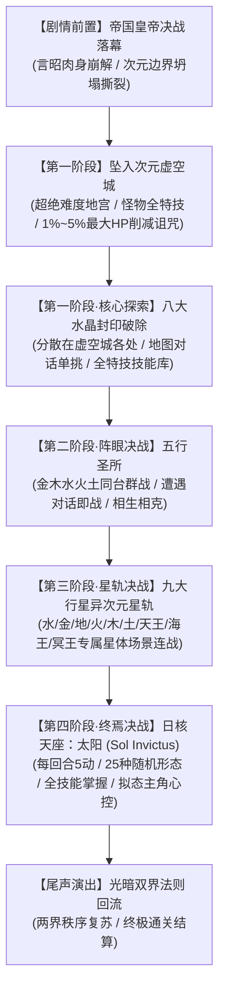

# 09. 次元虚空城、八大水晶、五行圣所、九大行星与终焉太阳决战白皮书
# (Void Castle, Eight Crystals, Five Elements, Nine Celestial Planets & Sol Invictus Master Spec)

> **版本**：v1.0.0  
> **所属架构**：新世界规范矩阵 (`news-world/new-world/`)  
> **设计依据**：皇帝决战落幕后剧情衔接、终局异次元迷宫生态、八大属性水晶探索战、五行同台阵眼决战、九大行星星轨战场生成与终极首领太阳（25形态/5动/拟态心控）工业级战斗规范。
> **前置宇宙学渊源**：八大水晶在主线 30 章节的立体空间分布（4 地面天空 + 4 地下深渊）与五行在地球（正五行：金木水火地）与月球（逆五行：地火水木金）的镜像对偶法则，详见 [`10_THIRTY_CHAPTERS_CRYSTALS_AND_FIVE_ELEMENTS_SPEC.md`](./10_THIRTY_CHAPTERS_CRYSTALS_AND_FIVE_ELEMENTS_SPEC.md)。

---

## 1. 剧情衔接与关卡流转总览 (Narrative Transition & Phase Progression)

在帝国皇帝（言昭 / 皇帝之影）被击溃后，非之狭缝发生坍缩，未被平息的法则暗流彻底撕开空间边界，将全队拖入超越物质与时间的根源之地——**次元虚空城 (Dimensional Void Castle)**。在前 29 章中经历地空与地下洗礼的八大水晶投影，以及地球正五行与月球逆五行法则，在此汇流为终焉决战的封印核心。



---

## 2. 次元虚空城生态与高危环境法则 (Void Castle Ecology & Rules)

### 2.1 整体强度定位与迷宫基调
- **难度越级**：虚空城怪物数值基准（攻击力、防御力、敏捷与抗性）全面超越古代斗技场深渊 49 层（Colosseum Abyss 49F），为游戏全篇常规非隐藏迷宫的最高巅峰。
- **全特技掌握 (Omni-Skill Arsenal)**：
  - 虚空城内的所有巡逻/遇敌小怪均拥有无限制全技能释放权限。
  - AI 具备高阶战术逻辑：包含全阶单体/全体元素魔法（火、冰、雷、风、水、土、圣、暗）、异常状态特技（混乱、石化、即死、沉默、失明、剧毒）以及高阶物理真伤穿甲突击。

### 2.2 虚空侵蚀：最大生命值百分比削减机制 (HP Percent Reduction Curse)
- **环境被动效果**：虚空城内蕴含扭曲的重力与反物质场。
- **削血公式**：
  $$\text{Damage}_{\text{Total}} = \text{Damage}_{\text{Skill}} + \text{Target.MaxHP} \times P_{\text{erosion}}$$
  - 其中虚空侵蚀比例 $P_{\text{erosion}} \in [1\%, 5\%]$，依据怪物技能等级与行动随机判定。
  - 即使目标处于高额防御或格挡状态，该 $1\% \sim 5\%$ 的生命值扣减依然作为法则真实伤害结算，迫使玩家保持血量线健康并配备高频续航。

---

## 3. 第一阶段：虚空城八大属性水晶探索战 (Eight Void Crystals)

八大水晶是维持虚空城空间稳定的古代核心，散布于虚空城迷宫的不同深度区域，需要玩家逐一探索探明。

```
[虚空城一层·潮汐回廊] ──────> 【水之水晶】(Water Crystal)
[虚空城二层·熔岩炉心] ──────> 【火之水晶】(Fire Crystal)
[虚空城三层·地脉断层] ──────> 【土之水晶】(Earth Crystal)
[虚空城四层·森罗树界] ──────> 【木之水晶】(Wood Crystal)
[虚空城五层·极光神殿] ──────> 【光明水晶】(Light Crystal)
[虚空城六层·永夜深渊] ──────> 【黑暗水晶】(Dark Crystal)
[虚空城七层·风暴断崖] ──────> 【风之水晶】(Wind Crystal)
[虚空城八层·鸣雷天顶] ──────> 【雷之水晶】(Thunder Crystal)
```

### 3.1 探索与交互机制
- **非踩雷遇敌**：水晶以独立的实体光华神像形态矗立于地图特定坐标，作为地图可见交互对象。
- **对话触发**：玩家必须移动至水晶前触发对话剧情。水晶发出低鸣警示，确认后进入独立单体 Boss 战。
- **单兵突破**：8 场战斗均为 1 对多（主角队伍对战单一水晶实体）的单体决战，击破一个水晶后该区域虚空屏障消散，开启通往更深层的甬道。

### 3.2 水晶属性与核心机制矩阵

| 水晶名称 | 元素属性 | HP / 双防 | 核心机制与特技池 | 战斗特性与破法 |
|---|---|---|---|---|
| **水之水晶** | 水 (Water) | 72,000 / 65 | 海啸冲刷、极寒冻结、泡沫守护、大回复、全特技施展 | 具有水吸收与雷弱点；高频施放全体潮汐，需维持雷魔法剑爆发 |
| **火之水晶** | 火 (Fire) | 75,000 / 60 | 烈焰轰爆、炼狱业火、热浪灼烧、狂暴增益、全特技施展 | 吸收火属性、弱冰；狂暴状态下攻击力激增，需适时驱散 (Dispel) |
| **土之水晶** | 土 (Earth) | 88,000 / 90 | 大地震、重力压制 (Gravity)、石化吐息、金刚磐石护盾 | 吸收土、弱风；物理防御极高，推荐魔法真伤与时空浮空术规避地震 |
| **木之水晶** | 木 (Wood) | 70,000 / 55 | 荆棘缠绕 (麻痹)、森罗寄生 (吸血)、花粉剧毒、群体生机回复 | 弱火；周期性恢复自身生命值并施加复合毒性，需火系集火压制 |
| **光明水晶** | 圣 (Light) | 80,000 / 75 | 至高神圣 (Holy)、裁决之光、复原圣泉、全异常反弹 (Reflect) | 吸收圣、弱暗；自带高阶魔法反射壁，需依靠物理乱打或破魔武器 |
| **黑暗水晶** | 暗 (Dark) | 82,000 / 70 | 终末核爆、死之宣告、深渊失明、暗影汲取、暗夜降临 | 吸收暗、弱圣；会施放即死与高额暗属性侵蚀，全员需装备防暗与防死饰品 |
| **风之水晶** | 风 (Wind) | 68,000 / 50 | 龙卷裂空、真空风刃、音速突进、全回避幻影 | 吸收风、弱土；极高敏捷与回避率，必中物理技能与风属性抗性装为核心 |
| **雷之水晶** | 雷 (Thunder)| 76,000 / 62 | 狂雷万仞、高压脉冲 (感电瘫痪)、等离子护体 | 吸收雷、弱水；造成持续麻痹与断行动，需装备防雷饰品与水系打击 |

> **水晶全能技能机制**：除专属元素招牌技外，8 个水晶共享“游戏全特技库”，在血量降低至 50% 与 20% 时会随机抽取包括各职业究极技能在内的全能技能轰炸战场。

---

## 4. 第二阶段：五行圣所群战决战 (Five Elements - Metal, Wood, Water, Fire, Earth)

在 8 大水晶尽数击破后，虚空城中枢大门洞开，队伍进入“五行圣所”（The Five Phases Sanctuary）。

### 4.1 触发与不可避战规则
- **空间一体**：金、木、水、火、土 5 个五行守护灵体环绕于同一个中央阵眼之中。
- **强制战斗判定**：
  - 玩家上前触发与五行灵体的对话。
  - **分支收敛**：无论玩家在剧情对话选项中选择“迎战”、“探究”、“谈判”或“保持沉默”，对话终结后**无条件百分之百直接触发切入战斗**。

### 4.2 五位一体同台群战机制 (5-in-1 Battle System)
5 个 Boss 同时出现在敌方战斗序列中，形成严密的五行协同循环：

```
           [木灵 (Wood)] ──(生命滋养)──> [火灵 (Fire)]
              ▲                               │
              │ (生)                          │ (生)
              │                               ▼
           [水灵 (Water)]                 [土灵 (Earth)]
              ▲                               │
              │                               │ (生)
              └──(生)── [金灵 (Metal)] <──────┘
```

- **金之守护 (Metal)**：
  - 定位：重甲盾卫 / 反击之壁。
  - 特性：常驻高额物理减伤与物理反弹；为全队提供钢铁护盾。
- **木之守护 (Wood)**：
  - 定位：阵眼核心治疗 / 解除负面。
  - 特性：每回合为全体五行回复固定百分比生命，并定期净化全场负面状态（优先集火击杀目标）。
- **水之守护 (Water)**：
  - 定位：法术屏障 / 寒冰控制。
  - 特性：为全队提供魔法反射与护盾，释放群体冰冻与降速迟缓 (Slow)。
- **火之守护 (Fire)**：
  - 定位：极意狂暴炮台。
  - 特性：随着队伍减员或木灵滋养，法术爆发伤害递增，施展全屏地狱业火。
- **土之守护 (Earth)**：
  - 定位：重力控制 / 破阵强攻。
  - 特性：强制嘲讽我方单体攻击，释放大地震与单体濒死重力压制。

---

## 5. 第三阶段：九大行星异次元星轨决战 (Nine Celestial Planets Boss Rush)

突破五行圣所后，虚空城穹顶碎裂，显现出太阳系维度的异次元轨道——**天球星轨战场 (Celestial Planetary Orbit)**。在直面虚空核心“太阳”之前，队伍必须依次击溃九大行星守卫者。

### 5.1 九大行星战场场景概念与生成规范 (Scene Environments)

每个行星决战具有专属的场景拓扑结构、背景特效（Shader / Parallax）与环境氛围：

```
  [行星 1: 水星] ──> [行星 2: 金星] ──> [行星 3: 地球]
         │                 │                 │
  [行星 4: 火星] ──> [行星 5: 木星] ──> [行星 6: 土星]
         │                 │                 │
  [行星 7: 天王星] ──> [行星 8: 海王星] ──> [行星 9: 冥王星]
                                                     │
                                                     ▼
                                          【虚空日核·太阳天座】
```

1. **水星战场 (Mercury Arena - `scene/map/planetary_mercury.tscn`)**：
   - **环境视觉**：背靠水星超高温灼热背阳面与极寒阴影交界线，地表布满金属水银流淌的陨石坑。
   - **音画氛围**：高频流光粒子、极速空间折跃音效。
   - **场景机制**：行动条加速 20%，攻速与施法判定极为迅猛。
2. **金星战场 (Venus Arena - `scene/map/planetary_venus.tscn`)**：
   - **环境视觉**：浓厚的黄色超临界二氧化碳与浓硫酸云层，伴随金黄色温室耀光。
   - **场景机制**：全场常驻微弱酸雨腐蚀，每 3 回合削减全员当前 MP。
3. **地球/盖亚战场 (Earth / Gaia Arena - `scene/map/planetary_earth.tscn`)**：
   - **环境视觉**：自外层轨道俯瞰壮丽的蔚蓝地表，周围环绕着漂浮的古代文明浮岛残骸与盖亚晶壁。
   - **场景机制**：重力稳定，生命与自然元素共鸣，土/水伤害提升 25%。
4. **火星战场 (Mars Arena - `scene/map/planetary_mars.tscn`)**：
   - **环境视觉**：铁锈红色的荒凉奥林匹斯山之巅，席卷着遮天蔽日的红色扬尘龙卷。
   - **场景机制**：狂暴斗志场，全员物理暴击率与受伤害同步提升 30%。
5. **木星战场 (Jupiter Arena - `scene/map/planetary_jupiter.tscn`)**：
   - **环境视觉**：置身于大红斑超级气暴外围浮空平台，深紫与橙黄相间的巨型气体漩涡翻滚，雷电贯穿天地。
   - **场景机制**：强对流扰动，周期性随机打乱行动顺位。
6. **土星战场 (Saturn Arena - `scene/map/planetary_saturn.tscn`)**：
   - **环境视觉**：宽广壮观的土星冰晶光环边缘，脚下踩着由数以亿计微细冰石与岩屑汇成的环轨光带。
   - **场景机制**：星环锋芒切割，受到攻击时附带冰属性追加撕裂。
7. **天王星战场 (Uranus Arena - `scene/map/planetary_uranus.tscn`)**：
   - **环境视觉**：青翠幽蓝的甲烷冰巨星，极轴 98 度严重倾斜，空间视觉呈现 90 度倒悬感。
   - **场景机制**：极轴错乱，角色方向键操作反转，单体战技与全体技能目标判定偶尔偏转。
8. **海王星战场 (Neptune Arena - `scene/map/planetary_neptune.tscn`)**：
   - **环境视觉**：深邃湛蓝的暴风外层，超音速暗流形成的时空大黑斑在虚空中旋转。
   - **场景机制**：深海重压，全员敏捷下降，水/冰属性法术伤害翻倍。
9. **冥王星战场 (Pluto Arena - `scene/map/planetary_pluto.tscn`)**：
   - **环境视觉**：柯伊伯带边缘永恒冻土与卡戎双星共舞的灰暗虚空，绝对寂静与冥府彼岸花浮光。
   - **场景机制**：冥府死界，治疗效果降低 30%，光属性驱散黑暗加成。

### 5.2 九大行星 Boss 战技与核心机制

| 行星首领 | HP | 核心机制与招式 | 战术应对要点 |
|---|---|---|---|
| **水星守卫·墨丘利** | 95,000 | **双动极速**、水银飞溅、光速瞬步 (回避一切普通物理攻击) | 依靠必中战技、雷系法术锁定打击 |
| **金星守卫·维纳斯** | 102,000 | **硫酸毒雾**、致命魅惑 (我方角色陷入混乱)、温室热流 | 配备防混乱与防毒饰品，速战速决 |
| **地球守卫·盖亚** | 120,000 | **板块构造挤压** (全体物伤)、地幔护甲 (吸收物理伤害)、地动山摇 | 魔法剑穿透与风属性强力突破 |
| **火星守卫·阿瑞斯** | 115,000 | **战神咆哮**、护甲粉碎 (防御降为0)、赤红战刃 (连续物理重击) | 骑士挑衅掩护，后排保持高防御增益 |
| **木星守卫·朱庇特** | 135,000 | **大红斑风暴**、全屏十亿伏特雷暴、重力聚爆 | 装备雷吸收/减半防具，浮空术避开震波 |
| **土星守卫·萨图恩** | 128,000 | **土星环刃斩**、时空停滞 (Stop)、环轨重力束缚 | 佩戴防停止饰品，白魔法师预读驱散 |
| **天王星守卫·乌拉诺斯**| 122,000 | **极轴反转**、绝对零度急冻 (石化冻结)、青蓝脉冲 | 准备解冻药品与圣灵药，火系高阶输出 |
| **海王星守卫·涅普顿** | 130,000 | **海王超音速冲击**、暗海巨浪、法力抽离 (MP 归零) | 随身携带万灵药与高级以太，雷系狂暴轰杀 |
| **冥王星守卫·普路托** | 140,000 | **黄泉死线**、死亡宣告 (Doom 30秒)、寂灭冰霜、冥界引渡 | 缎带免疫即死，白魔预置自动复活 (Reraise) |

---

## 6. 第四阶段：终焉绝对核心 —— 太阳 (Sol Invictus)

直通九大行星后，星轨光桥汇入虚空最核心的超巨型炽热日冕圣殿——**虚空日核·太阳天座 (The Solar Core Zenith)**。

```
              ┌──────────────────────────────────────────────┐
              │          终焉神威：太阳 (Sol Invictus)       │
              ├──────────────────────────────────────────────┤
              │ • 绝对行动频次：每回合固定 5 次行动          │
              │ • 多相随机变换：25 种多维战斗形态            │
              │ • 技能全知全能：全技能池无差别调度          │
              │ • 镜映同调心控：长成主角时控心反噬队友      │
              └──────────────────────────────────────────────┘
```

### 6.1 核心战斗参数与行动规则
- **HP 规格**：360,000（阶段多形态共用动态核心血池）。
- **行动次数 (Action Economy)**：**每回合拥有独立 5 次行动点数**（5 Actions Per Turn）。
  - 可以连续编织普通物理特技、大范围神阶法术、状态诅咒、形态变换与形态特权技。
- **全技能库 (Omniscient Skill Library)**：
  - 无论处于何种形态，太阳均拥有调用游戏中所有攻击特技、辅助魔法、禁忌奥义的权限。

### 6.2 25 种多相动态形态系统 (25 Shifting Forms)
在战斗回合推进中，太阳在每回合初或受到关键创伤时，会在 25 种形态中**随机变换**：

| 形态编号与名称 | 外观与视觉呈现 | 专精倾向与被动加成 |
|---|---|---|
| **01. 日冕初生态** | 悬浮赤金光球，日珥环绕 | 基础均衡形态，全属性抗性 50% |
| **02. 耀斑核爆态** | 烈焰翻滚的狂暴火柱 | 火属性吸收，全体火伤害翻倍，每动附加灼烧 |
| **03. 黑子死寂态** | 漆黑日轮，吞噬光线 | 暗属性吸收，法术抗性 90%，高频施放死之宣告 |
| **04. 恒星聚变态** | 白炽刺目光团，粒子激射 | 物攻/魔攻暴增 50%，防御降为 0 |
| **05. 红巨星膨胀态** | 遮蔽全屏的暗红巨星 | HP 临时虚空护盾 50,000，速度下降，地震频发 |
| **06. 白矮星致密态** | 极致小巧但刺眼的蓝白球 | 物理防御 999，仅受真实伤害与魔法伤害 |
| **07. 中子星重力态** | 超高频旋转发光灯塔 | 全体持续重力吸引，无法逃跑与跳跃 |
| **08. 超新星前兆态** | 脉冲式红蓝光交替剧烈震颤 | 3 行动后释放全体毁灭性技能“全宇宙超新星” |
| **09. 磁暴极光态** | 五彩斑斓的光带舞动 | 随机反弹物理/魔法，施加全异常状态 |
| **10. 质子风暴态** | 极速流窜的高能粒子束 | 敏捷翻倍，行动间隔极短 |
| **11. 日食幽影态** | 黑色月盘挡住日轮形成的黑金光环 | 圣与暗双属性吸收，施放全屏虚无之光 |
| **12. 熔岩炽热态** | 流淌滚烫岩浆的炎魔神相 | 受到物理攻击时必反击“熔岩喷涌” |
| **13. 光子结晶态** | 几何体棱镜折射光耀 | 反射一切单体黑魔法与白魔法 |
| **14. 虚无坍缩态** | 扭曲引力透镜漩涡 | 周期性驱散全场所有增益状态 |
| **15. 等离子雷暴态** | 激荡青紫色球状闪电 | 雷电多段弹射，附加高概率麻痹 |
| **16. 严冬极夜态** | 蓝白冰焰包裹的寒冷日轮 | 颠覆常理的冰冷太阳，吸收冰与水 |
| **17. 空间撕裂态** | 周围空间碎裂成玻璃碎屑 | 随机将队伍单体目标放逐异空间 1 回合 |
| **18. 混沌神魔态** | 巨型古代神祇面容与金光结合 | 释放古代禁咒核爆 (Flare) 与流星群 (Meteor) |
| **19. 秩序裁决态** | 手持光之天平的圣辉法相 | 施放全体神圣仲裁，若我方HP为偶数则强制濒死 |
| **20. 始源奇点态** | 凝聚为一粒无限微小的奇点 | 闪避一切普通判定，必须依靠连击打碎 |
| **21~24. 四大主角拟态 (Mirror Mimics)** | **长成与队伍对应主角完全一致的外貌** | **触发太阳镜心控机制（见 6.3 节）** |
| **25. 终焉神威绝对态** | 日轮显现神之皇冠与十二光翼 | 攻防全属性达至顶峰，全技能连发 |

---

### 6.3 核心机制：太阳镜拟态心控 (Solar Mirror Mimicry & Mind Control)

当太阳在随机变换中转变为**形态 21 ~ 24（长成与我方其中一个主角一模一样）**时，触发特权绝技**【太阳镜·同调心控】**：

```
                ┌───────────────────────────────────┐
                │ 太阳拟态变换：长成我方主角 A 外貌 │
                └─────────────────┬─────────────────┘
                                  │
                                  ▼
                ┌───────────────────────────────────┐
                │    太阳镜折射：我方主角 A 受控    │
                │  • 攻击力/特技库同步至太阳级别    │
                │  • 攻击必中、无法闪避             │
                │  • 绝不自残，专向攻击队友 B、C、D │
                └─────────────────┬─────────────────┘
                                  │
                                  ▼
                ┌───────────────────────────────────┐
                │ 战场胜负判定：                    │
                │ • 若队友全部阵亡 ──> 游戏直接结束 │
                │ • 队友集火击破太阳镜/迫退形态 ──> │
                │   同调解除，受控主角恢复自由      │
                └───────────────────────────────────┘
```

#### 规则与运行逻辑明细：
1. **心控触发判定**：
   - 当太阳随机转变为与主角 A（如塞拉、索尔、纳哈特、格雷夫等）相等的拟态时，场上主角 A 瞬间获得 `SOLAR_ENTHRALLED`（太阳镜控心）状态。
2. **被控能力升华**：
   - 被控制的主角能力面板直接**同步飙升至太阳神级水平**（物攻、魔攻与敏捷获得巨大倍率加成）。
   - 被控主角会利用其全部学会的技能、融合技及太阳级能力无差别攻击其他在场队友。
3. **攻击靶向与锁定约束**：
   - **必中特性**：心控角色的攻击判定必中（Cannot Miss），无法通过常规闪避或幻影躲避。
   - **绝不自伤**：心控角色不会受到自身攻击波及，行动目标严格排除自身，仅向其余我方存活队友倾泻火力。
4. **即时团灭失败裁决**：
   - 一旦在场的其余所有未受控队友全部阵亡，即便受控主角当前仍存活，**战斗系统立即判定全队沦陷，直接触发 Game Over 结算画面**。
5. **破解策略与解除机制（遵循正常战斗博弈）**：
   - 心控状态**不可被常规解异常道具（如万灵药/清醒剂）直接秒解**，其核心绑定在“太阳本体的拟态投影”上。
   - **破法路径**：
     - **打破拟态**：其余存活队友集中爆发火力输出太阳本体，当在 1 轮行动内对其造成累计达到生命阈值（如当前形态最大 HP 的 5%~10%）或施加破盾特技时，太阳的镜像拟态被强行击碎，自动切换至其他恒星形态，**主角 A 的心控状态随之自然解除**。
     - **队友抢救与复原**：战斗中不幸被击倒的队友，依然支持使用正规复活手段（不死鸟之尾、转生之炎、白魔法复活术）进行救治与拉起，维持团队作战韧性。

---

## 7. 引擎实现与数据契约规范 (Godot Engine & DB Architecture)

### 7.1 数据库结构扩充设计 (`game_database.sql`)

```sql
-- 1. 虚空城怪物与首领注册
INSERT OR REPLACE INTO enemies (
    id, name, max_hp, attack, defense, magic_defense, speed, exp_reward, gold_reward, ap_reward, ai_script
) VALUES 
('crystal_water', '水之水晶', 72000, 160, 65, 80, 55, 5000, 8000, 30, 'ai_crystal_omni'),
('crystal_fire',  '火之水晶', 75000, 175, 60, 75, 58, 5000, 8000, 30, 'ai_crystal_omni'),
('crystal_earth', '土之水晶', 88000, 190, 90, 60, 42, 5000, 8000, 30, 'ai_crystal_omni'),
('crystal_wood',  '木之水晶', 70000, 150, 55, 85, 50, 5000, 8000, 30, 'ai_crystal_omni'),
('crystal_light', '光明水晶', 80000, 165, 75, 95, 60, 5000, 8000, 30, 'ai_crystal_omni'),
('crystal_dark',  '黑暗水晶', 82000, 185, 70, 70, 62, 5000, 8000, 30, 'ai_crystal_omni'),
('crystal_wind',  '风之水晶', 68000, 155, 50, 65, 75, 5000, 8000, 30, 'ai_crystal_omni'),
('crystal_thunder','雷之水晶', 76000, 180, 62, 70, 65, 5000, 8000, 30, 'ai_crystal_omni'),
-- 五行首领
('element_metal', '金行灵神', 95000, 200, 120, 60, 48, 6000, 10000, 35, 'ai_element_metal'),
('element_wood',  '木行灵神', 85000, 150, 70, 110, 52, 6000, 10000, 35, 'ai_element_wood'),
('element_water', '水行灵神', 90000, 165, 80, 100, 56, 6000, 10000, 35, 'ai_element_water'),
('element_fire',  '火行灵神', 92000, 220, 75, 75, 64, 6000, 10000, 35, 'ai_element_fire'),
('element_earth', '土行灵神', 105000, 210, 110, 70, 40, 6000, 10000, 35, 'ai_element_earth'),
-- 终焉太阳
('boss_sol_invictus', '太阳·终焉神威', 360000, 260, 130, 130, 88, 50000, 99999, 100, 'ai_sol_invictus');
```

### 7.2 核心战斗控制器逻辑参考 (`gdscripts/combat/sol_invictus_controller.gd`)

```gdscript
# 终焉太阳战役专用控制器
class_name SolInvictusController
extends RefCounted

const TOTAL_FORMS_COUNT: int = 25
const ACTIONS_PER_TURN: int = 5
const EROSION_MIN_PERCENT: float = 0.01
const EROSION_MAX_PERCENT: float = 0.05

# 当前形态索引 (0 ~ 24)
var current_form_index: int = 0
# 被控制的角色 ID (若无则为 "")
var enthralled_hero_id: String = ""

# 结算虚空生物命中时扣除最大生命值 1%~5% 真实伤害
static func calculate_void_erosion_damage(max_hp: int) -> int:
	var percent = randf_range(EROSION_MIN_PERCENT, EROSION_MAX_PERCENT)
	return maxi(1, int(float(max_hp) * percent))

# 随机轮换形态
func roll_next_form(party_heroes: Array[String]) -> Dictionary:
	current_form_index = randi() % TOTAL_FORMS_COUNT
	var is_mimic_form = (current_form_index >= 20 and current_form_index <= 23)
	
	if is_mimic_form:
		var hero_slot = current_form_index - 20
		if hero_slot < party_heroes.size():
			enthralled_hero_id = party_heroes[hero_slot]
		else:
			enthralled_hero_id = party_heroes[0]
	else:
		enthralled_hero_id = ""
		
	return {
		"form_index": current_form_index,
		"is_mimic": is_mimic_form,
		"enthralled_hero": enthralled_hero_id
	}

# 判定心控胜利/失败规则：其余主角是否全亡
func check_party_defeat_under_control(party_status: Array[Dictionary]) -> bool:
	if enthralled_hero_id.is_empty():
		return false
	
	var other_heroes_alive: int = 0
	for member in party_status:
		if member.id != enthralled_hero_id:
			if member.current_hp > 0:
				other_heroes_alive += 1
				
	# 若其余所有队友全部阵亡，即便受控者活着，也立即判负
	return (other_heroes_alive == 0)
```

---

## 8. 验收基准与测试验证要点 (Acceptance Criteria & QA Test Scenarios)

1. **地图与对话触发验收**：
   - 虚空城内 8 处水晶场景位置正确，与水晶交互对话后单体战斗正确拉起。
   - 五行圣所对话无论选择何种文本选项，均正常切入 5 体同台战斗。
2. **虚空削血被动校验**：
   - 虚空城怪物攻击命中后，角色 HP 扣除包含 $1\% \sim 5\%$ 最大生命值真实损耗。
3. **九大行星星轨场景连战**：
   - 击败前序行星后，星轨光桥正确解密并激活下一个行星战斗场景，音画氛围与场景特效无异常。
4. **太阳 5 动与 25 形态变换**：
   - 太阳在每个行动回合中严格执行 5 次独立行动。
   - 25 种形态随机轮换且数值属性/抗性正确映射。
5. **拟态心控与全队沦陷裁决**：
   - 太阳变成我方主角时，对应主角获得神级能力提升并不受控攻击队友。
   - 当其他队友全部倒地时，立即判负结算；集火破坏拟态时心控解除恢复自由。
