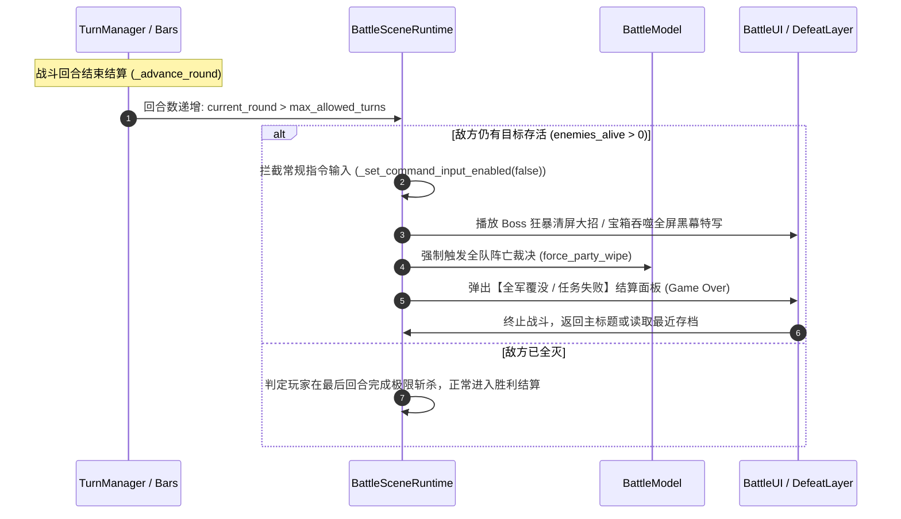

# 11. 剧情首领战限回合决算、等级动态压制惩罚与宝箱怪三回合绝杀白皮书
# (Story Boss Turn Limit, Dynamic Overlevel Penalty & Chest Monster Three-Turn Execution Master Spec)

> **版本**：v1.0.0  
> **所属架构**：新世界规范矩阵 (`news-world/new-world/`)  
> **设计依据**：剧情 Boss 战强制回合限制体系、等级过高逆向回合递减算法（最低默认为 2 次，最高上限为 9999 次）、超时直接 Game Over 败北裁决，以及全域宝箱怪物统一定格 3 回合生死限时战工业级战斗规范。

---

## 1. 核心设计哲学与机制意图 (Design Philosophy)

为了彻底根除传统回合制 JRPG 中依靠全辅助套盾、极度苟活拖延回合、毫无操作张力的无脑磨血战术，本规范正式引入**“硬限回合生存与歼灭决算体系”**：

```mermaid
flowchart TD
    Encounter["切入战斗 (Encounter Start)"] --> CheckType{"遭遇战类型判定"}
    
    CheckType -->|剧情 Boss 战| StoryBoss["读取 Boss 基准推荐等级与基准回合数<br/>(最低保底 2 次，最多封顶 9999 次)"]
    StoryBoss --> CheckLevel{"玩家队伍平均等级 > 推荐等级?"}
    CheckLevel -->|是 (等级过高)| CalcReduction["应用逆向削减算法：<br/>回合上限 = max(2, 基准回合 - 等级差惩罚)"]
    CheckLevel -->|否 (平级/越级挑战)| KeepBase["保持完整基准回合数"]
    
    CheckType -->|宝箱怪物 (Chest Monster)| ChestMonster["无视等级差异：<br/>严格统一定格为 3 回合 (Exact 3 Turns)"]
    
    CalcReduction --> BattleLoop["进入战斗循环 (每回合末判定)"]
    KeepBase --> BattleLoop
    ChestMonster --> BattleLoop
    
    BattleLoop --> CheckVictory{"限制回合内全歼目标?"}
    CheckVictory -->|是| Victory["战斗胜利！获取战利品与剧情推进"]
    CheckVictory -->|否| TurnOver{"达到指定上限回合仍未击杀?"}
    TurnOver -->|是| DirectGameOver["【触发绝对败北裁决】<br/>首领狂暴清屏 / 宝箱放逐吞噬<br/>游戏直接失败结束 (Game Over)"]
```

---

## 2. 剧情 Boss 战限回合系统与等级压制削减算法 (Story Boss Turn Limits)

### 2.1 回合参数边界与保底约束
所有被标记为 `is_story_boss: true` 的遭遇战，系统强制赋予全局回合上限参数 $T_{\text{limit}}$：
- **绝对保底下限**：**最低默认为 2 回合**（$T_{\text{limit}} \ge 2$）。即无论等级高出多少，系统决不缩减至低于 2 次回合，保证玩家具备至少 1 轮整备与 1 轮爆发的操作空间。
- **绝对最高上限**：**最高封顶为 9999 回合**（$T_{\text{limit}} \le 9999$）。用于特定史诗持久战或漫长连战的大型首领设定。

### 2.2 等级过高逆向削减计算公式 (Overlevel Penalty Formula)

系统通过对比我方参战队伍的等级与当前剧情 Boss 的设计基准等级，动态修正可用回合数：

$$\Delta \text{Lv} = \max\left(0, \text{Party.AvgLevel} - \text{Boss.RecommendedLevel}\right)$$

$$T_{\text{limit}} = \operatorname{clamp}\left( T_{\text{base}} - \left\lfloor \frac{\Delta \text{Lv}}{k_{\text{step}}} \right\rfloor \times C_{\text{reduce}},\; 2,\; 9999 \right)$$

- **参数定义**：
  - $T_{\text{base}}$：Boss 的初始设计基准回合数（常规主线 Boss 基准范围通常为 $10 \sim 30$ 回合，极限制约战为 $5 \sim 8$ 回合）。
  - $\Delta \text{Lv}$：玩家队伍超出基准的等级差额。
  - $k_{\text{step}}$：等级梯度步长（默认设定为每超出 $3$ 级判定一个惩罚阶梯）。
  - $C_{\text{reduce}}$：每阶梯扣减回合数（默认每超出 1 个梯度扣减 $1 \sim 2$ 回合）。
  - $\operatorname{clamp}(\cdot, 2, 9999)$：硬性双端截断，确保**最低决不低于 2 次，最高决不超过 9999 次**。

#### 等级削减实例速查表（以某基准 Lv.20、初始 15 回合的 Boss 为例）：

| 玩家队伍平均等级 | 等级差 $\Delta \text{Lv}$ | 惩罚阶梯数 | 扣减回合 | 实际允许挑战回合 | 难度体验评估 |
|---|---|---|---|---|---|
| **Lv. 15 ~ 20** | 0 级（未超标） | 0 | 0 回合 | **15 回合** | 标准开荒，宽裕战术容错 |
| **Lv. 23** | +3 级 | 1 阶 | -2 回合 | **13 回合** | 适度压迫，要求提高输出效率 |
| **Lv. 29** | +9 级 | 3 阶 | -6 回合 | **9 回合** | 严重压迫，必须熟练运用属性弱点 |
| **Lv. 35** | +15 级 | 5 阶 | -10 回合 | **5 回合** | 极限速杀，严苛爆发检验 |
| **Lv. 50+ (极端碾压)**| +30 级及以上 | 10 阶+ | -20 回合 | **2 回合（触发硬保底）** | **绝对极限制约：最低保底 2 回合必须斩杀！** |

---

## 3. 全域宝箱怪物三回合绝杀规则 (Chest Monster 3-Turn Rule)

在全游戏所有迷宫、地穴与隐藏藏宝点中，所有通过打开宝箱所触发的怪物遭遇（包括但不限于：魔术宝箱怪 Mimic、潘多拉魔盒、封印宝箱守护巨兽等）：

### 3.1 统一固定 3 回合原则
- **无视等级修正**：宝箱怪物**不适用**等级递减公式，全域严格锁定**限制回合为 3 次**（$T_{\text{chest}} = 3$）。
- **设计初衷**：宝箱怪物是地下城探险中的突发高风险/高收益事件。开启宝箱代表玩家贪婪的博弈，必须在 3 回合内集中最强火力（二刀流、魔法剑爆发、风魔手里剑投掷、神圣核爆）完成速杀。

### 3.2 超时即死败北演出
- 如果战斗进入到第 4 回合初，场上仍有宝箱怪存活：
  1. 宝箱怪触发无法打断的优先行动：**【宝箱合拢·时空吞噬 (Chest Devour)】**。
  2. 宝箱大口张开释放黑暗漩涡，将全队瞬间吸入并彻底粉碎。
  3. **战斗系统立即跳过普通濒死与结算，游戏直接失败结束（Direct Game Over）**！

---

## 4. 超时判定与游戏失败裁决流程 (Timeout Game Over Resolution)

当剧情 Boss 战或宝箱怪战的回合计数递增超过限制上限时，触发系统终极制裁：



### 4.1 核心裁决铁律
1. **极限同局判定**：若在最后一回合（例如第 2 回合或第 3 回合）的最后一动中，玩家成功将 Boss/宝箱怪击杀，**判定为玩家压哨胜利**，正常获得全部经验与稀有掉落。
2. **绝对不可逃避性**：在限回合剧情 Boss 战与宝箱怪战斗中，全员指令菜单中的“逃跑”（Escape）指令被全局灰色禁用（Disabled），无法逃避时限惩罚。
3. **无免死护盾豁免**：超时触发的 Game Over 是剧情法则级别的败北，不被任何装备被动（如“天使之羽”免死一次）或白魔法“预言复活”（Reraise）抵消，全队强制判负。

---

## 5. UI/UX 视觉与警示规范 (Battle HUD & Presentation)

为了给玩家提供清晰的战场时间压力反馈，战斗界面必须实时呈现倒计时状态：

```
┌─────────────────────────────────────────────────────────────┐
│  [战斗主视口]                                               │
│                                                             │
│  ┌──────────────────────────────┐                           │
│  │ ⚡ 剧情首领决战             │                           │
│  │ 剩余回合：[ 02 / 05 ] (紧迫) │ <── 动态红金警示面板     │
│  └──────────────────────────────┘                           │
│                                                             │
│                                           [首领 Boss]       │
│                                                             │
│  [我方队员 1]  [我方队员 2]  [我方队员 3]  [我方队员 4]     │
└─────────────────────────────────────────────────────────────┘
```

1. **左上角回合指示器 (Round Indicator)**：
   - 常规战斗显示：“第 X 回合”。
   - 剧情 Boss 战显示：“决战剩余：`X` 回合 / 限制：`Y` 回合”。
   - 宝箱怪战显示：“宝箱吞噬倒计时：`X / 3` 回合”。
2. **临界色调渐变与警报**：
   - 剩余回合 $> 3$：字体为标准淡金黄色 (`#FFEAA0`)。
   - 剩余回合 $= 2$：字体变为橙红色发光 (`#FF7043`)，面板边框轻微脉冲缩放。
   - 剩余回合 $= 1$（最后一回合）：字体变为赤红色急促闪烁 (`#FF1744`)，伴随急促的心跳重音警报音效 (`sfx_heartbeat_alarm`)。
3. **入场开战横幅 (Encounter Banner)**：
   - 若检测到我方等级过高触发削减，战斗开场时弹出持续 2.5 秒的半透明暗红警告条：
     > ⚠️ **【战意压迫】队伍等级过高，首领警惕度提升！决战回合削减至 $T$ 回合！**

---

## 6. 系统架构伪代码设计参考 (Architecture Reference)

> *注：本节仅作为技术设计说明，供后续引擎接入参考，不直接修改现有工程脚本。*

```gdscript
# 战斗限回合决算器 (BattleTurnLimitResolver)
class_name BattleTurnLimitResolver
extends RefCounted

const CHEST_MONSTER_MAX_TURNS: int = 3
const STORY_BOSS_MIN_TURNS: int = 2
const STORY_BOSS_MAX_TURNS: int = 9999

# 计算当前遭遇战允许的最大回合数
static func calculate_max_turns(encounter_data: Dictionary, party_avg_level: int) -> int:
	var encounter_type: String = encounter_data.get("type", "normal")
	
	# 1. 宝箱怪：严格固定 3 回合
	if encounter_type == "chest_monster" or encounter_data.get("is_chest_monster", false):
		return CHEST_MONSTER_MAX_TURNS
		
	# 2. 剧情 Boss 战：计算等级递减
	if encounter_data.get("is_story_boss", false):
		var base_turns: int = int(encounter_data.get("base_turn_limit", 15))
		var boss_level: int = int(encounter_data.get("recommended_level", 20))
		
		var level_diff: int = maxi(0, party_avg_level - boss_level)
		# 每超 3 级减少 2 回合
		var penalty_steps: int = level_diff / 3
		var reduced_turns: int = base_turns - (penalty_steps * 2)
		
		# 严格截断在 [2, 9999] 范围内
		return clampi(reduced_turns, STORY_BOSS_MIN_TURNS, STORY_BOSS_MAX_TURNS)
		
	# 普通遭遇战无限制
	return -1

# 每回合递增时检查是否触发超时败北
static func check_turn_limit_exceeded(current_round: int, max_turns: int, has_alive_enemies: bool) -> bool:
	if max_turns <= 0:
		return false
	# 当前回合已超出允许上限且敌方仍有存活
	return (current_round > max_turns) and has_alive_enemies
```

---

## 7. 验收测试用例矩阵 (QA Acceptance Criteria)

| 编号 | 测试场景 | 前置条件 | 预期决算结果 |
|---|---|---|---|
| **TC-01** | 标准平级剧情 Boss 战 | 队伍 Lv.20，Boss 推荐 Lv.20，基准 15 回合 | 允许挑战回合为 15 回合，界面正确显示剩余计数 |
| **TC-02** | 高等级压制剧情 Boss 战 | 队伍 Lv.35，Boss 推荐 Lv.20，基准 15 回合 | 触发等级惩罚（超 15 级扣 10 回合），实战限制为 5 回合 |
| **TC-03** | 极端超高等级保底测试 | 队伍 Lv.99，Boss 推荐 Lv.10，基准 15 回合 | 削减触发硬性保底，实际限制严格定格为 **2 回合** |
| **TC-04** | 剧情 Boss 超时判负测试 | 达到最大回合数后敌方 HP > 0 | 第 X+1 回合初直接判定败北，触发 Game Over 结算 |
| **TC-05** | 剧情 Boss 压哨绝杀测试 | 在最后回合的最后一动击杀 Boss | 判定玩家正常获胜，不触发 Game Over |
| **TC-06** | 全域宝箱怪物战测试 | 任意等级打开宝箱触发遭遇 | 限制回合严格显示为 3 回合，3 回合未击杀直接全队败北 |
