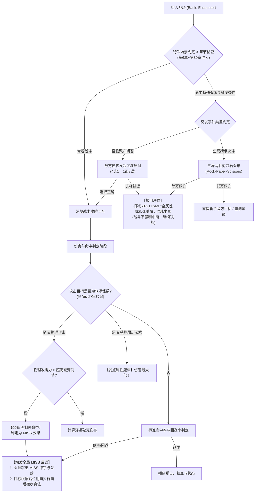
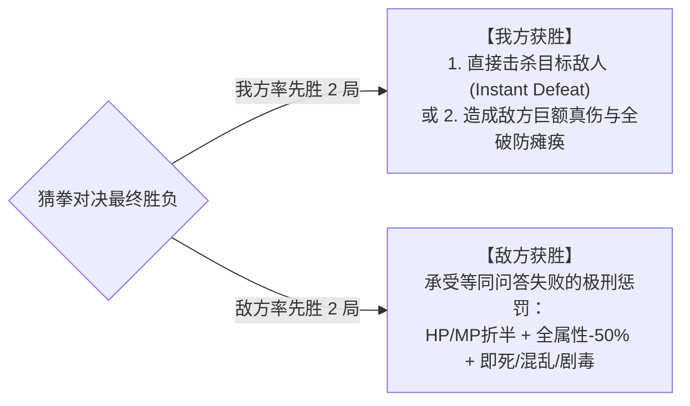

# 12. 战斗突发随机事件、生死猜拳决斗、软泥怪克制与全局闪避身法白皮书
# (Battle Random Events, Death RPS Duel, Slime Magic Affinity & Evasion Motion Master Spec)

> **版本**：v1.0.0  
> **所属架构**：新世界规范矩阵 (`news-world/new-world/`)  
> **设计依据**：第 6~30 章特殊场景战斗突发问答四选一与极刑惩罚体系、三局两胜生死剪刀石头布机制、软泥怪谱系（黑/黄/红/紫）99%物抗穿透门槛与特种魔法克制、全局 MISS 浮字及基于战场站位朝向的自适应后撤闪避身法规范。

---

## 2026-10-11 已授权首批实现口径

真人授权按现有来源决定参数并实现。首发仅古王陵 `old_kingdom_tomb` 普通可见/随机遭遇，产品第19–20章起（运行时篇章ID不等同产品章号）；本次地图访问首场问答、其后每5场以35%概率候选、事件后3场静默、成功触发后问答/猜拳交替。除下述显式神将决斗外，剧情、波次和Boss保留原门禁。答错或猜拳失败仅前五存活出战者HP/MP减半、保留至少1HP、六维减半持续三次本人有效行动；首存活者混乱沿原免疫与两次本人行动恢复。首发不接即死或毒。题库保留外部常识并在答题前明确标注，规划未实装题不参与生产处罚。普通代表猜拳败北沿真实HP归零和原胜利收尾，无额外奖励。

软泥首批仅现有来源 `ff1_pr_027` 绿软泥、`ff1_pr_029` 灰软泥、`ff1_pr_044` 黄果冻；四色条目仍是后续设计，不覆盖这三种来源身份、17项事实或抗性。按§5.2公式，有效攻击力 `attack + attack_bonus + hero_stat_bonus("attack") >= 320` 时穿透；低于阈值仅1%命中，技能倍率不影响阈值。失明先判，瞄准/必中仅免失明，不能绕过胶质滑移；非软泥及达到阈值不新增该抽签。

专属攻击法术显式使用现有 `magic_id`：`fire`、`hail`、`fira`、`thundara`。仅正确法术ID、属性、该来源弱点与当前弱点倍率同时匹配，最终倍率提高至3.0（不是原2倍再乘成6倍；已有更高倍率保留）。027/044弱火冰，029弱雷；免疫、吸收、魔盾、耐性及普通元素武器保持原合同。胶质MISS复用现浮字、声音与朝向撤步；嵌套反击反馈在敌方挥击之后安排，避免其撤步被挥击取消。

首批事件及限回合接线输入通过私有full-v21 2481/2481测试；软泥新增输入另通过55项核心邻项、16项反馈邻项和正反阵型实际Metal50检查。Metal日志6条RGB8转换警告，音频信号有验证、静音图形夹具不代表听觉验收；完整白皮书分阶段清单仍未全部完成，见最新连续开发backlog。第28章神将左右卫（`divine_generals / empire_capital / ch11_finale_one`）已以显式非波次剧情白名单接入开局一次猜拳，不消费普通访问计数。左卫获胜奖励扣当前HP40%保1，跳过两次本人充能行动机会，期间整项有效物理防御为0；基础DEF及各独立增减益保持，到期自然恢复，右卫不动。失败在温和矩阵之后对首存活者判即死，尊重免疫及一次不屈；随后存活前五沿原异常入口中毒，既有固定毒不重置，死亡对象不转移混乱给别人。高级代价和真实处罚结果均可见，正常全灭走既有GameOver，胜利/奖励/剧情返图只沿原路径一次。正常及20FPS真实流程各381检查通过；最终共享核心输入通过私有full-v22 2519/2519测试、66998断言，MAIN/QA源码和系列素材SHA保持；6条预期SQL故障注入及18条既有Exponent警告保留，无parse/script或资源退出错误。该证据不等同自然难度/概率平衡、人工素材批准或全部后续场景已接入。

---

## 1. 核心设计哲学与机制意图 (Design Philosophy)

为了打破传统回合制 JRPG 战斗后期数值固化、玩家流程操作机械化的痛点，本规范正式确立四大战斗衍生机制维度：



---

## 2. 章节范围与特殊场景突发随机事件规范 (Random Battle Events)

### 2.1 章节准入梯度与生命周期
- **第 1 章 ~ 第 5 章（含序章）：绝对封禁期**
  - 前 5 章为玩家基础职业、基础队伍构筑、属性克制与基础机制的学习磨合期。
  - 此阶段严禁注入任何打断主线节奏的问答、突发惩罚或猜拳事件。
- **第 6 章 ~ 第 30 章：全域准入期**
  - 从第 6 章（暗队·失明的猎人 / 记忆的人造者过渡篇）开始，正式解锁突发世界事件，直至第 30 章（非之世界终局）。
  - 伴随世界分裂、异界虚空侵蚀、古代迷宫深入，敌方怪物拥有更高维度的智慧与精神干扰能力。

### 2.2 触发场景白名单与动态触发判定模型
突发事件决不在平原、普通道路或每次暗雷中无脑弹出，而是遵循**环境白名单**与**情境蓄积判定**：

```
P(Trigger) = BaseRate(Scene) × StageFactor(BattleCount)
```

1. **场景白名单约束（Special Scenes Only）**：
   - 虚空裂隙、古代遗迹深层、封印神殿、地底熔岩回廊、深海海沟、异界幻影之城等高危险度地图。
2. **战斗计数器情境决策（Encounter Cadence）**：
   - **首次探索威慑**：部分极度诡异的地下城，在玩家该图“第 1 次遭遇战”即强制或高概率触发，给玩家建立该迷宫的规则压迫感。
   - **疲劳蓄积触发**：在深层迷宫中，第 5 次、第 10 次切入战斗时伴随高概率触发，模拟角色在漫长探索中遭受的精神试炼。
   - 冷却间隔：一旦触发并结算完毕，设定至少 3~5 场战斗的静默安全期，防止连续打断战斗节奏。

---

## 3. 敌方怪物四选一致命问答机制 (Four-Choice Quiz Trial)

### 3.1 表现形式与交互规则
- **发起方**：由当前战场中的首领怪、精英怪或指定主脑怪物代表敌方阵营发起。
- **交互界面**：战斗进入瞬时决断状态，时间轴冻结；屏幕正上方呈现怪物的冷酷质问对白，下方呈现 4 个独立选择支：
  - **选项结构**：**严格为 4 个选项**，其中**仅有 1 个正确选项**，其余 **3 个为错误/陷阱选项**。
  - 题目范畴：涵盖世界观历史、古代晶石法则、怪物生理弱点、逻辑哲学诡辩或两难决断。

### 3.2 严厉惩罚决算矩阵 (Failure Penalty Matrix)

如果玩家选中 3 个错误选项之一，立即面临惨烈的多重惩罚组合，由系统根据怪物属性与当前战局严重程度执行判决：

| 惩罚类型 | 结算公式与作用机制 | 战术影响与恢复限制 |
|---|---|---|
| **生命折半 (HP Halving)** | $\text{CurrentHP} = \lfloor \text{CurrentHP} \times 0.5 \rfloor$ | 扣减当前生命值 50%（非最大生命值，保底剩余 1点 HP，不直接死于扣血）。 |
| **魔力折半 (MP Halving)** | $\text{CurrentMP} = \lfloor \text{CurrentMP} \times 0.5 \rfloor$ | 扣减当前 MP 50%，瞬间封杀高阶法术连发与大回复储备。 |
| **全属性削弱 (All-Stat -50%)** | $\text{Stat}_{\text{eff}} = \lfloor \text{Stat}_{\text{base}} \times 0.5 \rfloor$<br/>覆盖攻击力、防御力、速度、精神、魔攻、魔防 | 持续 3~5 个行动轮次。角色输出腰斩、护甲破裂、行动条充能速率大幅减缓。 |
| **致命处决 (Instant Death)** | $\text{Target} = \text{Party.Leader}$ 或主要输出者<br/>直接造成真实致死伤害 | 在高阶深渊首领或高难试炼中触发，直接判定主角即死，逼迫队伍使用复活手段救场。 |
| **深度精神混乱 (Confusion)** | 施加 `confuse` 状态，强行攻击友军 | 混乱角色在行动时有极高概率砍向同伴，且无法执行精细指令。 |
| **猛毒浸蚀 (Poison / Toxins)** | 施加 `poison` 状态，每动扣减巨额百分比 | 结合 HP 折半，形成致命的存活倒计时压迫。 |

> **[!IMPORTANT] 战斗不强制终止保护原则 (Combat Continuity Guard)**  
> 惩罚结算后，**系统决不直接宣判战斗终止或强制中断战斗**！  
> 即使全员遭受 HP/MP 折半与全属性暴跌，战斗仍在极度恶劣的逆境下继续运行。只有当主角即死且全员被后续敌人攻势全歼时，才由常规胜负判定模块判定败北。

---

## 4. 战斗生死剪刀石头布对决规范 (Rock-Paper-Scissors Duel)

### 4.1 对决流程与三局两胜制 (Best of Three)
在部分具有智慧玩弄倾向的怪物或博弈型精英战中，可触发“生死猜拳决斗”：
1. **启动条件**：特定怪物濒死反扑、特定博弈怪开场、或特殊随机事件抽中。
2. **规则机制**：
   - 规则严格为**三局两胜制（First to 2 Points）**。
   - 每轮玩家从【剪刀】、【石头】、【布】中选择一项，敌方通过隐藏决策权重同时出招。
   - 平局不计分，自动进入下一把加赛，直至决出单局胜负。
   - 界面实时显示比分盘（例如：我方 1 : 0 敌方）。

### 4.2 双方胜负结算对照



- **我方获胜（Victory Reward）**：
  - **绝杀击杀**：对于非关键主线免疫 Boss 的常规怪与精英怪，直接斩杀敌方（HP 归零，触发击倒动效）。
  - **首领重创**：对于拥有剧情免死锁血的 Boss，强制削减其当前 HP 30%~50%，并施加 2 回合眩晕瘫痪与防御归零（防守大开）。
- **敌方获胜（Defeat Penalty）**：
  - 我方承受与四选一错误惩罚完全相同的极刑矩阵（HP/MP 减半、全属性 50% 压制、即死或混乱剧毒）。

---

## 5. 软泥怪谱系（黑/黄/红/紫）克制与物抗法则 (Slime Ecology & Affinity)

### 5.1 涵盖对象谱系 (Slime / Ooze Family)
本规则覆盖所有属于胶质生物谱系（`category == "slime"` 或带有胶质/软泥标签）的四色核心怪物及其变体：
- **黑软泥 (Black Slime / Ooze)**：暗黑胶质，物理抗性极高，惧怕高阶圣光与雷电。
- **黄软泥 (Yellow Slime / Jelly)**：导电凝胶，具备极度绝缘的物理流体缓冲，惧怕寒冰与烈火。
- **红软泥 (Red Slime / Flan)**：高热酸液胶质，物理打击会如陷泥沼，惧怕极度深寒冰系法术。
- **紫软泥 (Purple Slime / Pudding)**：剧毒异变胶体，常规刀剑物理无效，惧怕神圣与驱魔纯净法术。

### 5.2 物理 99% 未命中（MISS）判定法则

由于软泥怪具备非牛顿流体特性，任何常规物理刀刃、钝击、箭矢接触瞬间均会被其凝胶身躯化解或穿透滑移：

$$\text{SlimeHitRate}_{\text{physical}} = \begin{cases} 
1.0 & \text{若 } \text{Attacker.ATK} \ge \text{Threshold}_{\text{pierce}}(\text{Slime}) \\ 
0.01 & \text{若 } \text{Attacker.ATK} < \text{Threshold}_{\text{pierce}}(\text{Slime}) 
\end{cases}$$

- **默认判定**：常规角色攻击力未达到破壳阈值时，**强制仅有 1% 命中率，即 99% 的概率无法击中**！
- **判定结果**：凡未命中的攻击，**直接判定为 MISS 效果**，不产生 0 伤害扣血或受击硬直，而是触发闪避与落空反馈。
- **极端高攻击力特权（Extreme ATK Pierce）**：只有极度后期的神兵力量型角色（如装备顶级神剑、狂战士破界、二刀流极值），攻击力突破软泥怪的破壳阈值 $\text{Threshold}_{\text{pierce}}$ 时，才能撕裂胶质造成实体物理创伤。

### 5.3 特种属性魔法克制（Damage Maximization）
- 软泥类怪物**只能由对应属性的特殊魔法（Special Spells）进行克制打击**。
- 当使用正确属性法术时，享受属性相性 2.0x ~ 3.0x 暴击级加成，且无视胶质减伤，实现**伤害最大化秒杀**。

---

## 6. 全局战斗 MISS 效果与阵营站位朝向闪避后退身法 (Miss & Evasion Motion)

### 6.1 全局 MISS 视觉与音频表现规范
在所有物理未命中、软泥怪 99% 滑移落空、失明导致挥空、或高回避装备闪避时，系统必须提供清晰明了的反馈：
1. **浮动文字展示 (Floating Miss Label)**：
   - 目标角色受到攻击且判定落空时，在受击点上方跳出醒目的 **"MISS"** 字符。
   - 字样风格：区别于红色的受伤数字与绿色的回复数字，采用银灰高亮带深色描边样式（例如 `Color(0.88, 0.9, 0.95)`，描边纯黑 4px），斜向抛物线上浮并渐隐淡出。
2. **专属音效调度 (Audio Cue)**：
   - 立即播放专用闪避音效 `res://assets/audio/sfx/battle/attack_miss_evade.mp3`，强化“身法躲闪/挥空划过”的打击节奏。

### 6.2 阵营站位与向后撤步身法算法 (Adaptive Step-Back Vector)

当角色触发 MISS 闪避成功时，被攻击方角色身体迅速执行一段“后撤闪避动作”（迅速后撤一段距离，随后平滑弹回原位）。

```mermaid
flowchart TD
    TriggerMiss["攻击落空，触发 MISS 闪避"] --> CheckTeam{"被攻击方阵营与战场阵型"}
    
    CheckTeam -->|我方默认站位 (右侧，面朝左)| PlayerNormal["我方后撤向量：向右方移动 (+X)<br/>StepOffset = (+28px, 0)"]
    CheckTeam -->|我方反向阵型 Reverse (左侧，面朝右)| PlayerReverse["我方后撤向量：向左方移动 (-X)<br/>StepOffset = (-28px, 0)"]
    
    CheckTeam -->|敌方默认站位 (左侧，面朝右)| EnemyNormal["敌方后撤向量：向左方移动 (-X)<br/>StepOffset = (-28px, 0)"]
    CheckTeam -->|敌方反向阵型 Reverse (右侧，面朝左)| EnemyReverse["敌方后撤向量：向右方移动 (+X)<br/>StepOffset = (+28px, 0)"]
    
    PlayerNormal --> ExecTween["执行身法补间动画 (Tween)"]
    PlayerReverse --> ExecTween
    EnemyNormal --> ExecTween
    EnemyReverse --> ExecTween
    
    ExecTween --> MotionDetails["1. 快速后撤：耗时 0.08~0.12s, EASE_OUT<br/>2. 滞空瞬停：短暂微停留 0.05s<br/>3. 平滑归位：耗时 0.15~0.18s, EASE_IN_OUT 归位至 RestPosition"]
```

#### 精确坐标位移对照表：

| 角色类别 | 战场阵型 (Formation) | 屏幕实际方位 | 角色面向朝向 | “后方”定义与后撤向量 $\vec{V}_{\text{step}}$ |
|---|---|---|---|---|
| **我方主角/队员** | **默认标准阵型 (Normal)** | **右侧区域** ($X \approx 800\sim 950$) | 面向左侧 ($-X$) | **向右后撤：$+X$ 方向** ($\Delta X = +28.0\text{px}$) |
| **我方主角/队员** | **反向战斗 (Reverse)** | **左侧区域** ($X \approx 100\sim 300$) | 面向右侧 ($+X$) | **向左后撤：$-X$ 方向** ($\Delta X = -28.0\text{px}$) |
| **敌方怪物** | **默认标准阵型 (Normal)** | **左侧区域** ($X \approx 100\sim 450$) | 面向右侧 ($+X$) | **向左后撤：$-X$ 方向** ($\Delta X = -28.0\text{px}$) |
| **敌方怪物** | **反向战斗 (Reverse)** | **右侧区域** ($X \approx 520\sim 950$) | 面向左侧 ($-X$) | **向右后撤：$+X$ 方向** ($\Delta X = +28.0\text{px}$) |

---

## 7. 架构契约与数据模型定义 (Data & Architecture Contracts)

### 7.1 突发随机事件数据结构 (`battle_world_event.json`)
```json
{
  "event_id": "event_quiz_void_memory_01",
  "min_chapter": 6,
  "max_chapter": 30,
  "scene_whitelist": [
    "map_void_rift",
    "map_ancient_library_depths",
    "map_sealed_temple"
  ],
  "trigger_conditions": {
    "cadence_type": "encounter_count",
    "target_counts": [1, 5, 9],
    "random_chance": 0.35
  },
  "event_kind": "quiz",
  "speaker_role": "enemy_leader",
  "question": "当光与暗的世界在永曜之巅交汇，始源晶石碎裂时释放的最初元素为何？",
  "options": [
    { "id": "opt_01", "text": "无序的纯白光辉与虚无之暗", "is_correct": true },
    { "id": "opt_02", "text": "地脉翻腾的熔岩烈火", "is_correct": false },
    { "id": "opt_03", "text": "席卷四方的终焉雷霆", "is_correct": false },
    { "id": "opt_04", "text": "冻结时空的极寒之息", "is_correct": false }
  ],
  "penalties": {
    "hp_percent_drain": 50,
    "mp_percent_drain": 50,
    "all_stat_debuff_percent": 50,
    "all_stat_debuff_duration": 3,
    "allow_instant_death": false,
    "possible_status": ["confuse", "poison"]
  }
}
```

### 7.2 猜拳决斗数据结构 (`battle_rps_duel.json`)
```json
{
  "event_id": "event_rps_shadow_gambler",
  "min_chapter": 6,
  "max_chapter": 30,
  "event_kind": "rps_duel",
  "best_of": 3,
  "enemy_ai_profile": "weighted_reactive",
  "victory_reward": {
    "instant_defeat_enemy": true,
    "boss_damage_percent": 40,
    "stun_turns": 2
  },
  "defeat_penalty": {
    "hp_percent_drain": 50,
    "mp_percent_drain": 50,
    "all_stat_debuff_percent": 50,
    "all_stat_debuff_duration": 3,
    "possible_status": ["confuse"]
  }
}
```

### 7.3 软泥怪特质数据接口 (`slime_defense_traits.json`)
```json
{
  "slime_id_list": [
    "ff1_black_slime",
    "ff1_yellow_slime",
    "ff1_red_slime",
    "ff1_purple_slime",
    "ff1_pr_027",
    "ff1_pr_029",
    "ff1_pr_044"
  ],
  "physical_miss_rate": 0.99,
  "pierce_attack_threshold": 320,
  "optimal_elements": {
    "black_slime": ["holy", "thunder"],
    "yellow_slime": ["fire", "ice"],
    "red_slime": ["ice", "water"],
    "purple_slime": ["holy"]
  },
  "optimal_element_multiplier": 3.0
}
```

---

## 8. 实施阶段与测试验收清单 (Implementation & Verification Checklist)

- [ ] **Phase 1: 章节与场景触发门禁验证**
  - [ ] 验证处于序章及第 1~5 章时，任何场景的战斗绝对不会触发问答与猜拳事件。
  - [ ] 验证进入第 6 章后，在白名单场景内按照设定步频（如第 1 次或第 5 次战斗）正确概率触发。
- [ ] **Phase 2: 致命问答四选一与极刑结算验证**
  - [ ] 验证 4 个选项中仅有 1 个正确，选错时精准扣减当前 HP 的 50% 与 MP 的 50%。
  - [ ] 验证全属性削弱 50% 正确附加于攻防速魔面板，且持续规定回合。
  - [ ] 验证主角即死及混乱/中毒附加逻辑，核实战斗不会直接被系统提前终止，而是正常继续。
- [ ] **Phase 3: 剪刀石头布三局两胜决斗验证**
  - [ ] 验证平局重新出拳，先得 2 分者获胜。
  - [ ] 验证我方获胜时成功斩杀敌人或打出巨额重创；敌方获胜时我方遭受极刑扣减。
- [ ] **Phase 4: 软泥怪 99% 物抗与法术克制验证**
  - [ ] 验证常规物理攻击软泥怪时 99% 概率返回 MISS。
  - [ ] 验证超高攻击力角色超过穿透阈值后能正常造成物理伤害。
  - [ ] 验证使用特定弱点法术打击软泥怪时伤害获得最大化倍率。
- [ ] **Phase 5: 全局 MISS 飘字与朝向后退身法动效验证**
  - [ ] 验证无论是玩家攻击落空还是敌人攻击落空，均正确触发 "MISS" 浮动文字与闪避音效。
  - [ ] 验证默认阵型下我方队员向右（$+X$）撤步后复位；反向战斗下我方队员向左（$-X$）撤步后复位。
  - [ ] 验证敌人闪避时朝向与位移矢量完全自适应其阵营位置。
