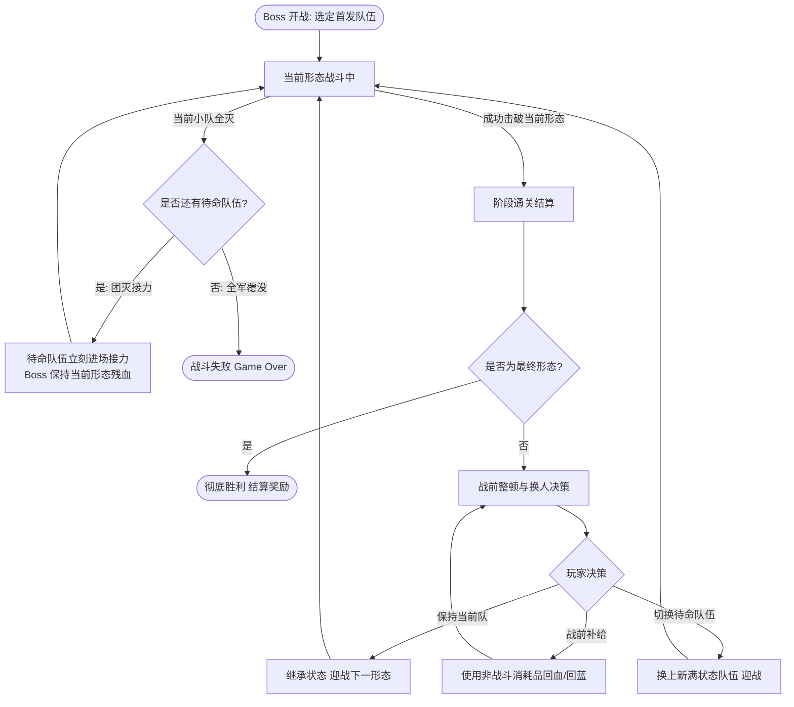
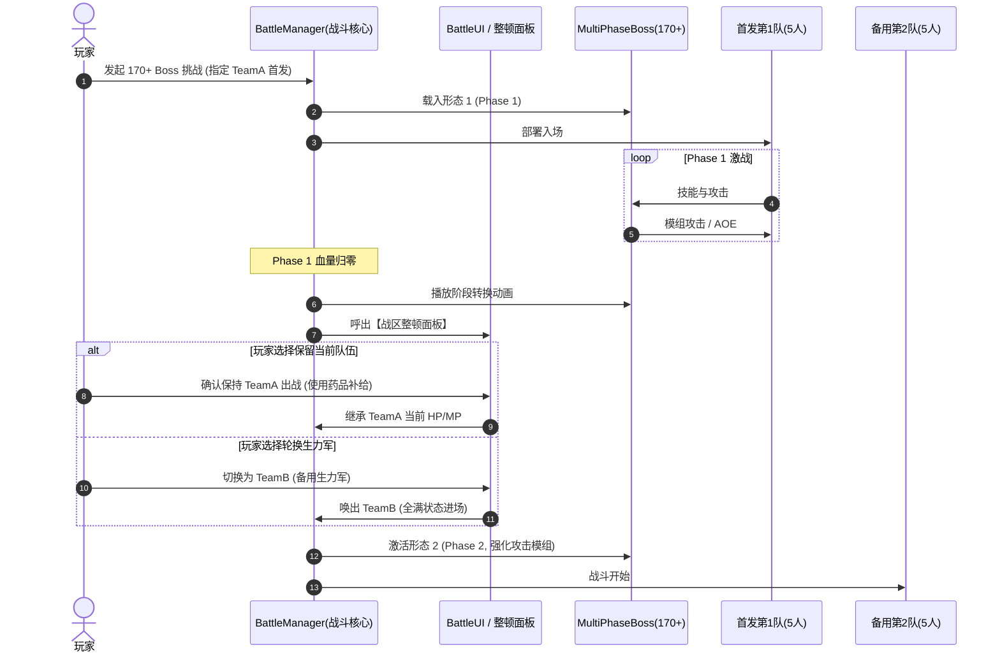

# 170+ 级多形态 Boss 连战与剧情技能系统设计规范

> **版本**：v1.0.0  
> **文档性质**：策划设计与系统技术架构规范（PRD / System Spec）  
> **状态**：已评审确认待落地  

---

## 目录
1. [系统概述与设计目标](#一系统概述与设计目标)
2. [170+ 级高阶多形态 Boss 战斗机制](#二170-级高阶多形态-boss-战斗机制)
   - 2.1 [形态与触发规则](#21-形态与触发规则)
   - 2.2 [车轮战与状态继承](#22-车轮战与状态继承)
   - 2.3 [三队 15 人多小队编组体系](#23-三队-15-人多小队编组体系)
   - 2.4 [队伍轮换、阶段整顿与团灭接力机制](#24-队伍轮换阶段整顿与团灭接力机制)
3. [专属剧情技能系统规范](#三专属剧情技能系统规范)
   - 3.1 [基础定位与获取规则](#31-基础定位与获取规则)
   - 3.2 [六大剧情技能详解与 Lv.1 ~ Lv.3 成长路线](#32-六大剧情技能详解与-lv1--lv3-成长路线)
4. [剧情技能点（SPP）产出与养成曲线](#四剧情技能点spp产出与养成曲线)
5. [战斗逻辑与时序交互图](#五战斗逻辑与时序交互图)
6. [数据契约与数据结构草案 (GDScript)](#六数据契约与数据结构草案-gdscript)
7. [实施分期规划 (Roadmap)](#七实施分期规划-roadmap)

---

## 一、系统概述与设计目标

为了支撑游戏后期（170 级及以上）的长线养成体验与高阶战术策略深度，本项目引入：
1. **多形态 Boss 连战系统**：将高难 Boss 战升级为跨越 2~7 个形态的持久车轮战，形态数量大于 5 的战斗需调配 3 支队伍（共 15 人）轮番接力，打破单一主力阵容通关的固化思维。
2. **剧情专属技能系统**：提供具有极高战术价值（克隆、重载、预判、削减、阵线交接、战意共鸣）的特殊能力，并配套专属剧情技能点（Story Skill Point），实现剧情探索度直接转化为战斗战术维度的正向反馈。

---

## 二、170+ 级高阶多形态 Boss 战斗机制

### 2.1 形态与触发规则
* **生效门槛**：Boss 等级 $\ge 170$ 级。
* **涵盖范围**：
  * **主线最终 Boss**（Final Boss）
  * **隐藏世界 Boss**（Secret / Hidden Boss）
  * **重大高难度剧情分支 Boss**（Scenario Boss）
* **形态阶级**：
  * 范围：**最低 2 形态，最高 7 形态**。
  * 强度规则：形态逐阶递增。每一阶形态拥有独立的血量槽、行动点数（AP）、攻击模组、被动抗性机制及专属演出。

### 2.2 车轮战与状态继承
* **连战机制**：击败形态 $N$ 后，战斗不脱离场景，即刻触发形态转换动画并进入形态 $N+1$ 的对决。
* **状态持久化（不自动回满）**：
  * **我方状态**：全员的当前生命值（HP）、魔法值（MP）、怒气/战意值、正负面持续 Buff/Debuff 均完整继承至下一形态。
  * **阵中恢复要求**：玩家必须依靠战斗内的技能治愈、药品道具使用或特定换人被动，在战斗过程中维持团队续航。

### 2.3 三队 15 人多小队编组体系
当 Boss 的**形态总数 $> 5$**（即 6 形态或 7 形态顶级 Boss）时，自动强制启用【多小队战区编组】：
* **编队规模**：3 支小队（Team A、Team B、Team C），每小队 5 名角色，共计 **15 名参战角色**。
* **首发出战选择**：开战前弹出战术编组面板，玩家可自由挑选由哪一支小队担任首发。

### 2.4 队伍轮换、阶段整顿与团灭接力机制



1. **击破后战术决策（整顿面板）**：
   * 每当击破 Boss 一个形态后，游戏暂停并进入【战区整顿】界面。
   * 玩家可选择：
     * **保留当前队伍**继续进攻；
     * **切换为待命队伍（Team B 或 Team C）**接力迎战；
     * **背包补给**：可使用背包内的补给品（绷带、灵药等）对上阵或待命队员进行治疗。
2. **团灭接力机制（容错保障）**：
   * 若当前场上队伍不幸全灭，**不直接判定 Game Over**。
   * 系统将自动呼叫下一支存活的备用队伍进场，**Boss 保持当前形态所剩的残余血量**，形成前仆后继的史诗救援战。
   * 仅当 3 支队伍（15 人）全部阵亡时，判定最终战败。

---

## 三、专属剧情技能系统规范

### 3.1 基础定位与获取规则
* **不可售卖**：各大常规城镇道具店、黑市商人均无法购买。
* **获取途径**：
  * 主线章节史诗事件解锁；
  * 远古遗迹壁画领悟；
  * 隐藏剧情分支高道德/高难度抉择奖励；
  * 击败特定 170+ 多形态 Boss 阶段形态掉落专属技能秘典。

---

### 3.2 六大剧情技能详解与 Lv.1 ~ Lv.3 成长路线

#### 1. 【克隆 (Clone / 拟态窃取)】
* **定位**：战术复制与破局奇策。
* **基本机制**：选定敌方或友方单一目标，解析并窃取其拥有的 1 项技能，置换入当前快捷槽。若目标无技能或技能不可克隆，提示“克隆失败”。
* **等级成长**：
  * **Lv.1**：可复制普通/中阶技能，复制后限在当前场内使用 **1 回合**。
  * **Lv.2**：使用期限提升至 **2 回合**，允许自主在目标技能列表中选择 1 个技能，技能消耗降低 20%。
  * **Lv.3 (质变)**：使用期限提升至 **3 回合**，有 50% 概率直接克隆目标的**终极绝技/高阶大招**，且当前战斗中允许多次施放。

#### 2. 【预判 (Prediction / 心眼感知)】
* **定位**：预知危险，精准规避与弱点打击。
* **基本机制**：读取并高亮显示目标下一回合的行动类型（攻击、蓄力、单体技能、AOE大招）及目标对象。
* **Boss 战平衡方案**：开放对 Boss 使用；采用冷却限制防止无脑预判。
* **等级成长**：
  * **Lv.1**：战斗第 5 回合起方可启用，窥探单个指定敌方目标下回合动作（冷却 4 回合）。
  * **Lv.2**：战斗第 4 回合起可用，可窥探**敌方全体**下回合动作（冷却 3 回合）。
  * **Lv.3 (质变)**：战斗第 3 回合起即可使用，窥探全体动作；且预判成功后，我方全员对被预判目标的技能伤害/暴击率提升 25%（持续 1 回合）。

#### 3. 【削减 (Attribute Drain / 维度崩解)】
* **定位**：复利衰减百分比削弱。
* **基本机制**：按目标当前剩余值扣除 HP/MP 或攻、防、速、精神等属性。每次削弱均基于**当前前一次剩余值**计算，避免数值归零。
* **Boss 战平衡方案**：对普通怪满额削减；对 Boss 生效时转为“抗性衰减模型”，保证数值不被秒杀。
* **等级成长**：
  * **Lv.1**：随机削弱目标 1 项属性当前值的 25%（Boss 生效时衰减为 5%）。
  * **Lv.2**：可**手动指定**削减某项特定属性（如定向削攻击或防），削减幅度提升至 35%（Boss 为 8%）。
  * **Lv.3 (质变)**：削减幅度提升至 50%（Boss 为 12%），若指定削减 HP，额外附加破甲 20% 效果（持续 2 回合）。

#### 4. 【重载 (Reload / 战场回溯)】
* **定位**：特定解谜/恶劣环境战场的重置保底。
* **基本机制**：仅在特殊机关场景、具备灾厄级场地的战斗中生效。敌我双方均可能触发；将战局重置为该形态初始状态。
* **等级成长**：
  * **Lv.1**：重置当前形态战斗至第 1 回合初始状态（敌我生命重置，每场战斗限用 1 次）。
  * **Lv.2**：重载后，**保留我方全员已积攒的战意/怒气值**，敌方状态完全重置。
  * **Lv.3 (质变)**：玩家可自主二选一：“完全重置战局”或“仅清除场上所有不可驱散的灾厄环境与我方全体负面状态”（无需重打）。

#### 5. 【阵线交接 (Tactical Switch)】*(拓展推荐技能 1)*
* **定位**：车轮战队内急救与人选替换。
* **基本机制**：在当前形态未结束时，由施法者消耗本回合行动，将当前场上濒危或空蓝的 1 名队员，与待命小队中的 1 名健康角色对调进场。
* **等级成长**：
  * **Lv.1**：每场战斗限用 1 次，换入的角色本回合处于防御待机状态。
  * **Lv.2**：每场战斗可用 2 次，换入的角色入场立即获得 15% 护盾。
  * **Lv.3 (质变)**：换入的角色入场直接获得行动回合，并净化换出角色的异常状态。

#### 6. 【战意共鸣 (Soul Resonance)】*(拓展推荐技能 2)*
* **定位**：团灭接力与亡者护佑。
* **基本机制**：被动/主动触发。当前队伍有成员阵亡或队伍团灭撤退时，将余下的战力转化为光环赠予接力队伍。
* **等级成长**：
  * **Lv.1**：队伍全灭接力时，新进场队伍全员攻击力提升 15%（持续 3 回合）。
  * **Lv.2**：接力时新队伍继承上一队阵亡时 50% 的未消耗怒气值，全员全属性提升 20%（持续 3 回合）。
  * **Lv.3 (质变)**：接力队伍进场获得 1 回合【绝对免伤/无敌】壁障，吹响反击号角。

---

## 四、剧情技能点（SPP）产出与养成曲线

### 4.1 升级消耗表
所有剧情技能初始均为 **Lv.0（未激活/未领悟）**。

| 阶段转换 | 所需剧情技能点 | 累计消耗 | 达标体验 |
| :---: | :---: | :---: | :--- |
| **Lv.0 $\rightarrow$ Lv.1** | **10 点** | 10 点 | 解锁基础机制，可以登场使用 |
| **Lv.1 $\rightarrow$ Lv.2** | **45 点** | 55 点 | 消除苛刻限制，灵活性与数值明显增强 |
| **Lv.2 $\rightarrow$ Lv.3** | **105 点** | 160 点 | 机制质变，成为攻克 170+ Boss 的核心王牌 |

> **养成总量**：单技能升满需 **160 点**，6 个技能全部修满共需 **960 点**。

### 4.2 技能点产出途径规划
1. **主线史诗大事件**：通关每个主线大章战役，系统发放结算宝匣，奖励 30~50 点。
2. **多形态 Boss 阶段首通**：首次击破 170+ 级 Boss 的任一形态，奖励 10~25 点。
3. **隐藏秘境探索**：解开远古石碑、开启高难度隐藏宝箱，每次奖励 5~15 点。
4. **剧情关键抉择**：在道德两难、阵营路线抉择中坚定心性，奖励 20 点。

---

## 五、战斗逻辑与时序交互图

### 多形态多小队战斗时序图



---

## 六、数据契约与数据结构草案 (GDScript)

### 1. Boss 多形态数据定义 (`boss_phase_data.gd`)
```gdscript
class_name BossPhaseData
extends Resource

@export var phase_index: int = 1
@export var phase_name: String = ""
@export var max_hp: int = 500000
@export var attack_power: int = 3500
@export var defense: int = 2200
@export var speed: int = 180
@export var skills: Array[String] = []
@export var phase_transition_anim: String = "transform_p1_to_p2"
@export var background_music: AudioStream
```

### 2. 剧情技能数据结构 (`story_skill_data.gd`)
```gdscript
class_name StorySkillData
extends Resource

enum SkillType {
	CLONE,          # 克隆
	PREDICTION,     # 预判
	ATTR_DRAIN,     # 削减
	RELOAD,         # 重载
	TACTICAL_SWITCH,# 阵线交接
	SOUL_RESONANCE  # 战意共鸣
}

@export var skill_id: String
@export var skill_type: SkillType
@export var skill_name: String
@export var current_level: int = 0 # 0 ~ 3
@export var unlock_requirement_text: String = ""

# 升级所需剧情技能点常量
const UPGRADE_COSTS: Dictionary = {
	1: 10,
	2: 45,
	3: 105
}

func can_upgrade(available_points: int) -> bool:
	if current_level >= 3:
		return false
	var next_level: int = current_level + 1
	return available_points >= UPGRADE_COSTS.get(next_level, 999999)

func get_next_upgrade_cost() -> int:
	if current_level >= 3:
		return 0
	return UPGRADE_COSTS.get(current_level + 1, 0)
```

---

## 七、实施分期规划 (Roadmap)

1. **第一阶段：核心战斗状态机与多形态切换**
   * 扩充 `BattleManager`，支持 `Phase 1 -> Phase N` 连续切换不重置战斗。
   * 实现伤害结算、血条阶段刷新与转场动画播放。
2. **第二阶段：多小队编成与整顿交互**
   * 构建 3 队 15 人阵型配置数据模型。
   * 制作阶段通关后的【战区整顿面板】（队伍轮换、背包快速补给UI）。
   * 实现队伍全灭时的“团灭接力”进场逻辑。
3. **第三阶段：六大剧情技能机制与 UI 呈现**
   * 编写克隆技能的“技能窃取”解析器。
   * 编写预判系统的“AI 意图透视”浮层。
   * 编写削减系统的“当前值复利衰减”计算器。
4. **第四阶段：剧情技能点与升级界面**
   * 接入角色属性面板与剧情技能养成页签。
   * 配置首批 170+ Boss（最终 Boss 7 形态、隐藏 Boss 6 形态）的阶段数据。

2026-10-22 原已开放削减的养成说明补齐：现StatusPage仅该技能显示当前等级效果与标明“未取得”的下级预览，直接引用正式BattleAttributeDrain常量，不另设比例；Lv3指定HP限定破甲与目标两次有效行动、当前剩余值和正值保留1明确，Lv0未取得/满级不造Lv4。原说明节点字号保留，仅该项高度230并实测四等级换行，五个未开放技能原文/高度/禁用保持，SPP升级/确认/战斗不改。新4/634及原防护/确认邻域22/22执行、3070零诊断全强私，含重复继承CRT与受控私升级后夹具恢复；证据 `verification/story-drain-description-20261022`，非自然施术或真人视觉验收。
