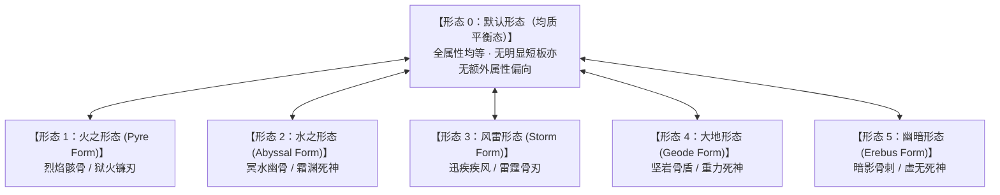
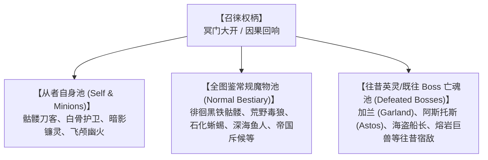
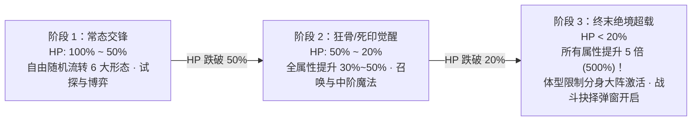
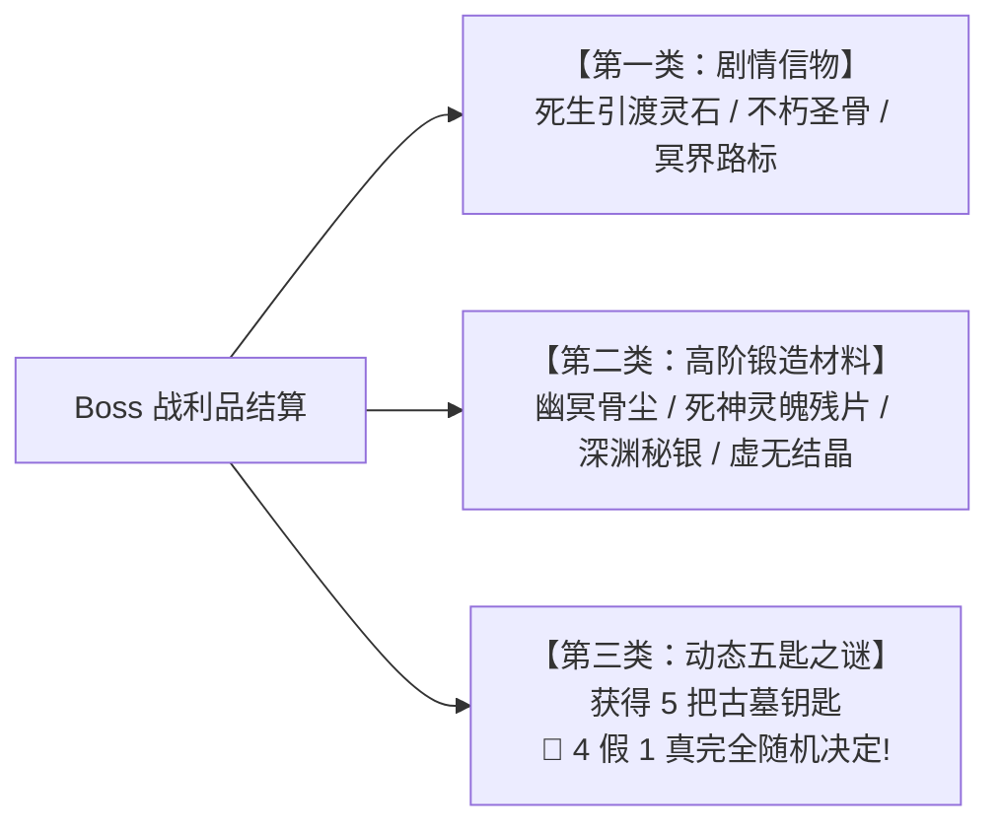
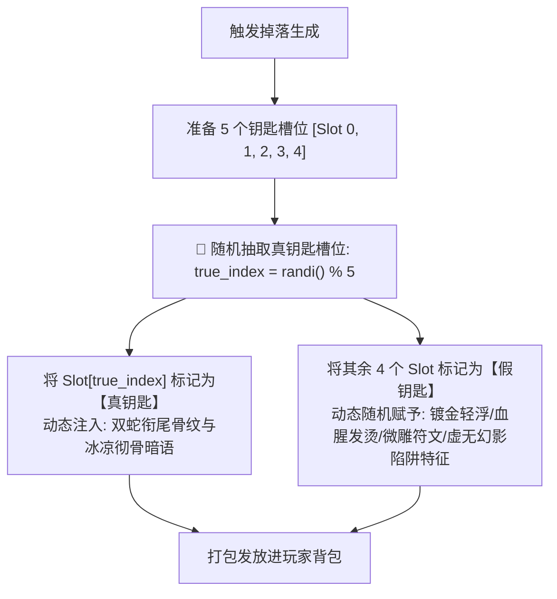
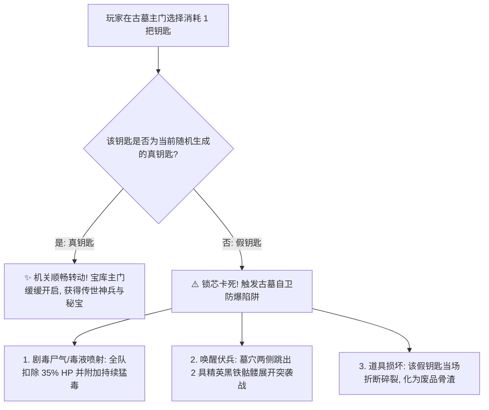
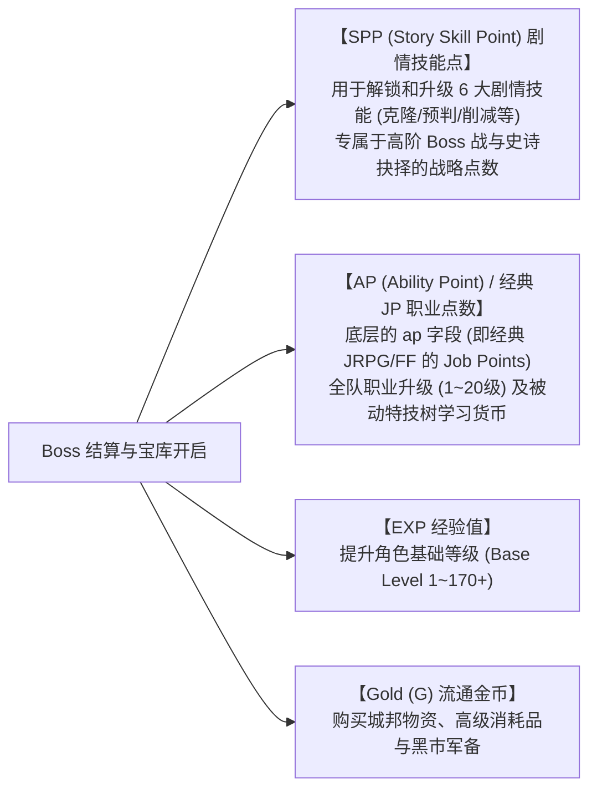
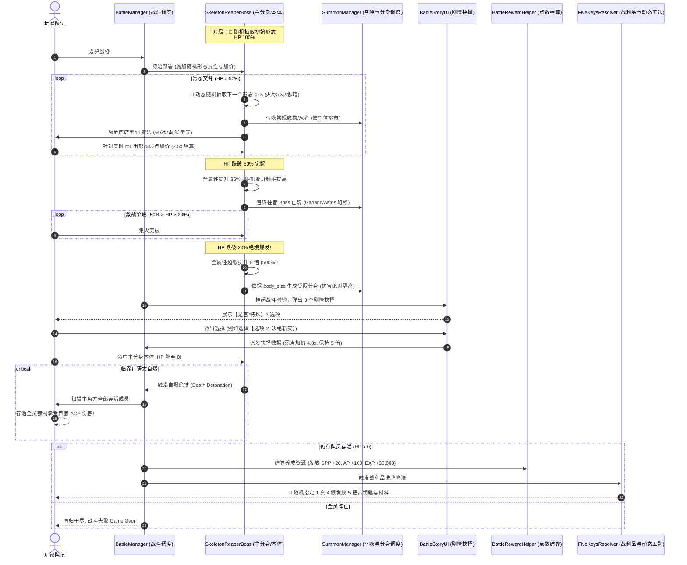

# 骷髅与死神双重角色系统设计规范 (Skeleton & Reaper Boss/NPC Spec)

> **版本**：v1.4.0  
> **文档性质**：策划设计与核心战斗/剧情交互技术架构规范（PRD / System Spec）  
> **状态**：已评审并归档待落地  
> **关联规范**：  
> - [170+ 多形态 Boss 连战与剧情技能设计规范](./MULTI_PHASE_BOSS_AND_STORY_SKILLS_SPEC.md)  
> - [全 30 章节架构与场景生成规则规范](./CHAPTER_AND_SCENE_GENERATION_SPEC.md)  
> - [不死系治疗反转与装备抗性规则](../news-world/agent-work/EQUIPMENT_UNDEAD_RULES.md)  
> - [战斗场景排布与体型常量定义](../gdscripts/gdconst/scene/battle/battleScene/battle_scene_const.gd) (`BODY_SIZE_VISUAL_LIMITS`)

---

## 目录
1. [系统概述与设计定位](#一系统概述与设计定位)
2. [双重身份设计：NPC 探索与 Boss 战役](#二双重身份设计npc-探索与-boss-战役)
3. [六大形态随机流变系统 (Randomized Hexa-Form System)](#三六大形态随机流变系统-randomized-hexa-form-system)
   - 3.1 [默认形态与 5 大元素特化形态定义](#31-默认形态与-5-大元素特化形态定义)
   - 3.2 [战斗内全随机变相机制与属性流转算法](#32-战斗内全随机变相机制与属性流转算法)
   - 3.3 [克制惩罚机制（“弱点加价”公式）](#33-克制惩罚机制弱点加价公式)
4. [全图鉴怪物与既往 Boss 召唤体系](#四全图鉴怪物与既往-boss-召唤体系)
   - 4.1 [深渊召徕范围：从者自身、常规魔物与既往 Boss 亡魂](#41-深渊召徕范围从者自身常规魔物与既往-boss-亡魂)
   - 4.2 [战场空位与体型排布动态调度](#42-战场空位与体型排布动态调度)
5. [商店可购魔法技能库与形态协同施法](#五商店可购魔法技能库与形态协同施法)
   - 5.1 [全城镇商店可购魔法解析与映射](#51-全城镇商店可购魔法解析与映射)
   - 5.2 [形态流变对商店魔法的增幅矩阵](#52-形态流变对商店魔法的增幅矩阵)
6. [生命阈值双阶段狂暴机制](#六生命阈值双阶段狂暴机制)
   - 6.1 [HP < 50%：属性强化觉醒](#61-hp--50属性强化觉醒)
   - 6.2 [HP < 20%：5 倍属性绝境爆发](#62-hp--205-倍属性绝境爆发)
7. [体型制约分身机制与绝对伤害隔离](#七体型制约分身机制与绝对伤害隔离)
   - 7.1 [体型规格（Body Size）与分身上限算法](#71-体型规格body-size与分身上限算法)
   - 7.2 [分身与主分身（本体）伤害隔离法则](#72-分身与主分身本体伤害隔离法则)
   - 7.3 [分身战术行为与真假识别博弈](#73-分身战术行为与真假识别博弈)
8. [亡语绝杀机制：临界自爆（全存活成员受创）](#八亡语绝杀机制临界自爆全存活成员受创)
   - 8.1 [自爆触发条件与结算规则](#81-自爆触发条件与结算规则)
   - 8.2 [全员波及逻辑与战术博弈应对](#82-全员波及逻辑与战术博弈应对)
9. [战斗场景内 3 个剧情抉择系统](#九战斗场景内-3-个剧情抉择系统)
   - 9.1 [抉择触发时机与战局暂停交互](#91-抉择触发时机与战局暂停交互)
   - 9.2 [三项决策分支（“是否/中立”）与战局分支矩阵](#92-三项决策分支是否中立与战局分支矩阵)
   - 9.3 [对后续剧情、支线与 NPC 羁绊的影响](#93-对后续剧情支线与-npc-羁绊的影响)
10. [战利品掉落与动态随机「五匙辨真」解谜机制](#十战利品掉落与动态随机五匙辨真解谜机制)
    - 10.1 [三大掉落类别：剧情道具、高阶材料与五匙之谜](#101-三大掉落类别剧情道具高阶材料与五匙之谜)
    - 10.2 [动态随机洗牌算法（4 假 1 真完全随机分配）](#102-动态随机洗牌算法4-假-1-真完全随机分配)
    - 10.3 [五把钥匙暗喻线索与动态真伪破绽特征](#103-五把钥匙暗喻线索与动态真伪破绽特征)
    - 10.4 [假钥匙误用惩罚与开锁陷阱](#104-假钥匙误用惩罚与开锁陷阱)
    - 10.5 [真钥匙鉴别途径与终极宝库收益](#105-真钥匙鉴别途径与终极宝库收益)
11. [养成资源结算与点数获取体系（剧情点 SPP 与 AP/JP 机制）](#十一养成资源结算与点数获取体系剧情点-spp-与-apjp-机制)
    - 11.1 [核心概念对齐：SPP、AP (JP)、EXP 与金币定义](#111-核心概念对齐spp-ap-jp-exp-与金币定义)
    - 11.2 [三大抉择路线的点数产出倾斜矩阵表](#112-三大抉择路线的点数产出倾斜矩阵表)
    - 11.3 [真钥匙宝库的二次点数大爆发](#113-真钥匙宝库的二次点数大爆发)
    - 11.4 [队伍分配与结算资格规范](#114-队伍分配与结算资格规范)
12. [战斗状态机与逻辑时序图](#十二战斗状态机与逻辑时序图)
13. [GDScript 数据契约与核心系统草案](#十三gdscript-数据契约与核心系统草案)
14. [实施规划与落地路线 (Roadmap)](#十四实施规划与落地路线-roadmap)

---

## 一、系统概述与设计定位

在本作的暗黑奇幻史诗架构中，**骷髅（Skeleton）** 与 **死神（Reaper）** 承担了极具张力的“双重镜像”生态位。它们既不是单纯的刷怪木桩，也不是扁平的恶魔傀儡，而是贯穿世界观主暗线的重要存在：

1. **双重身份深度（Dual Role）**：在探索场景中，他们是掌握古老禁忌知识、引渡亡魂、设立试炼的 **NPC**；在特定主线转折、深渊暗门或誓约崩坏时，他们将化身为压迫感极强的 **场景/剧情 Boss**。
2. **六大形态全随机流变（Randomized Hexa-Form Shift）**：具有 1 个属性均衡的默认基础形态，以及 5 个特化属性形态（火、水、风雷、地、暗）。**开战初始形态与战斗过程中的变身皆采用动态完全随机抽取机制**，变身带来针对性属性强化的同时，亦遵循严苛的“弱点加价”惩罚法则。
3. **全图鉴与既往 Boss 召唤能力（Summoning Master）**：除分身外，他们掌握跨越时间与冥界的召唤大权，能唤醒自身骨卫、常规魔物乃至**前期已被击败的剧情 Boss 亡魂**重临战场。
4. **商店魔法精通（Shop Magic Repertoire）**：娴熟施展凡间各大城镇商店贩售的全部白/黑魔法，并与自身当前随机抽取出的元素形态产生协同增幅。
5. **阶梯式濒死压迫（Double HP Thresholds）**：血量跌破 50% 属性激活强化；跌破 20% 触发绝境潜能，**全属性跃升 5 倍**，将战斗紧张度推向峰值。
6. **体型约束分身与严格伤害隔离（Size-Capped Clones & Damage Isolation）**：分身数量由生物体型（`body_size`）与战场空间容积共同决定；更关键的是，**主角击中分身只会削减分身自身的生命与属性，绝不波及主分身（本体）**，迫使玩家运用洞察、走位与群体驱散进行真假博弈。
7. **临界亡语自爆绝杀（Death Throes Detonation）**：死亡绝非终结，Boss 阵亡瞬间触发毁灭性灵魂大自爆，**主角方只要活着的所有队员全员承受巨额伤害**，贪刀残血将面临灭顶之灾。
8. **战中剧情三向抉择（In-Battle 3-Choice Decision）**：打破“遇怪即砍”的单一体验，在战斗激烈交锋中直接插入关键的剧情抉择弹窗，提供 3 个具有深远走向的“是否/特殊”分支，将战斗结果转化为剧情分水岭。
9. **战后五匙动态随机解谜系统（Randomized Five Keys Mystery）**：战利品掉落专属剧情道具、高阶稀有锻造材料及 **5 把神秘钥匙**；**哪 1 把是真钥匙、哪 4 把是陷阱假钥匙完全由系统伪随机种子动态洗牌决定**，彻底杜绝死记硬背与背板解密。
10. **双轨高阶养成资源释放（SPP & AP/JP Pipeline）**：击溃或化解对决将释放丰厚的**剧情技能点（SPP）**与**职业能力点（AP / 即经典 JP）**，不同决策路线产生明确的养成资源倾斜，真钥匙宝库更提供二次点数飞跃。

---

## 二、双重身份设计：NPC 探索与 Boss 战役

骷髅与死神在游戏内具备完整的生命周期与身份转换逻辑：

| 维度 | 骷髅 (Skeleton / 亡骨战灵 / 骸骨统帅) | 死神 (Reaper / 幽冥死神 / 冥界引渡者) |
| :--- | :--- | :--- |
| **基础定位** | 远古战场的不灭残躯，执掌武器秘法与骨魂誓约 | 深渊与现世边界的引渡使者，裁决生死与灵魂流向 |
| **常态 NPC 形态** | **遗迹驻守者 / 骸骨锻造师 / 游荡旅人**<br/>• 出没于迷雾森林、古代龙栖岭地下古墓、沙月黑街密道。<br/>• 为玩家提供亡灵语翻译、古代骨装强化、指引隐藏密室。 | **冥河引渡人 / 命轨占卜师 / 契约仲裁者**<br/>• 出没于烬堡废墟尽头、织造城深层冷库边缘、虚无裂隙入口。<br/>• 向玩家揭示灵魂碎片流向、兑换高阶禁忌遗物、警告命运分歧。 |
| **Boss 战役触发场景** | **主线第 7/10 章关底、或第 14 章机密工坊守卫**<br/>• 当主角拒绝交出先祖古骨、或强行开启封印门扉时，骷髅卸下伪装，唤醒千骨武装进入 Boss 连战。 | **第 11 章火矶城深处熔岩暗室、或第 20 章暗之纪元末期终焉试炼**<br/>• 当主角直面命定死亡、或试图干涉因果线时，死神降临展开裁决 Boss 战。 |
| **战后身份演化** | 战斗抉择影响：可恢复为友善 NPC 并驻留营地，或彻底碎裂遗留专属传世魂骨。 | 战斗抉择影响：可成为主线关键引路人、或被放逐至虚无裂隙等待最终合流。 |

---

## 三、六大形态随机流变系统 (Randomized Hexa-Form System)

骷髅与死神均掌握古老的原质塑形秘术，在战斗中拥有 **6 大形态**（1 个初始默认平衡形态 + 5 个元素/战术特化形态）。

### 3.1 默认形态与 5 大元素特化形态定义



1. **形态 0：默认形态（平衡均质态 / Neutral Balance）**
   * **特点**：全属性（物攻、物防、魔攻、魔防、速度、精神）按标准数值模型平均分配，无特别极端的偏向；
   * **抗性**：全元素抗性均为基准 1.0 倍（受到火、水、风、地、暗、圣等属性伤害均不放大亦不缩减）。
2. **形态 1：火之形态 (Pyre Form - 烈焰焚尽)**
   * **特化提升**：火属性防御大幅提升（火抗承受倍率降低至 0.2，物攻与火魔攻提升 40%）；
   * **代价加价**：水属性受到克制惩罚——**水属性伤害承受倍率“加价”至 2.5 倍**！
3. **形态 2：水之形态 (Abyssal Form - 冥水激荡)**
   * **特化提升**：水/冰属性防御提升（水抗承受倍率降至 0.2，魔防与生命缓回能力提升 35%）；
   * **代价加价**：雷/风属性弱点加价——雷风系伤害承受倍率“加价”至 2.5 倍！
4. **形态 3：风雷形态 (Storm Form - 疾风奔雷)**
   * **特化提升**：敏捷、闪避率与行动条（ATB）流速提升 60%，雷风属性抗性降至 0.2；
   * **代价加价**：大地/重力属性弱点加价——地属性物理与魔法伤害承受倍率“加价”至 2.5 倍！
5. **形态 4：大地形态 (Geode Form - 磐石重铠)**
   * **特化提升**：物理防御（PDEF）与地属性抗性大幅提高 80%，免疫击退与破甲；
   * **代价加价**：烈火与侵蚀弱点加价——火属性与熔解类伤害承受倍率“加价”至 2.5 倍！
6. **形态 5：幽暗形态 (Erebus Form - 极恶暗影)**
   * **特化提升**：暗属性伤害完全吸收并转化为自身 HP，吸血特技效果与暴击率提升 50%；
   * **代价加价**：圣属性（Holy）与净化治疗弱点超级加价——圣属性攻击承伤“加价”至 3.0 倍，且不死系治疗反转伤害（Cure/Life）结算提高 50%！

### 3.2 战斗内全随机变相机制与属性流转算法

为了避免固定脚本循环导致的“套路化背板打法”，Boss 的形态切换引入**动态随机抽取机制**：

```mermaid
flowchart LR
    TriggerCheck{变相触发契机} -->|开战初始/行动轮次/受击阈值| RollPhase[🎲 随机形态抽取器: roll_random_form]
    RollPhase --> ExcludeCurrent[从 6 大形态候选池中排除当前形态]
    ExcludeCurrent --> PickRandom[等概率均匀随机抽取新形态 (1/5)]
    PickRandom --> ApplyShift[更新立绘滤镜/粒子特效/属性增益]
    ApplyShift --> RefreshTax[即刻刷新对应属性防御与弱点加价]
```

1. **随机变相触发契机（Triggers）**：
   * **开局随机**：战斗开始瞬间，Boss 在 6 大形态中完全随机 roll 出初始登场形态（默认为平衡态权重略高，但各特化态均可首发）；
   * **回合流转随机**：Boss 每次行动开始时，有 35% 基础概率触发变相指令；若处于 HP < 50% 觉醒阶段，该概率提升至 60%；
   * **受击应激随机**：若在单回合内承受超过最大生命值 10% 的高额伤害，必定在回合末尾随机 roll 入下一个形态。
2. **随机抽取规则（Random Roll Logic）**：
   * 每次切换从排除当前正在生效形态的其余 5 个候选形态中**完全等概率随机选取**（或加入反向克制权重的伪随机算法）；
   * 每次随机成功后，战场画面立即播放原质重组粒子动画，顶层 UI 状态栏实时更新当前元素图标；
   * 玩家必须眼明手快，实时观察 Boss 变相结果，迅速切出克制属性打出“弱点加价 2.5x”的巨额伤害。

### 3.3 克制惩罚机制（“弱点加价”公式）

当骷髅或死神随机切换到某一特化形态时，必须承担对应的法则代价（即“加价机制”）：

$$\text{FinalDamage} = \text{BaseDamage} \times \text{FormResistanceMultiplier} \times \text{WeaknessPenaltySurcharge}$$

| 当前随机形态 | 增益属性与强化方向 | 提升幅度 | 对应受罚（加价）属性 | 加价受伤倍率 | 战术克制弱点提示 |
| :--- | :--- | :--- | :--- | :---: | :--- |
| **0. 默认形态** | 各属性绝对平均分布 | 基准 100% | 无加价（平衡） | 1.0x | 无明显弱点，稳扎稳打 |
| **1. 火形态** | 火防、火伤、单体近战物理攻击 | +40% 攻 / 80% 火抗 | **水属性 (Water)** | **2.5x** | 切换水系魔法/珊瑚剑实施爆发打击 |
| **2. 水形态** | 水防、魔防、每回合再生愈合 | +35% 魔防 / 80% 水抗 | **雷/风属性 (Thunder)** | **2.5x** | 切换雷电系技能集火打断愈合 |
| **3. 风雷形态** | 速度、ATB流速、多段连击率 | +60% 速度 / 80% 风雷抗 | **地属性 (Earth)** | **2.5x** | 使用落石/地震/重力系法术破其高速 |
| **4. 大地形态** | 物防、坚韧度、护甲反震 | +80% 物防 / 80% 地抗 | **火属性 (Fire)** | **2.5x** | 切换高温熔火/烈焰焚身融化重甲 |
| **5. 幽暗形态** | 暗吸、吸血特技、暴击率与诅咒 | 暗吸收 / +50% 暴击 | **圣属性 (Holy) / 治愈** | **3.0x** | 圣水、圣光魔法及反转治疗精准爆破 |

---

## 四、全图鉴怪物与既往 Boss 召唤体系

除了分身（自身复制）之外，骷髅与死神还掌握着冥界招徕的终极权柄——**【万象唤灵与往昔因果召徕】**。

### 4.1 深渊召徕范围：从者自身、常规魔物与既往 Boss 亡魂

Boss 在战斗中可通过特技《冥门大开》、《唤骨集众》或《因果回响》从以下三大池库中进行召唤：



1. **从者自身池（Self & Kin）**：
   * 召唤忠诚的亡灵眷属（如 `black_skeleton` 徘徊黑铁骷髅、`reaper_shadow` 影镰精魄）。
   * 具备辅助护卫、嘲讽、替死或自爆小范围骚扰功能。
2. **常规魔物图鉴池（Normal Bestiary Catalog）**：
   * 从项目已有的普通怪物库（如 `json/monsters/normal_monsters.json`）中随机或定向拉取 1~2 只魔物；
   * 继承怪物原本的攻击特性与异常状态（如毒、麻痹、石化）。
3. **往昔 Boss 亡魂重现（Past Defeated Boss Echoes）**：
   * **唤醒前置条件**：仅在玩家于当前周目或先前剧情中已经击败过的 Boss 才会进入召徕候选池（避免剧透与逻辑错乱）；
   * **Boss 亡魂属性规范**：
     * 以“幽冥残影 / Phantom Echo”形式显化，身披半透明暗色滤镜；
     * 最大生命值为原本 Boss 的 $30\% \sim 50\%$，但**完全保留其标志性攻击技能与 AI 行为**（例如加兰的剑技、阿斯托斯的黑暗魔法）；
     * 极大地增加战场应对维度的复杂度，迫使玩家重温过往的战术博弈。

### 4.2 战场空位与体型排布动态调度

召唤机制不是无上限堆砌，必须受底层排布与体型容量约束：

1. **容量限制联动**：
   * 每次召唤前，系统自动遍历战场现存怪物，计算当前占用的网格权重；
   * 若要召唤 `boss` 或 `large` 级别的往昔 Boss 亡魂，战场必须有足够的空闲槽位；若槽位已满，则降级召唤 `small` 或 `medium` 的常规怪物或骨卫。
2. **召唤冷却与波次限制**：
   * 常规召唤技能设定固定冷却（3~4 回合）；
   * 同一场战斗中，既往 Boss 亡魂最多只能同时存在 1 尊，击溃后方可隔轮重新唤醒。

---

## 五、商店可购魔法技能库与形态协同施法

骷髅与死神作为存活了千百年的古老施法大师，对人类城邦贩售的所有法术了如指掌。

### 5.1 全城镇商店可购魔法解析与映射

Boss 的魔法技能池不仅涵盖其专属大招，还完整配置了玩家在各大城镇（如晨辉王都、火矶城、沙月城、精灵城 Elfheim、米希迪亚）道具与魔法商店中可买到的全系魔法：

| 魔法分类 | 商店可购对应法术名（代码标识） | Boss 施法行为与战术意图 |
| :--- | :--- | :--- |
| **黑魔法·火系** | `fire`, `fira`, `firaga` (火炎 / 中火 / 大火) | 单体高伤或全屏灼烧，用于压制我方轻甲与植物/弱火角色 |
| **黑魔法·冰水系** | `blizzard`, `blizzara`, `blizzaga` (冰冻 / 中冰 / 暴风雪) | 单体穿透与降速，施加迟缓 Debuff |
| **黑魔法·雷电系** | `thunder`, `thundara`, `thundaga` (雷电 / 中雷 / 狂雷) | 破除我方重装金属铠甲，对机械或水生特性角色造成毁灭打击 |
| **白魔法·神圣/恢复**| `cure`, `cura`, `curaga` (治愈 / 强疗) | **战术反转**：对我方使用为治疗；对自身使用在幽暗/亡灵形态下触发特殊机制，或为召唤出的非亡灵魔物加血 |
| **增益与防御白魔法**| `protect` (护盾), `shell` (魔抗), `haste` (加速) | 为主分身本体或召唤出的既往 Boss 施加 50% 物防/魔抗增益，或提升 ATB 流速 |
| **妨碍与状态黑魔法**| `poison` (猛毒), `blind` (失明), `silence` (沉默) | 封锁我方法系角色的施法，使近战角色命中率骤降 |

### 5.2 形态流变对商店魔法的增幅矩阵

当 Boss 切换不同形态时，施展这些原本普通的商店魔法将获得**形态共鸣加成**：

* **火之形态**：施放 `fire/fira/firaga` 伤害提升 **50%**，并附加 2 回合不可驱散的持续烈火灼烧；
* **水之形态**：施放 `blizzard/blizzara` 暴击率提升 **30%**，施放 `cure` 类法术对我方产生强烈吸水枯竭；
* **风雷形态**：施放 `thunder/thundara` 无视目标 40% 魔防，施放 `haste` 持续回合翻倍；
* **大地形态**：施放 `protect/shell` 效果强化至物防/魔防提高 **70%**；
* **幽暗形态**：所有状态类魔法（`blind/poison/silence`）命中率直接提升至 **90%**。

---

## 六、生命阈值双阶段狂暴机制

骷髅与死神的生命值变化将触发不可逆的深度暴走狂暴，形成阶梯式的战力爆发：



### 6.1 HP < 50%：属性强化觉醒
* **触发判定**：Boss 当前生命值首次满足 $\text{CurrentHP} \le \text{MaxHP} \times 0.5$。
* **状态演出**：全场音效突变，播放骨骼重组轰鸣声（骷髅）或深渊死钟长鸣（死神），身周附带血色战意光环。
* **属性提升**：
  * 基础物攻、物防、魔攻、魔防全面提升 **35%**；
  * 行动速度提升 **25%**，形态随机切换冷却回合缩短为 0（允许每回合变身）；
  * 激活往昔 Boss 亡魂召徕与高阶商店魔法连发（二连咏唱）。

### 6.2 HP < 20%：5 倍属性绝境爆发
* **触发判定**：Boss 当前生命值首次满足 $\text{CurrentHP} < \text{MaxHP} \times 0.2$。
* **核心规则**：**所有核心战斗属性瞬间提升 5 倍（500%）！**
  * $\text{Attack} = \text{BaseAttack} \times 5.0$
  * $\text{Defense} = \text{BaseDefense} \times 5.0$
  * $\text{MagicAttack} = \text{BaseMagicAttack} \times 5.0$
  * $\text{MagicDefense} = \text{BaseMagicDefense} \times 5.0$
  * $\text{Speed} = \text{BaseSpeed} \times 2.0$（速度做平滑限制，避免敌方单方面持续无间断走条）。
* **绝境压迫感**：普攻足以击穿非防守角色护甲，魔法招式具备全队濒死威胁；此时唯有利用对应随机形态的**弱点加价机制（2.5x ~ 3.0x）**、剧情技能或战中抉择方能化险为夷。

---

## 七、体型制约分身机制与绝对伤害隔离

当 Boss 进入 HP < 20% 绝境爆发阶段时，会立刻激活【禁忌分身秘术】。

### 7.1 体型规格（Body Size）与分身上限算法

分身制造并非无止境的画面堆叠，必须严格依循**实体模型体型（Body Size）与战场排布网格的物理容量**进行限制。本项目沿用底层已有的 `BODY_SIZE_VISUAL_LIMITS` 约束契约：

$$\text{MaxClones} = \text{BODY\_SIZE\_VISUAL\_LIMITS}[\text{body\_size}] - 1$$

| 角色阶段 / 变种 | 设定体型类别 (`body_size`) | 单体视觉高度基准 | 战场最大容纳总数 | **最多可制造分身数** | 战术分布形态说明 |
| :--- | :---: | :---: | :---: | :---: | :--- |
| **游荡小骷髅 / 骷髅影卫** | `small` | 88.0 px | 10 | **9 个分身** | 漫山遍野的密集白骨阵，极难快速找出真身 |
| **标准战灵骷髅 / 敏捷死神** | `medium` | 124.0 px | 6 | **5 个分身** | 呈前后交错六芒星阵列站位，均衡护卫本体 |
| **高阶骸骨统帅 / 巨镰死神** | `large` | 168.0 px | 4 | **3 个分身** | 占据敌阵半壁江山，极具威慑力与压制感 |
| **巨大化死神（融合姿态）** | `giant` | 220.0 px | 3 | **2 个分身** | 体型遮蔽天日，战场空位仅容 2 个分身共存 |
| **终极史诗形态（主线关底）** | `boss` | 260.0 px | 2 | **1 个分身** | 双生死神镜像，彼此对称施法，压迫感极致 |

### 7.2 分身与主分身（本体）伤害隔离法则

```mermaid
flowchart TD
    PlayerAtk[主角团队发起攻击] --> TargetCheck{攻击目标判定}
    TargetCheck -->|目标为: 分身 (Clone)| CloneHit[命中分身]
    TargetCheck -->|目标为: 主分身/本体 (Original)| BodyHit[命中本体]

    CloneHit --> DmgClone[扣除该分身当前血量/属性]
    DmgClone --> CheckDead{分身 HP <= 0?}
    CheckDead -->|是| DestroyClone[分身溃散破碎消亡]
    CheckDead -->|否| Remain[分身属性衰减但仍存活]
    DmgClone -.->|绝对物理隔离! 0 伤害传导| SafeBody[主分身本体 HP 与属性毫发无损!]

    BodyHit --> DmgBody[真实扣除 Boss 核心总血量!]
    DmgBody --> BossDefeatCheck{Boss HP <= 0?}
    BossDefeatCheck -->|是| Victory[Boss 彻底被击溃 进入自爆阶段]
```

1. **绝对单向隔离原则**：
   * 主角攻击分身时，**仅扣除被击中分身自身的 HP 与临时属性**；
   * **绝对禁止任何将分身伤害传导、溅射或折算至主分身（本体）的逻辑**。主分身的生命槽不会因此减少哪怕 1 点 HP。
2. **全屏/群攻技能（AOE）结算规则**：
   * 当主角施放群体攻击魔法或大范围斩击时，所有被卷入的分身与本体各自独立跑伤害结算判定；
   * 分身承受其应受的群攻伤害，本体承受其应受的群攻伤害，两者数值互不相干、互不干涉。
3. **分身属性继承规范**：
   * 分身生成时复制本体当前的形态与抗性，但分身的最大生命值仅为本体的 $20\% \sim 30\%$；
   * 分身受击致死后即刻化为骨粉/黑烟散去，移出战场目标列表。

### 7.3 分身战术行为与真假识别博弈
* **真假伪装**：分身与主分身在外形、名字、动作上完全一致，防止玩家单纯通过肉眼一眼识破；
* **破绽感知机制**：
  * **行动条与预判**：拥有高阶【预判】剧情技能或心眼状态的角色，可观察到主分身带有极细微的“魂火律动”标识；
  * **属性削弱战术**：分身受到攻击后属性会衰减，若一个目标受击后攻速明显下滑，则玩家可判定其为虚妄分身。

---

## 八、亡语绝杀机制：临界自爆（全存活成员受创）

骷髅与死神的肉身/灵体在战败瞬间不会平静溃散，而是引爆毕生积攒的怨念与死寂之力。

### 8.1 自爆触发条件与结算规则

```mermaid
flowchart TD
    BossDying[Boss HP 归零 / 触发致命一击] --> CheckChoice{是否为和解抉择【是】?}
    CheckChoice -->|是| PeacefulEnd[和平化解: 魂火熄灭, 不触发自爆!]
    CheckChoice -->|否: 武力击杀/选项【否】| TriggerExplode[💥 触发亡语绝杀: 临界殉爆!]
    
    TriggerExplode --> ScanParty[遍历我方全员状态]
    ScanParty --> HeroFilter{成员是否存活 (HP > 0)?}
    HeroFilter -->|已倒地/死亡| Immune[已阵亡成员不受二次伤害]
    HeroFilter -->|存活中 (Alive)| ApplyDamage[强制施加全屏殉爆巨额真实伤害!]
    
    ApplyDamage --> WipeCheck{我方全员是否在此刻全部阵亡?}
    WipeCheck -->|是: 团灭| Defeat[⚠️ 同归于尽! 战斗判定战败 Game Over]
    WipeCheck -->|否: 仍有人存活| FinalVictory[🎉 险胜! 进入胜利结算与战利品发放]
```

1. **触发契机**：
   * 当武力将 Boss 的最后 1 点 HP 扣除、宣告击倒时；
   * 若此前在 3 剧情选项中选择了【是】（契约和解），则 Boss 平静消散，**不触发自爆**；
   * 若选择了【否】（正面斩灭）或直接跳过剧情武力击破，**必定 100% 触发自爆**！
2. **全存活成员全员波及法则（Living Heroes Hit Rule）**：
   * **只要主角及队友当前活着（Alive，HP > 0），每一个存活角色都会受到伤害**！
   * 伤害公式：
     $$\text{ExplodeDamage} = \text{TargetMaxHP} \times 0.40 + \text{BossMagicAttack} \times 1.2$$
     *(附注：受全员 Protect/Shell、防御姿态与减伤装备加成削减，保底扣除当前存活角色大量血量)*
   * 倒地阵亡的队友不追加受创。

### 8.2 全员波及逻辑与战术博弈应对

这一设计彻底杜绝了玩家“残血拼刀、赌命最后一击”的侥幸打法：
* **致命同归于尽风险**：若玩家全队处于残血状态强行斩杀 Boss，Boss 自爆将直接带走全队存活角色，**导致同归于尽判定为 Game Over（战斗失败）**！
* **破局战术指引**：
  1. **控血与斩杀前抬血**：在打出致死一击前，必须由白魔法师施放全队大回血（Curaga）；
  2. **防御减伤准备**：全队提前铺设 `Protect`（护盾）、`Shell`（魔抗壁障）或开启防御姿态（Defend）；
  3. **保命被动活用**：依赖圣骑士的舍身守护、刺客的假死、或【坚毅不倒 (Last Stand)】锁 1 血被动抵挡殉爆冲击。

---

## 九、战斗场景内 3 个剧情抉择系统

战斗不仅是数值的碰撞，更是灵魂观点的拷问。在战斗特定阶段，战场时间流动挂起，呼出核心剧情决策面板。

### 9.1 抉择触发时机与战局暂停交互
* **触发时机**：
  * 默认设定在 **HP < 20% 绝境爆发后的第 1 个回合**（或主线剧情 Boss 濒死跪地喘息时）；
* **交互呈现**：
  * 战斗时钟与 ATB 走条瞬间挂起暂停（Pause）；
  * 沿用项目标准蓝底金框界面（`classic_window` / `Dialogic` 交互层），浮现骷髅或死神的对话与灵魂发问；
  * 界面下方固定排布 **3 个横向/纵向选项按钮**，等待主角最终裁定。

### 9.2 三项决策分支（“是否/中立”）与战局分支矩阵

```text
+--------------------------------------------------------------------------+
|  【幽冥契约之问】                                                         |
|  骷髅/死神：“生者啊……跨越万千骸骨至此，你所追求的终点，究竟是拯救还是毁灭？  |
|  吾之骨刃已碎，魂火将熄。现在，立下你的抉择：”                             |
|                                                                          |
|   [ 选项 A：【是】 缔结幽冥誓约，收纳残魂（宽恕与救赎 · 免除自爆） ]        |
|   [ 选项 B：【否】 拒绝邪祟蛊惑，彻底挥剑斩灭（斩绝与正义 · 迎战自爆） ]    |
|   [ 选项 C：【特殊/置之不理】 以魂为镜，封入魂晶化为战力（第三方收服/封印）]   |
+--------------------------------------------------------------------------+
```

#### 三项分支结算矩阵表：

| 抉择分支 | 核心语义 | 战斗内即时收益与战局变化 | 自爆结算与战利品 |
| :--- | :--- | :--- | :--- |
| **选项 1：【是】**<br/>(Yes / 缔结契约 / 宽恕救赎) | 认可对方的守望使命，选择以柔和之道平息暴怒 | • Boss 立即解除 5 倍暴走与全部实体分身/召唤物；<br/>• 战斗提前结束并判定“和解胜利”；<br/>• 我方全员受到【幽冥祝福】，战后恢复 50% HP/MP。 | • **免除自爆**：完全不触发亡语殉爆；<br/>• **专属掉落**：剧情钥匙【死生引渡灵石】；<br/>• **NPC 状态**：在本地图退回友善 NPC 状态，开启高阶法术兑换。 |
| **选项 2：【否】**<br/>(No / 拒绝妥协 / 彻底斩杀) | 彻底否定其理念，坚守主角誓约，以纯粹武力决胜 | • Boss 暴走形态不解除，全属性保持 5 倍狂暴；<br/>• 但 Boss 因心智动摇产生破绽，**所有弱点加价惩罚由 2.5x 提升至 4.0x**；<br/>• 需继续战斗将其剩余 HP 彻底清零。 | • **必定自爆**：击杀瞬间全员承受全屏殉爆，存活方算胜；<br/>• **专属掉落**：顶级战利品【死神绝望之镰】或【骸骨统帅战铠】；<br/>• **NPC 状态**：角色彻底灰飞烟灭。 |
| **选项 3：【第三解】**<br/>(Neutral / 破阵封印 / 夺魂) | 不被善恶说辞绑架，以冷静的策略封印其力量源泉 | • 战场所有分身瞬间石化并转为可被利用的掩体或炸弹，对主分身造成最大 HP 15% 的真实反噬伤害；<br/>• 主分身属性强化倍率由 5 倍削减为 2 倍。 | • **弱化自爆**：自爆伤害削减 60%；<br/>• **专属掉落**：解锁专属召唤物/剧情技能秘典【魂影分身】；<br/>• **NPC 状态**：角色化为沉默的守护魂灯。 |

### 9.3 对后续剧情、支线与 NPC 羁绊的影响
1. **多周目与剧情分支标记**：选项直接向 `GameState.story_flags` 写入标志位（如 `skeleton_contract_accepted = true` 或 `reaper_slain = true`）；
2. **章节场景生成联动**：若在黑暗篇（第 11~20 章）选择了【是】，在合流篇（第 21~30 章）的虚无裂隙中，该角色将率领亡者援军在关键剧情战中协助主角破除结界；若选择了【否】，该处将替换为更艰险的自主突破关卡。

---

## 十、战利品掉落与动态随机「五匙辨真」解谜机制

战斗胜利（或和解成功）结算时，骷髅与死神将提供极其丰厚但暗藏凶险的战利品池。

### 10.1 三大掉落类别：剧情道具、高阶材料与五匙之谜



1. **剧情核心信物（Story Key Items）**：
   * 【死生引渡灵石 (Stone of Transmigration)】或【不朽先祖骨 (Sacred Forebear Bone)】；
   * 对应章节主线通行权或进入下一区域大门的硬性钥匙。
2. **稀有高阶素材（Rare Materials）**：
   * **幽冥骨尘 (Nether Bone Dust)** $\times 3 \sim 5$：打造 170+ 级顶级骨装武器与骨盾的核心催化剂；
   * **死神灵魄残片 (Reaper Soul Fragment)** $\times 1 \sim 2$：为防具赋予 20% 暗属性吸收与即死免疫附魔；
   * **深渊秘银丝 (Abyssal Mithril Thread)** $\times 4 \sim 8$：法袍开孔与高阶披风强化素材；
   * **虚无结晶 (Void Crystal)** $\times 1$：融合世界神级药剂配方必备素材。
3. **「五匙之谜」掉落套组（The Five Keys Mystery）**：
   * 战后玩家背包将收到一组共计 **5 把古钥匙**；
   * **核心法则**：**5 把钥匙中哪 1 把是真钥匙、哪 4 把是陷阱假钥匙，完全由系统在结算瞬间动态随机洗牌决定（Random Shuffle）！**

### 10.2 动态随机洗牌算法（4 假 1 真完全随机分配）

为了杜绝固定攻略背板，掉落生成器采用伪随机洗牌模型：



* **随机性保障**：即使同一玩家读档或在多周目重战 Boss，真钥匙的位置（Index 0~4）与外观载体全部重新随机生成，无法通过死记硬背通关。
* **暗号动态依附**：真钥匙的核心判定特征（“**触感冰凉彻骨，正面刻有双蛇衔尾骨纹**”）始终动态且唯一地绑定在被随机选中的真钥匙实例上。

### 10.3 五把钥匙暗喻线索与动态真伪破绽特征

所有钥匙在背包中均命名为古钥匙，但在详细检查（Inspect）与文本暗号中暗藏玄机：

| 动态分配属性 | 随机生成特征名称 | 物品详情暗语与材质特征（动态绑定） | 鉴别破绽点 |
| :---: | :--- | :--- | :--- |
| **随机假钥匙 A** | 镀金铅铸钥 | “表面泛着璀璨的金芒，但掂在手心却异常轻浮，隐约能闻到硫磺与铅矿的气味。” | 重量轻、镀层接缝有铅斑 |
| **随机假钥匙 B** | 血沁脆骨钥 | “通体布满干涸血渍，齿痕参差不齐，握住时掌心发烫，仿佛有怨灵微弱嘶嚎。” | 齿槽过脆、温度异常发烫 |
| **随机假钥匙 C** | 锈铁符文钥 | “极不起眼的铁质锈钥匙，齿槽磨损严重，但其铁锈内侧似乎雕刻着微小的聚能符文。” | 锈迹为符文伪装的陷阱触媒 |
| **随机假钥匙 D** | 幽火幻影钥 | “通体幽蓝半透明，如鬼火般跳动，靠近锁孔时有虚无的寒气冒出。” | 纯灵体投影，无法受物理扭矩 |
| **🎲 随机选中的真钥匙** | **冥玉原质真匙** | “通体由远古冥玉雕琢，无浮夸金芒亦无血腥，**入手冰凉彻骨，正面刻有双蛇衔尾骨纹**。靠近深渊宝库大门时产生温和恒定共鸣。” | **触感冰冷彻骨、双蛇骨纹、恒温共鸣** |

### 10.4 假钥匙误用惩罚与开锁陷阱

若玩家未仔细鉴别，贸然使用假钥匙去尝试开启【远古幽冥原质宝库】或场景大门，将触发严苛的陷阱反制：



1. **锁孔反噬陷阱**：
   * 锁芯内部机关剧烈震荡卡死，喷射【冥界死雾】，**我方全员瞬间扣除当前 35% 生命值，并附加 3 回合不可驱散的中毒与致盲状态**；
   * 触发警报唤醒 2 具精英骷髅守卫进战突袭。
2. **钥匙损毁**：
   * 误用的假钥匙在锁孔内应声碎裂，从背包中移除，转换为杂物垃圾【碎裂的古骨残渣】（售价 1 G）。
3. **黑市套现旁支（灰产利用）**：
   * 未使用的假钥匙虽无法开门，但由于外观古朴精美，可前往沙月城或织造城地下黑市，以每把 **800 G** 的价格典当给不明真相的黑市走私商人，转化为额外经济收益。

### 10.5 真钥匙鉴别途径与终极宝库收益

玩家无需盲目试错，游戏内提供多种严谨的真伪鉴别线索与交互链路：

1. **线索一：仔细阅读物品说明（高智商博弈）**：
   * 只有当前 roll 中的真钥匙明确注明“**触感冰凉彻骨，正面刻有双蛇衔尾骨纹**”，其余 4 把在重量、温度、符文上均有明显破绽；
2. **线索二：战后 NPC 亲口指点（和解收益）**：
   * 若此前在战斗抉择中选择了【选项 1：是（契约和解）】，化为营地 NPC 的骷髅/死神在对话中会动态读取本局真钥匙的特征并向主角揭秘：“*吾留下的钥匙中仅有一枚是真货……记住，真正能触动幽冥之门的力量，绝无喧嚣金芒，唯有刺骨冰凉与衔尾古蛇……*”；
3. **线索三：城镇鉴定大师（常规消耗途径）**：
   * 前往城邦鉴定所支付 500 G，由老学者进行魔法共鸣测试，可 100% 精准鉴定出当前随机到的真钥匙；
4. **线索四：剧情专属技能【预判】探测**：
   * 若角色拥有 Lv.2 以上的【预判 (Prediction)】剧情技能，在背包选中钥匙时，当前被选为真钥匙的道具图标周围会流转金色神韵光辉。

---

## 十一、养成资源结算与点数获取体系（剧情点 SPP 与 AP/JP 机制）

骷髅与死神战役是全游戏最重要的养成资源爆发点之一。

### 11.1 核心概念对齐：SPP、AP (JP)、EXP 与金币定义

为了与现有系统契约保持绝对统一，对本战涉及的四项核心点数进行明确对齐：



1. **剧情技能点（SPP - Story Skill Points）**：
   * 专属于《170+ 多形态 Boss 连战与剧情技能设计规范》设定的专属货币；
   * 仅用于剧情专属六大神技（克隆、预判、削减、重载、阵线交接、战意共鸣）从 Lv.0 升级至 Lv.3（升级消耗分别为 10、45、105 点）；
   * 不受常规野外杀怪影响，仅在重大剧情分支与高阶 Boss 战后结算。
2. **职业能力点（AP - Ability Points / 等同经典 JP）**：
   * **术语统一说明**：在经典日式回合制 RPG（如 FF 系列）中常被称为 **JP（Job Points / 职业点）**，在本项目底层架构（如 `BattleRewardHelper`、`GameState` 及数据库）中统一使用 **`ap`** 字段进行承载；
   * **核心消耗方向**：专门用于战士、黑魔法师、白魔法师、盗贼等各职业的职业等级提升（当前最高 20 级）以及技能树专精解锁；
   * 骷髅与死神战后结算发放的 AP 远超普通小怪，直接支持队伍实现多职业跨越式满级进阶。
3. **EXP 与金币**：
   * 对应角色的基础属性等级成长（HP、MP、基础力量等）及经济购买力。

### 11.2 三大抉择路线的点数产出倾斜矩阵表

玩家在战中作出的 3 个剧情抉择不仅改变战斗走向与自爆风险，还将决定**养成资源的倾斜分配模式**：

| 抉择路线 | 战后结算 SPP (剧情点) | 战后结算 AP (即 JP 职业点) | 战后结算 EXP | 战后结算金币 (G) | 养成倾斜与战术定位 |
| :--- | :---: | :---: | :---: | :---: | :--- |
| **路线 1：【是】**<br/>(和平和解 / 免除自爆) | **+40 点** (极高) | **+80 点** (稳健) | 12,000 | 5,000 G | **剧情神技导向**：规避了危险的自爆死伤，直接获取巨额 SPP，可立即将某项剧情技能连升两阶。 |
| **路线 2：【否】**<br/>(死战歼灭 / 迎战自爆) | **+20 点** (基础) | **+160 点 (超巨额 JP)** | **30,000** | **15,000 G** | **职业战力导向**：承受了 5 倍暴走与全员殉爆自爆的高风险回报，全员 AP 瞬间暴涨，推动职业极速升至满级。 |
| **路线 3：【第三解】**<br/>(战术封印 / 弱化自爆) | **+30 点** (均衡) | **+120 点** (充沛) | 20,000 | 8,000 G | **智取均衡导向**：分身反噬破敌，剧情点与职业点均衡兼得。 |

### 11.3 真钥匙宝库的二次点数大爆发

若玩家成功识破 4 把伪造钥匙，使用随机抽取的真钥匙【冥玉原质真匙】解开【远古幽冥原质宝库】，系统将在宝库界面发放**二次点数大爆发奖励**：

$$\text{VaultBonus} = \{ \text{SPP}: +50,\quad \text{Team\_AP}: +100,\quad \text{Gold}: +20,000 \}$$

* **SPP 额外 +50 点**：配合战斗结算收益，足以支撑将任一核心剧情技能（如【克隆】或【预判】）直接突破至 Lv.3 终极质变态！
* **全队全员 AP 额外 +100 点**：无论出战还是备选角色，均获得 100 AP 的职业点数巨幅注入，瞬间掌握中高阶职业招式。

### 11.4 队伍分配与结算资格规范

依循项目已有的 `BattleRewardHelper` 与状态异常限制规则：
1. **存活参战角色**：全额享受 EXP 与 AP 收益；
2. **阵亡/石化角色**：依据项目既有规范（`DEFAULT_REWARD_BLOCKING_STATUSES`），若战后处于倒地或石化状态未被救赎，无法获得当场 EXP 与 AP（但**团队共享的 SPP 剧情点不受个人状态影响，全额入库**）；
3. **后备队伍（Sub-Party）分摊**：后备未出战角色享受 **50% 的 AP（JP）协同领悟加成**（例如结算 160 AP，后备队员各自获得 80 AP），确保多小队轮换体系下的全员同步成长。

---

## 十二、战斗状态机与逻辑时序图

### 12.1 完整生命周期时序图（含随机形态、召唤、魔法、自爆、动态五匙与点数结算）



---

## 十三、GDScript 数据契约与核心系统草案

以下代码遵循项目现有 QFramework、companion 脚本架构及中文注释规范。

### 13.1 六大形态数据定义与随机流转调度器 (`boss_form_controller.gd`)

```gdscript
class_name BossFormController
extends Node
## 管理骷髅与死神的形态属性流变、随机切换与克制加价计算

enum FormType {
	NEUTRAL_DEFAULT = 0, # 默认平衡形态
	PYRE_FIRE = 1,       # 火之形态
	ABYSSAL_WATER = 2,   # 水之形态
	STORM_WIND = 3,      # 风雷形态
	GEODE_EARTH = 4,     # 大地形态
	EREBUS_DARK = 5      # 幽暗形态
}

var current_form: FormType = FormType.NEUTRAL_DEFAULT
var boss_actor: Node = null

# 元素抗性与弱点加价表配置
const FORM_ELEMENT_TAX := {
	FormType.NEUTRAL_DEFAULT: {"fire": 1.0, "water": 1.0, "thunder": 1.0, "earth": 1.0, "dark": 1.0, "holy": 1.0},
	FormType.PYRE_FIRE:       {"fire": 0.2, "water": 2.5, "thunder": 1.0, "earth": 1.0, "dark": 1.0, "holy": 1.0},
	FormType.ABYSSAL_WATER:   {"fire": 1.0, "water": 0.2, "thunder": 2.5, "earth": 1.0, "dark": 1.0, "holy": 1.0},
	FormType.STORM_WIND:      {"fire": 1.0, "water": 1.0, "thunder": 0.2, "earth": 2.5, "dark": 1.0, "holy": 1.0},
	FormType.GEODE_EARTH:     {"fire": 2.5, "water": 1.0, "thunder": 1.0, "earth": 0.2, "dark": 1.0, "holy": 1.0},
	FormType.EREBUS_DARK:     {"fire": 1.0, "water": 1.0, "thunder": 1.0, "earth": 1.0, "dark": -1.0, "holy": 3.0} # -1.0 表示吸收
}


# 方法：roll_random_form，在战斗环境中完全随机抽取切换下一个形态
func roll_random_form() -> FormType:
	var candidate_pool: Array[FormType] = []
	for form_val in FormType.values():
		if form_val != current_form:
			candidate_pool.append(form_val)
			
	# 从排除当前形态的候选池中随机抽取
	var next_form: FormType = candidate_pool[randi() % candidate_pool.size()]
	apply_form(next_form)
	return next_form


# 方法：apply_form，应用形态变化与属性抗性刷新
func apply_form(new_form: FormType) -> void:
	current_form = new_form
	var tax_table: Dictionary = FORM_ELEMENT_TAX.get(current_form, {})
	
	if boss_actor != null:
		boss_actor.set_element_multipliers(tax_table)
		boss_actor.play_form_shift_vfx(current_form)
```

### 13.2 召唤与分身调度器 (`boss_summon_and_clone_manager.gd`)

```gdscript
class_name BossSummonAndCloneManager
extends Node
## 管理从者召唤、全图鉴魔物、往昔 Boss 亡魂及分身体型容积与伤害隔离

# 引用战斗场景体型容量配置
const BODY_SIZE_LIMITS := {
	"tiny": 10,
	"small": 10,
	"medium": 6,
	"large": 4,
	"giant": 3,
	"boss": 2,
}

var active_clones: Array[Node] = []
var active_summons: Array[Node] = []
var original_boss: Node = null


# 方法：can_summon_enemy，检查当前战区网格是否有足够空位容纳新单位
func can_summon_enemy(body_size: String) -> bool:
	var max_capacity: int = int(BODY_SIZE_LIMITS.get(body_size, 2))
	var current_count: int = 1 + active_clones.size() + active_summons.size()
	return current_count < max_capacity


# 方法：summon_past_boss_echo，召唤往昔已被击败的 Boss 亡魂
func summon_past_boss_echo(past_boss_id: String) -> Node:
	if not GameState.has_defeated_boss(past_boss_id):
		return null
	if not can_summon_enemy("large"):
		return null
		
	var echo_instance := preload("res://gdscripts/scene/battle/echo_boss_actor.gd").new()
	echo_instance.init_as_echo(past_boss_id, 0.4) # 40% 血量继承
	active_summons.append(echo_instance)
	return echo_instance


# 方法：on_actor_damaged，核心伤害隔离网关：确保打到分身绝对不扣除本体 HP
func on_actor_damaged(target_actor: Node, raw_damage: int, damage_type: String) -> void:
	if target_actor == original_boss:
		# 真实命中本体，扣除 Boss 主生命值
		_apply_damage_to_original(target_actor, raw_damage, damage_type)
	elif target_actor in active_clones:
		# 命中的是分身：仅削减该分身属性与血量，绝对隔离本体
		_apply_damage_to_clone_only(target_actor, raw_damage, damage_type)
	else:
		# 命中的是普通召唤物或往昔 Boss 幻影
		target_actor.take_damage(raw_damage)


func _apply_damage_to_clone_only(clone_actor: Node, damage: int, _damage_type: String) -> void:
	clone_actor.hp = maxi(clone_actor.hp - damage, 0)
	clone_actor.show_damage_number(damage, "CLONE_HIT")
	if clone_actor.hp <= 0:
		active_clones.erase(clone_actor)
		clone_actor.play_dissolve_and_free()


func _apply_damage_to_original(boss_actor: Node, damage: int, damage_type: String) -> void:
	boss_actor.hp = maxi(boss_actor.hp - damage, 0)
	boss_actor.show_damage_number(damage, "CRITICAL_BOSS_HIT")
```

### 13.3 临界亡语自爆控制器 (`boss_death_detonation.gd`)

```gdscript
class_name BossDeathDetonation
extends Node
## 处理 Boss 死亡时的临界全屏殉爆机制，波及全员存活主角

signal party_wiped_out
signal survived_explosion


# 方法：execute_death_throes_explosion，Boss 死亡瞬间触发
func execute_death_throes_explosion(boss_actor: Node, party_members: Array[Node], is_pacified: bool) -> void:
	if is_pacified:
		# 若通过剧情抉择达成和解，和平消散，不触发自爆
		return
		
	# 播放全屏核爆/灵魂碎裂特写动画与音效
	boss_actor.play_death_detonation_fx()
	
	var base_atk: int = int(boss_actor.stats.get("magic_attack", 200))
	var has_survivor: bool = false
	
	for hero in party_members:
		if hero.is_alive():
			# 只要活着的主角，全员强制承受巨额爆炸伤害
			var max_hp: int = int(hero.stats.get("max_hp", 1000))
			var explode_dmg: int = int(max_hp * 0.4) + int(base_atk * 1.2)
			
			# 考虑护盾/魔抗减免
			if hero.has_status("protect") or hero.has_status("shell"):
				explode_dmg = int(explode_dmg * 0.6)
				
			hero.apply_damage_direct(explode_dmg)
			hero.show_damage_number(explode_dmg, "DEATH_EXPLOSION")
			
			if hero.is_alive():
				has_survivor = true
				
	if not has_survivor:
		party_wiped_out.emit()
	else:
		survived_explosion.emit()
```

### 13.4 动态随机「五匙洗牌」解谜处理器 (`five_keys_mystery_resolver.gd`)

```gdscript
class_name FiveKeysMysteryResolver
extends Node
## 调度骷髅与死神的战利品结算、点数结算与完全随机五匙洗牌算法

# 钥匙生成模板库
const KEY_NAME_TEMPLATES := [
	"古朴骨纹钥匙",
	"幽冥雕纹钥匙",
	"深渊青铜钥匙",
	"黑铁锁魂钥匙",
	"原质冥玉钥匙"
]

# 运行时保存本局动态随机指定的真钥匙索引 (0 ~ 4)
var active_true_key_index: int = -1


# 方法：generate_boss_rewards，生成带随机洗牌钥匙的战利品
func generate_boss_rewards(boss_id: String, choice_option: int) -> Dictionary:
	var spp: int = 20
	var ap: int = 160
	var exp_val: int = 30000
	var gold: int = 15000
	
	match choice_option:
		1: # 【是】和解
			spp = 40
			ap = 80
			exp_val = 12000
			gold = 5000
		2: # 【否】死战
			spp = 20
			ap = 160
			exp_val = 30000
			gold = 15000
		3: # 【第三解】封印
			spp = 30
			ap = 120
			exp_val = 20000
			gold = 8000
			
	# 🎲 完全随机抽取 1 个槽位作为真钥匙 (0 ~ 4)
	active_true_key_index = randi() % 5
	
	var generated_keys: Array[Dictionary] = []
	for i in range(5):
		var is_true: bool = (i == active_true_key_index)
		var key_dict := {
			"key_slot": i,
			"key_id": "abyss_ancient_key_%d" % i,
			"display_name": KEY_NAME_TEMPLATES[i],
			"is_genuine": is_true,
			"hint_text": "入手冰凉彻骨，正面刻有双蛇衔尾骨纹。" if is_true else _get_random_fake_hint()
		}
		generated_keys.append(key_dict)
		
	return {
		"spp": spp,
		"ap": ap,
		"exp": exp_val,
		"gold": gold,
		"story_items": ["stone_of_transmigration"],
		"materials": [
			{"id": "nether_bone_dust", "count": 4},
			{"id": "reaper_soul_fragment", "count": 1},
			{"id": "abyssal_mithril_thread", "count": 5},
			{"id": "void_crystal", "count": 1}
		],
		"keys": generated_keys
	}


func _get_random_fake_hint() -> String:
	var fake_hints: Array[String] = [
		"手感过分轻浮，接缝隐约有铅斑与硫磺味。",
		"通体干涸血渍，齿痕参差不齐，掌心发烫。",
		"看似平凡的铁锈内侧，雕刻着自爆聚能符文。",
		"通体幽蓝半透明如虚无鬼火，没有实体重量。"
	]
	return fake_hints[randi() % fake_hints.size()]


# 方法：try_unlock_vault_gate，尝试开启深渊宝库大门 (校验是否为本局 roll 出的真钥匙)
func try_unlock_vault_gate(selected_key_slot: int, party_members: Array[Node]) -> Dictionary:
	var result := {}
	
	if selected_key_slot == active_true_key_index:
		# 匹配到当前随机真钥匙，成功打开主宝库
		result["success"] = true
		result["message"] = "双蛇古纹契合！幽冥宝库大门轰然开启！"
		result["rewards"] = ["reaper_transmigration_robe", "holy_judge_greatsword"]
		# 二次点数大爆发奖励
		result["bonus_spp"] = 50
		result["bonus_team_ap"] = 100
		result["bonus_gold"] = 20000
	else:
		# 使用假钥匙，触发锁孔防爆陷阱
		result["success"] = false
		result["message"] = "锁孔卡死！毒雾与机关爆发，钥匙化为碎片！"
		
		# 扣除全员存活队员 35% HP 并附加猛毒
		for hero in party_members:
			if hero.is_alive():
				var dmg: int = int(hero.stats.get("max_hp", 1000) * 0.35)
				hero.apply_damage_direct(dmg)
				hero.apply_status_effect("poison", 3)
				
		result["spawn_ambush"] = true # 触发 2 具黑铁骷髅伏兵
		
	return result
```

---

## 十四、实施规划与落地路线 (Roadmap)

| 阶段 | 周期目标 | 交付物与检验标准 |
| :--- | :--- | :--- |
| **第一阶段** | **全随机六形态数据契约与商店魔法库** | • 完成 `BossFormController` 动态随机抽取与 6 套形态配置；<br/>• 接入全系商店黑/白魔法映射及动态弱点加价公式（2.5x 承伤）；<br/>• 验证战斗内随机变相触发与抗性实时更新。 |
| **第二阶段** | **双重 HP 阈值暴走逻辑 (50% / 20%)** | • 实现 HP < 50% 觉醒数值增幅与随机变相概率提升；<br/>• 实现 HP < 20% 时 5 倍属性乘算与 UI 濒死特效。 |
| **第三阶段** | **体型容积约束与分身绝对伤害隔离** | • 接入 `BODY_SIZE_VISUAL_LIMITS` 计算小型 (9)、中型 (5)、大型 (3)、巨大 (2)、Boss (1) 分身上限；<br/>• 单元测试验证：攻击分身本体 HP 严格为 0 变化；分身死亡后移出目标队列。 |
| **第四阶段** | **战斗内 3 剧情抉择与自爆分支网关** | • 实现战斗时钟安全暂停与 3 选项弹窗；<br/>• 接入【是（免自爆）/ 否（迎战自爆）/ 封印（自爆减半）】逻辑；<br/>• 验证死亡时主角全存活成员全员承伤及同归于尽判定。 |
| **第五阶段** | **动态随机五匙洗牌与解谜落地** | • 接入 `FiveKeysMysteryResolver` 的 `randi() % 5` 动态真钥匙抽取与 4 假洗牌逻辑；<br/>• 编写假钥匙锁孔防爆陷阱与真钥匙幽冥宝库二次大爆发结算。 |
| **第六阶段** | **养成资源管道：SPP 与 AP (JP) 结算接入** | • 接入剧情抉择分支的 SPP（+20~40）与 AP（+80~160）阶梯化发放；<br/>• 接入宝库二次点数大爆发（SPP +50、全队 AP +100）及后备队伍 50% AP 共享。 |
| **第七阶段** | **全链路回归验收测试** | • 与不死系反转（Cure 扣血）、耐火斗篷、170+ 多形态车轮战系统进行全套联调回归；<br/>• 产出完整验证日志与用例。 |

---
*本文档由策划与系统工程组联合归档，技术细节修改须经主程与主策会签。*
