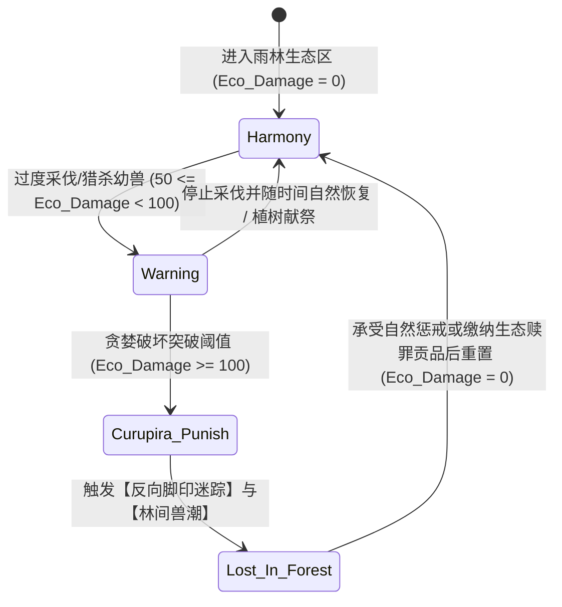

# 亚马逊雨林动物与传说怪物图鉴指南（按场景分布）

> 本文档基于**亚马逊 8 种真实动物与 2 大民间传说**整理，结合其生活生态、习性机制与文化背景，按照**雨林四大生境场景**（河流/深水湖泊、水陆浅滩与湿地、地面落叶层与低矮灌木、雨林林冠与林间迷域）进行场景化归档与展示。可作为游戏生态地图构建、区域怪兽设计、遇敌机制与图鉴系统的参考资料。

---

## 场景一：深水河流与泛滥湖泊（Deep Waters & Flood Lakes）

> **场景特征**：缓流水域、雨林主干支流、季节性泛滥湖泊。水质浑浊或富含腐殖质，潜伏着凭借特殊感官或庞大体量主宰水域的古老生物。

```
[场景图示]
~~~~~~~~~~~~~~~~~~~~~~~~~~~~~ 水面
      [电鳗] (感知/电击区)
   <><   <>< [食人鱼群] (撕咬/食腐)
~~~~~~~~~~~~~~~~~~~~~~~~~~~~~
 [巨骨舌鱼] (底层游弋/浮水换气)
============================= 河床
```

### 1. 电鳗 (Electric Eel)
* **分类属性**：真实生物 / 淡水鱼类（裸背电鳗目）
* **场景定位**：深水与缓流区隐匿者、电磁感知哨兵
* **生态本领与机制**：
  * **电器官放电**：拥有专门的电器官，分为弱电与强电模式。
    * **弱电（侦测/交流）**：用于在昏暗混浊水体中导航、探测周围环境与生物。
    * **强电（捕猎/防卫）**：强放电瞬间可达数百伏特，能击晕猎物或击退掠食者。
* **实际风险与误区澄清**：
  * **误区**：认为电鳗是让整条河流持续带电的无限电源。
  * **事实**：需根据接触距离、接触介质与刺激程度判断风险。切勿触摸、抓捕或刺激电鳗。
* **游戏化设计参考**：
  * **特性**：自带“电荷充能”状态，进入防御姿态时对近战攻击者施加反伤/麻痹判定；常态释放声呐波探隐。

---

### 2. 食人鱼 (Piranha / 红腹食人鱼)
* **分类属性**：真实生物 / 脂鲤科淡水鱼
* **场景定位**：水域清道夫、群聚巡游怪
* **生态本领与机制**：
  * **利齿与撕咬**：下颌力量极大，牙齿呈三角形交错排列，极为锋利。
  * **食性广泛**：以鱼鳍、鱼肉、小鱼、落水昆虫为食，兼具积极的动物尸体清理（食腐）作用，也会摄食部分水生植物。
* **实际风险与误区澄清**：
  * **误区**：“人畜一入水便在几秒内被群鱼啃成森森白骨”。
  * **事实**：大部分野外咬伤为单次防卫性咬击（多发生在护卵筑巢期或极度枯水期食物匮乏时），并非无差别嗜血追猎。
* **游戏化设计参考**：
  * **特性**：群聚攻击、低生命值单位流血斩杀加成；在巢穴附近触发高警戒警戒圈。

---

### 3. 巨骨舌鱼 (Arapaima / 巨龙)
* **分类属性**：真实生物 / 骨舌鱼目巨骨舌鱼科
* **场景定位**：古老巨型水怪、水体巡游霸主
* **生态本领与机制**：
  * **庞大体型与坚甲**：体长可达近 3 米，体表覆盖致密重叠的坚韧硬鳞，具有出色的天然防御。
  * **鳔呼吸适应**：能定期浮出水面吞咽空气呼吸，适应高温缺氧的泛滥洼地与死水湖。
  * **吸入式捕食**：以其他鱼类为主食，摄食时张开大口产生强力水流负压将猎物吸入口中。
* **实际风险与误区澄清**：
  * **误区**：因外形近似“史前巨兽”而被传为专门袭击人类的水怪。
  * **事实**：主要以鱼类为食，厚重鳞片和庞大体型为生存适应，无主动猎人记录。
* **游戏化设计参考**：
  * **特性**：高物理防御护甲、定期浮出水面的“换气破绽期”、大范围水流吸附控制技。

---

## 场景二：水陆交界、浅滩与沼泽湿地（Margin Swamps & Shallows）

> **场景特征**：浅而缓慢的泥泞水流、红树林根系、草泽湿地。这里是两栖潜伏杀手的温床，陆地与水生生态在此高度重叠。

```
[场景图示]
       [浅滩芦苇丛/泥潭]
     -------------------
     [绿森蚺] (水底潜伏/巨躯缠绕)
     [黑凯门鳄] (半潜巡视/雷霆伏击)
     ~~~~~~~~~~~~~~~~~~~
```

### 4. 绿森蚺 (Green Anaconda)
* **分类属性**：真实生物 / 蚺科水蚺属
* **场景定位**：潜伏巨蟒、绞杀型伏击者
* **生态本领与机制**：
  * **粗壮巨躯与水性**：体型粗壮庞大，擅长在浅水泥沼中潜行与藏匿。
  * **无毒绞杀**：不含毒素，凭借强悍的躯体肌肉环环缠绕使猎物窒息并阻断血液循环，成体可捕食水豚甚至凯门鳄。
* **实际风险与误区澄清**：
  * **误区**：电影中的狂暴巨蟒把人类当作日常主食一路追击吞食。
  * **事实**：可信的人类遭野生成年水蚺攻击吞食的记录极少。但因体型巨大，观察探索时必须留出安全距离，切忌围堵。
* **游戏化设计参考**：
  * **特性**：隐匿伏击、单体高爆发控制（“死亡缠绕”持续压制与窒息伤害，需要队友打断）。

---

### 5. 黑凯门鳄 (Black Caiman)
* **分类属性**：真实生物 / 短吻鳄科短吻鳄亚科
* **场景定位**：湿地顶级捕食者、岸线潜伏巨鳄
* **生态本领与机制**：
  * **体型优势与暗色伪装**：成年个体体长可超 5 米，暗黑色鳞甲在昏暗水流和夜色中具有极佳伪装效果。
  * **强大咬合力与多变食谱**：捕食鱼类、水龟、大型哺乳动物，甚至水豚与幼年水生掠食者。
* **实际风险与误区澄清**：
  * **误区**：电影式的凶暴嗜血怪兽。
  * **事实**：体型巨大且具备确切的伤人记录，尤其在靠近巢穴、近岸浅水区时极具威胁，必须保持安全距离。
* **游戏化设计参考**：
  * **特性**：“半潜伏”伪装姿态，出其不意发起冲刺撕咬；近身带有“死亡翻滚”撕裂流血效果。

---

## 场景三：地面落叶层、灌木与密林树冠（Forest Floor & Canopy）

> **场景特征**：密不透风的雨林底层，堆积着厚重的湿润落叶与腐木；中层树干与顶层树冠阳光斑驳。微型毒物与顶尖猛兽在此共存。

```
[场景图示]
 [树冠/林木上层]  --> [美洲豹] (攀爬/高空扑杀)
 [低矮植物/落叶]  --> [箭毒蛙] (警戒色/神经剧毒)
 [地表洞穴/落叶堆] --> [巨人食鸟蛛] (地穴潜伏/刺激刚毛)
```

### 6. 美洲豹 (Jaguar)
* **分类属性**：真实生物 / 猫科豹属
* **场景定位**：雨林全域霸主、暗影潜行刺客
* **生态本领与机制**：
  * **全地形适应**：身体结实，精通攀树与水下游泳，是水陆两栖的全能猛兽。
  * **致命头骨咬合**：捕猎主要依靠潜行接近与伏击，咬合力冠绝大型猫科，能直接咬碎龟甲与凯门鳄头骨。
* **实际风险与误区澄清**：
  * **误区**：见人即扑杀的野蛮凶兽。
  * **事实**：对人保持戒心，攻击能力极强但极少主动跟踪捕食健康成年人。野外不可为拍摄或观察而步步紧逼。
* **游戏化设计参考**：
  * **特性**：高敏捷潜行隐身、树冠/地面跳跃突袭、穿透护甲的“粉碎之咬”。

---

### 7. 巨人食鸟蛛 (Goliath Bird-eating Spider)
* **分类属性**：真实生物 / 蛛形纲捕鸟蛛科
* **场景定位**：底层地穴伏击者、毒刺防御怪
* **生态本领与机制**：
  * **巨大体躯与地穴栖居**：足展可达近 28 厘米，日间隐于地面泥洞，夜间在厚重落叶堆中搜寻昆虫与小动物。
  * **螯肢与踢毛防御**：受到威胁时扬起前肢露出螯牙恐吓，并用后足踢出腹部带有倒钩与致敏成分的刺激性刚毛。
* **实际风险与误区澄清**：
  * **误区**：“鸟类是其日常主食”、“触碰即暴毙”。
  * **事实**：“食鸟”多属偶发记录，其毒液对人类多为局部疼痛肿胀，但刚毛进入呼吸道或眼睛会引起剧烈过敏与刺痛。
* **游戏化设计参考**：
  * **特性**：近身地穴陷阱、受到威胁时释放范围致盲与持续瘙痒/减速负面状态（踢毛）。

---

### 8. 箭毒蛙 (Poison Dart Frog)
* **分类属性**：真实生物 / 两栖纲箭毒蛙科
* **场景定位**：微型致命毒物、活体警示标志
* **生态本领与机制**：
  * **警戒色与皮肤毒素**：体色鲜艳夺目（黄、蓝、红等亮丽色彩），皮肤分泌高活性生物碱毒素。
  * **食物链毒素积累**：野外毒性来自其摄食的特定蚂蚁、螨虫等有毒节肢动物。
* **实际风险与误区澄清**：
  * **误区**：“只要是彩色青蛙一碰就必死”。
  * **事实**：不同种类毒性悬殊，人工饲养个体甚至可能失去毒性。但野外难以肉眼分辨其毒性烈度，严禁徒手触摸。
* **游戏化设计参考**：
  * **特性**：体积极小难以命中、受击对反弹者施加高额叠加中毒 DOT（接触毒性）。

---

## 场景四：密林禁区与远古迷域（Forbidden Canopy & Mythic Depths）

> **场景特征**：未被踏足的雨林腹地、古老原住民敬畏的圣地。这里流传着人与森林关系的古老寓言与超自然怪兽传说。

```
[场景图示]
        [迷雾远古巨木]
             |
   [库鲁皮拉 Curupira]  --> 反向脚印 / 迷失幻境 / 森林戒律
             |
   [马平瓜里 Mapinguari] --> 腥臭恶风 / 腹生大嘴 / 巨爪重甲
```

### 9. 马平瓜里 (Mapinguari)
* **分类属性**：民间传说 / 雨林远古凶兽（相传映射已灭绝的巨型地懒）
* **场景定位**：禁区巨兽、腹口咆哮精英怪
* **传说特征与形象**：
  * **畸形怪异的肉身**：身形高大如巨猿或古熊，浑身覆盖浓密粗硬长毛，力大无穷。
  * **独眼与腹部巨口**：头部生有可怖独眼，长臂利爪，最具标志性的是**在腹部肚脐位置长有一张滴落粘液的血盆大口**。
  * **恶臭迷障**：所到之处散发令人作呕窒息的腐败恶臭，甚至能令猎物眩晕瘫软。
* **文化与现实背景**：
  * 民俗学者推测该传说可能源于远古人类对晚更新世巨型地懒（*Megatherium* 或 *Mylodon*）的集体记忆遗存，但切勿将其当成现存科学发现。
* **游戏化设计参考**：
  * **定位**：区域守门 Boss / 强力重装怪物。
  * **招式**：
    * **恶臭风暴**：大范围削弱敌方命中与攻击力。
    * **腹口吞噬**：腹部大嘴近距离强力吸扯撕咬，造成高额真实伤害。
    * **厚皮长毛**：极高钝击/穿刺抗性，需通过特定弱点（独眼/腹口内部）破防。

---

### 10. 库鲁皮拉 (Curupira)
* **分类属性**：民间传说 / 森林守护灵与自然戒律者
* **场景定位**：森林迷踪守护神、惩戒型中立/敌对 NPC
* **传说特征与形象**：
  * **红发赤足的森林孩童**：外表多为一头火红卷发、身手矫健敏捷的原住民少年/孩童。
  * **反向双脚 (Feet Backwards)**：**脚掌完全朝后生长**。这使得任何跟随脚印追踪他的人都会走向完全相反的方向，在迷宫般的雨林中彻底迷失。
  * **守护神使**：常骑乘野猪穿行树林，会敲击树干测试树木是否能抵御即将到来的风暴。
* **文化与现实背景**：
  * 并非单纯嗜杀的凶残怪物，而是雨林的守护神。他专门惩戒那些**过度砍伐树木、猎杀怀胎动物、贪婪破坏平衡**的人，体现了原住民对自然法则的敬畏。
* **游戏化设计参考**：
  * **定位**：奇遇守护者 / 场景机制怪（反规则机制）。
  * **招式/机制**：
    * **迷踪步（反向印记）**：使玩家的方向输入反转，或在小地图上制造虚假路径引导至荆棘陷阱。
    * **自然惩戒**：若玩家在当前区域过度清剿野生动物或采集资源，库鲁皮拉将会现身召唤林间兽潮进行压制惩罚。

---

## 五、场景遇敌与特征汇总矩阵

| 场景划分 | 生物/传说怪物 | 真实/传说 | 核心生态武器/本领 | 危险评级 | 电影误区 vs 现实事实 |
|---|---|---|---|---|---|
| **深水与湖泊** | 电鳗 | 真实 | 弱电感知、强电数百伏击晕 | ★★★☆☆ | 误以为通电整条河；实为近距离自卫与捕食 |
| **深水与湖泊** | 食人鱼 | 真实 | 锋利三角形牙齿、群聚撕咬食腐 | ★★☆☆☆ | 误以为几秒啃成白骨；实多为偶发自卫单次咬伤 |
| **深水与湖泊** | 巨骨舌鱼 | 真实 | 厚重鳞甲、吸入式捕食、浮水换气 | ★★☆☆☆ | 误以为史前水怪吃人；实为食鱼巨鱼无主动伤人 |
| **浅滩与沼泽** | 绿森蚺 | 真实 | 水底潜行、肌肉粗壮绞杀窒息 | ★★★★☆ | 误以为沿途追吞人类；实为可信伤人吞人记录极少 |
| **浅滩与沼泽** | 黑凯门鳄 | 真实 | 暗色伪装、超过 5 米巨躯、强咬合 | ★★★★★ | 误以为电影无脑嗜血；实为岸边与巢穴极度危险需敬畏 |
| **密林与灌木** | 美洲豹 | 真实 | 水陆树三栖、潜行伏击、咬穿头骨 | ★★★★★ | 误以为见人就猎杀；实为高智能猫科，保持安全距离 |
| **密林与灌木** | 巨人食鸟蛛 | 真实 | 地穴伏击、螯牙恐吓、腹部刺激刚毛 | ★★☆☆☆ | 误以为鸟类为主食见即死；实为踢毛刺激过敏为主 |
| **密林与灌木** | 箭毒蛙 | 真实 | 警戒色、皮肤分泌神经生物碱毒素 | ★★★☆☆ | 误以为碰触即死；实为食性积累毒性且品类悬殊 |
| **远古禁区** | 马平瓜里 | 传说 | 浓密长毛、独眼利爪、腹生巨口、恶臭 | ★★★★★ | 远古巨型地懒传闻映射；非现代生物学实体 |
| **远古禁区** | 库鲁皮拉 | 传说 | 红发反向脚印、林间迷踪、守护戒律 | ★★★★☆ | 守护自然惩戒贪婪之神；非食人凶兽，展现自然敬畏 |

---

## 六、参考资料与溯源链接

1. **亚马逊地理与生态背景**：WWF · The Amazon (`https://www.wwf.org.uk/learn/places/amazon`)
2. **绿森蚺**：史密森尼国家动物园 · Green anaconda (`https://nationalzoo.si.edu/animals/green-anaconda`)
3. **黑凯门鳄**：IUCN 鳄类专家组 · Caimans (`https://www.iucncsg.org/pages/Caimans`)
4. **美洲豹**：圣迭戈动物园 · Jaguar (`https://animals.sandiegozoo.org/animals/jaguar`)
5. **电鳗**：史密森尼国家动物园 · Electric eel (`https://nationalzoo.si.edu/animals/electric-eel`)
6. **红腹食人鱼**：史密森尼国家动物园 · Red-bellied piranha (`https://nationalzoo.si.edu/animals/red-bellied-piranha`)
7. **巨骨舌鱼**：史密森尼国家动物园 · Creature Feature 2024 (`https://nationalzoo.si.edu/animals/news/creature-feature-meet-freshwater-giant-arapaima`)
8. **巨人食鸟蛛**：圣迭戈动物园 · Goliath bird-eating spider (`https://sdzwildlifeexplorers.org/animals/goliath-bird-eating-spider`)
9. **箭毒蛙**：史密森尼国家动物园 · Poison frogs (`https://nationalzoo.si.edu/animals/poison-frogs`)
10. **马平瓜里传说**：MultiRio · Mapinguari (`https://multi.rio/index.php/conteudo-geral/13067-mapinguari`)
11. **库鲁皮拉传说**：MultiRio · Curupira (`https://multi.rio/index.php/conteudo-geral/13064-curupira`)
12. **食人鱼伤人模式**：Haddad & Sazima · Piranha Attacks on Humans in Southeast Brazil 2003 (`https://journals.sagepub.com/doi/10.1580/1080-6032(2003)14%5B249:PAOHIS%5D2.0.CO;2`)

---

## 七、四大雨林生境游戏化数值参数与状态机制表

为将上述 **8 种亚马逊真实动物**与 **2 大原住民传说生物**接入游戏生态地图与《VOL.17 跨世界 500 Boss 与 1000 小怪考据总表》体系，以下定义各单位的生境遇敌权重、核心战斗状态机参数及跨卷考据编号映射：

| 生态编号 | 生物/传说名称 | 所属生境层 | 定位与《VOL.17》映射 | 核心被动 / 触发条件 | 标志性技能与数值效果 | 弱点与生态反制手段 |
| :---: | :--- | :--- | :--- | :--- | :--- | :--- |
| `AMZ-01` | **电鳗**<br>*(Electric Eel)* | 场景一：深水河流与泛滥湖泊 | 精英哨兵<br>映射 `B0102`（电鳗） | **【弱电声呐】**：每回合脉冲扫描，破除半径 6 格内所有敌方【隐匿/潜行】状态 | **【高压放电】**：受近战物理攻击时 45% 概率触发反伤（雷属性 120 倍率）并附加 1 回合【麻痹】 | 绝缘装备、远程物理或土/木属性法术攻击（不触发近战导电反伤） |
| `AMZ-02` | **红腹食人鱼**<br>*(Piranha)* | 场景一：深水河流与泛滥湖泊 | 群聚巡游怪（3~6 只编队） | **【血腥嗅觉】**：场上存在带有【流血】或 HP `< 30%` 的目标时，行动速度（SPD）提升 35% | **【交错撕咬】**：单体物理连击；若目标已处于【流血】态，暴击率额外 `+40%` | 仅在枯水期洼地或巢穴警戒圈内主动追击；使用群体雷/冰法术可快速驱散鱼群 |
| `AMZ-03` | **巨骨舌鱼**<br>*(Arapaima)* | 场景一：深水河流与泛滥湖泊 | 水体巨型重甲怪 | **【致密硬鳞】**：常态物理减伤 `+50%`；每 3 回合必须执行一次【浮水换气】 | **【负压吞吸】**：将全体前排拉拽至近身并造成水属性冲击；**【浮水换气】**期间物理减伤归零 | 抓住每 3 回合一次的【浮水换气】破绽窗口集中物理爆发 |
| `AMZ-04` | **绿森蚺**<br>*(Green Anaconda)* | 场景二：水陆浅滩与沼泽湿地 | 伏击控制精英<br>映射 `B0100`（绿森蚺） | **【泥沼潜伏】**：开场自带【隐匿】，首回合伏击命中率 `+50%` | **【无毒死亡缠绕】**：单体压制控制（无法行动，每回合损失 18% 最大 HP 的窒息伤害，不含毒素） | 缠绕期间对绿森蚺造成单次超过其 8% 最大 HP 的重击即可强制打断解救队友 |
| `AMZ-05` | **黑凯门鳄**<br>*(Black Caiman)* | 场景二：水陆浅滩与沼泽湿地 | 湿地顶级捕食者<br>（参考 `B0096/B0097` 鳄类） | **【暗鳞半潜】**：夜间或浅水格内闪避率 `+25%`，靠近巢穴 4 格内必定先制攻击 | **【死亡翻滚】**：高倍率单体咬合（无视 25% 护甲）并附加 3 回合重度【撕裂流血】 | 火/光属性照明可破除【暗鳞半潜】加成；保持岸线安全距离远程消耗 |
| `AMZ-06` | **美洲豹**<br>*(Jaguar)* | 场景三：地面落叶层与树冠 | 区域霸主 / 刺客首领<br>映射 `B0085`（美洲豹） | **【水陆树三栖】**：无视水域、沼泽与林冠高低差移动惩罚 | **【颅骨粉碎之咬】**：从树冠隐身跃下，对单体造成 220% 穿甲物理伤害（无视护盾/龟甲类防御增益） | 布置地面陷阱或使用声呐/照明技能提前破除其树冠潜行态 |
| `AMZ-07` | **巨人食鸟蛛**<br>*(Goliath Spider)* | 场景三：地面落叶层与树冠 | 地穴陷阱怪 | **【泥洞伏击】**：夜间活跃度（攻击/速度）提升 20%；日间缩入地穴防御翻倍 | **【刺激刚毛踢射】**：受威胁时对扇形范围释放倒钩刚毛，附加 2 回合【致盲（命中-40%）】与【过敏减速】 | 佩戴面罩/护目镜饰品可完全免疫【刺激刚毛】的致盲与过敏效果 |
| `AMZ-08` | **箭毒蛙**<br>*(Poison Dart Frog)* | 场景三：地面落叶层与树冠 | 微型警戒毒物 | **【警戒色皮肤生物碱】**：体型微型（物理闪避 `+40%`）；任何徒手/近战接触攻击者必定染毒 | **【生物碱反噬】**：近战攻击箭毒蛙的单位叠加 1 层【神经剧毒】（每层每回合扣除 8% HP，最高 3 层） | 严禁徒手或近战搏击；使用非接触式魔法或远程投射物可无伤清除 |
| `AMZ-09` | **马平瓜里**<br>*(Mapinguari)* | 场景四：密林禁区与远古迷域 | 禁区守门 Boss<br>原型映射 `B0077`（大地懒） | **【厚皮长毛】**：正面钝击与穿刺伤害减免 `65%`；仅【独眼】与【腹部巨口】为有效弱点 | **【腐臭恶风】**：全场命中率与攻击力 `-25%`；**【腹口吞噬】**：腹部巨口张开时造成高额真实伤害 | 在其施放【腹口吞噬】张开腹部大口或露出独眼破绽时，集中攻击弱点触发破防瘫痪 |
| `AMZ-10` | **库鲁皮拉**<br>*(Curupira)* | 场景四：密林禁区与远古迷域 | 森林守护灵 / 戒律机制 Boss | **【自然戒律】**：默认处于**中立观察态**；仅当区域生态破坏值 `Eco_Damage >= 100` 时转入敌对惩戒态 | **【反向脚印迷踪】**：反转玩家十字键移动方向 15 秒并混淆小地图路径；**【林间兽潮】**：召唤野猪与雨林百兽协战 | 遵守雨林生态戒律（不滥砍林木、不猎杀带幼崽动物）即可保持中立甚至获得其指路赐福 |

---

## 八、生态戒律状态机与验收标准（Acceptance Criteria）

### 8.1 亚马逊雨林「生态破坏值 (`Eco_Damage`)」与库鲁皮拉触发状态机



### 8.2 验收标准（Acceptance Criteria）

- **AMZ-AC-01（科学事实与考据红线）**：图鉴 UI 与怪物百科中必须保留每一种真实动物的“电影误区 vs 现实事实”对照栏（如食人鱼并非几秒啃成白骨、电鳗并非令整条河持续带电、绿森蚺无毒且极少主动吞食人类），严禁将真实保护动物描述为“天生嗜血邪恶怪兽”。
- **AMZ-AC-02（巨骨舌鱼换气破绽循环）**：`AMZ-03` 巨骨舌鱼在战斗中第 1、2 回合保持 `50%` 物理减伤，第 3 回合强制执行【浮水换气】动作且当回合物理减伤降为 `0%`，第 4 回合恢复硬鳞减伤，循环往复。
- **AMZ-AC-03（箭毒蛙接触毒性判定）**：使用近战武器或徒手攻击 `AMZ-08` 箭毒蛙时必定触发皮肤生物碱反噬叠加【神经剧毒】；使用弓箭、投掷或魔法等非接触攻击时不得触发接触中毒。
- **AMZ-AC-04（库鲁皮拉中立与惩戒切换）**：当玩家在雨林区域的 `Eco_Damage < 100` 时，`AMZ-10` 库鲁皮拉保持非敌对状态，不可被恶意锁血击杀；当 `Eco_Damage >= 100` 时自动切入迷踪惩戒事件并施加方向反转 Debuff。

