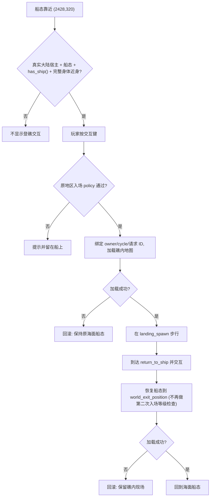

# 坠星礁探索区域首版方案

状态：真人已选择候选①，并明确答复“按方案实施（推荐）”，本首版设计已获准实施。批准时尚未生成图片或修改运行代码。

## 目标与来源

新增能实际进入、步行调查、保存恢复并返回海域的坠星礁。真人本次选择包含本区域配套图片；这不解除其它区域、人物、音频或战斗资产的原限制。

原地名册的 `loc_ruin_meteor` 为东曜海北 `(2380,320)` 的坠星礁；它与东曜海南 `(2480,1600)` 的 `loc_meteor_sea`“陨石坠海”是不同地点，不合并身份。当前正式地图目录未注册前者。

## 采用方式与取舍

- 已选择：独立礁岛子地图、现有船只近身登礁、原路返海。能同时交付新场景与探索交互。
- 未选择：只绘制世界海标，不能提供岛内探索。
- 未选择：同步建设潜艇、深海氧气、地下层及新首领；这些会扩展本次玩法和数值范围。

## 玩家流程

1. 沿用当前 `has_ship()` 船只资格及原航行规则，不再追加章节、等级硬门或收费。现有统一地区入场规则继续适用，不通过给角色补等级绕过。
2. 世界海标保持地名册 `(2380,320)`。该点靠近现岸线，不能直接假设船的完整身体可达；建议在其东侧 `(2428,320)` 设置明确的“坠星礁登岸”交互点和返回船位。此偏移是本方案新增适配，不是原稿坐标；实施须核完整船体净空，若不成立先修订方案，不改大陆岸线或放宽全局通行。
3. 仅当前真实大陆宿主、真实船态、具备船只资格且身体近身时，新独立交互键/点击才登礁。原普通城镇仍要求下船，不能全局放开 `can_enter_scene()`。
4. 在一张 `1280×960` 独立子地图步行，从南侧登岸空地进入，沿环形岩路绕过中央坠星坑；中央坑体、外侧海水及完整礁壁不可穿行。
5. 设置三处可反复调查的景物：登岸潮痕、坑缘碎石、中央陨石残骸的可达观察边缘。仅描述眼前可见事实，不编造水晶来源、古代历史或新主线。调查可取消，无收费、物品、战斗或完成任务奖励。
6. 从南侧“返回停泊船只”明确离开，恢复真实船态与已验证的东侧海面落点；离开入口圈后才能再次触发，避免自动往返。

## 视觉交付

沿现有俯视地图风格，以人鱼湾海岸、泰昆坑景和大陆水面为参考。海水、基础地砖和原角色复用；新生成两类透明环境图片：海蚀礁壁组合、陨石坑与残骸组合。原始稿、提示词、来源参考及处理元数据保留。运行图按现有最近邻缩放与脚点规则接入；切图尺寸、锚点和完整碰撞须依真实生成图冻结，不用缩碰撞凑路径。

采用分层地砖与道具拼装，保留可行走区，不把一张完整画面充当可玩的地图。光暗两界沿原世界配色与调制，不额外生成两套地图。生成稿先展示，技术导入或私运行不冒称真人视觉批准。

## 返回、存档与隔离

复用原 PartyMenu、SavePage、LoadSave 与现有场景恢复链；礁内角色以步行显示和碰撞运行，世界船态 `ship` 仅作为停泊/返回上下文。目录使用 `world_unlock: "ship"` 及明确 `world_exit_position`，初定为上述 `(2428,320)`，不让通用南偏 `+88` 落点接管返海。不得凭临时 Node 引用或只在内存中的票据实现存档后的返海。优先复用既有 `world_travel_mode`、世界坐标与 `current_story_map_id`，只在确证不够时提出最小新状态，不先迁移 schema。

新环境必须提供与完整碰撞一致的 `resolve_spawn()`：合法礁内保存位置保持，非法位置只退到已验证登岸点，不能把冷读一概重置到入口或放入坑体。共用地图的实际 ready 与保存安全回退均需覆盖，不将存在通用 API 当作本区域恢复已经通过。

登岸与返海接点须绑定真实宿主、owner/cycle、原场景和独立请求，拒绝过期回调；失败回滚应保留原现场，不把船态步行放在海水中。拒绝无船/飞空艇/黑陆行鸟借此入口绕过原规则。正常保存、冷读和菜单返回均须恢复礁内位置及安全返海能力。

实施交界裁定：现世界海区原入场策略为Lv13–16，旧有船低等级档合法登礁后若返海再过一次新入场门，会被困在礁内。管理采实施者推荐，仅本区返海作为恢复已验证停泊上下文，不再执行第二次新地区入场等级检查；新登礁仍过原policy，通用城镇/其它返图/任意坐标规则不变。不补角色等级、不新加Lv13登礁门。实际固定海位完整身体/当前真实礁根、ship资格与owner/cycle/请求有效性仍必须核，加载失败回滚礁内现场。这是防止进得去回不来的局部恢复语义，须有准确低级合法ship私例验证，不代表旧海域矩阵重测。

## 改动边界

独立地图环境、视觉 JSON、调查数据与登岸适配；中央目录、世界入口、共用地图安装点和地区百科按精确路径串行认领。原海岸、载具速度、既有港口、自然遇敌、主线、悬赏和陨石坠海身份保持。场内为无战斗探索区，不新增宝箱奖励、晶石事件、人物、音乐或自然战斗/Boss 运行。

## 验收

- 核新图透明边缘、原风格、显示尺寸与完整碰撞；实际展示整景截图。
- 原身体能从登岸点走到三处调查位置并返回，不能踩海水/坑底/穿礁壁，点击路线可达。
- 实际船态近身登礁及返海，错误载具拒绝，旧 owner/退树回调无效；原港口/城镇准入不扩大。
- 独立私槽保存与新进程实际恢复、菜单取消返回、调查取消和重复进入；数据库实际开闭，原档/seed及无关游戏状态不受影响。
- Godot 串行锁、仓库外私验证、原红与警告保真；仅本人路径本地提交，不 push，不恢复旧 tests/GUT。

实现与验证分阶段，不把合成前置或局部海路私运行称为从新游戏自然开船到达。现有十三聊天的定向监听继续，选定实施后在当前聊天内安排实际工作，不额外创建第十六个聊天。

## 只读可实现性审阅

独立审阅未发现需要新增产品规则的架构阻断，已补明确返海坐标和礁内落点解析两项。当前岸线在 `y=320` 附近约为 `x=2391`，东侧候选点为静态几何建议；没有执行完整船体/海路/引擎或素材视觉验证，不能将审阅作为运行验收。


---

## 附录 A：礁内布局与调查点数据草案

> 本附录只把上文已批准的范围细化为可实施的数据结构。所有坐标均为 `1280×960` 子地图内的**建议值**，须在真实生成图与完整碰撞冻结后复核；不新增奖励、战斗、人物、音乐或主线信息。

### A.1 区域分区（建议值）

| 分区 ID | 名称 | 大致矩形 (x, y, w, h) | 可行走 | 说明 |
| :--- | :--- | :--- | :---: | :--- |
| `zone_landing` | 南侧登岸空地 | (520, 780, 240, 140) | ✔ | 入场落点与返回停泊船只交互点所在 |
| `zone_ring_path` | 环形岩路 | 环绕中心，路宽约 96 | ✔ | 唯一可行走通道 |
| `zone_crater` | 中央坠星坑 | 圆心 (640, 440)，半径约 180 | ✘ | 坑体完整碰撞，不可进入 |
| `zone_reef_wall` | 外圈海蚀礁壁 | 地图外缘 | ✘ | 完整碰撞 |
| `zone_sea` | 外侧海水 | 礁壁之外 | ✘ | 不可行走 |

### A.2 三处调查点

| 调查点 ID | 位置描述 | 建议坐标 | 触发半径 | 可重复 | 文本原则 |
| :--- | :--- | :--- | :---: | :---: | :--- |
| `inspect_tide_mark` | 登岸潮痕 | (600, 800) | 48 | ✔ | 只描述潮水留下的痕迹、湿润岩面 |
| `inspect_crater_rubble` | 坑缘碎石 | (820, 470) | 48 | ✔ | 只描述碎石形状、颜色、散布 |
| `inspect_meteor_edge` | 中央陨石残骸可达观察边缘 | (640, 640) | 56 | ✔ | 只描述从岩路边缘能看到的残骸外观 |

调查文本示例（仅可见事实，不涉及来源或历史）：

- 潮痕：「岩面上留着一道道深浅不一的水痕，最高的一道比现在的海面高出许多。」
- 碎石：「坑缘散落着边角锐利的黑色碎石，越靠近坑口越密集。」
- 残骸：「坑底中央躺着一块表面焦黑、布满气孔的巨大岩块。」

### A.3 调查数据 JSON 草案

```json
{
  "map_id": "loc_ruin_meteor",
  "world_unlock": "ship",
  "world_exit_position": [2428, 320],
  "landing_spawn": [640, 840],
  "inspections": [
    { "id": "inspect_tide_mark", "pos": [600, 800], "radius": 48, "text_key": "ruin_meteor.tide_mark" },
    { "id": "inspect_crater_rubble", "pos": [820, 470], "radius": 48, "text_key": "ruin_meteor.crater_rubble" },
    { "id": "inspect_meteor_edge", "pos": [640, 640], "radius": 56, "text_key": "ruin_meteor.meteor_edge" }
  ],
  "exit_point": { "id": "return_to_ship", "pos": [640, 900], "radius": 40, "rearm_distance": 80 }
}
```

- 调查不写入任何奖励、任务或计数字段；`text_key` 走现有 i18n 字典。
- `rearm_distance`：离开返回点 80 像素后才重新允许触发，对应正文「离开入口圈后才能再次触发」。

---

## 附录 B：登礁 / 返海流程与拒绝条件



| 拒绝场景 | 期望结果 |
| :--- | :--- |
| 徒步 / 黄色陆行鸟靠近 | 无登礁交互 |
| 飞空艇 / 黑色陆行鸟靠近 | 无登礁交互，不能借此入口绕过原规则 |
| 过期 owner / cycle 回调 | 丢弃，不切场景 |
| 登礁中途关闭菜单 / 取消 | 保持原海面船态 |

---

## 附录 C：测试用例清单

| 编号 | 场景 | 步骤 | 期望 |
| :--- | :--- | :--- | :--- |
| RMR-T01 | 正常登礁返海 | 船态近身 → 登礁 → 走到返回点 → 返海 | 回到 (2428,320) 船态 |
| RMR-T02 | 三处调查 | 依次触发三处调查并取消一次 | 文本正确，取消无副作用，可再次调查 |
| RMR-T03 | 碰撞 | 尝试走入坑体、海水、礁壁 | 全部被阻挡 |
| RMR-T04 | 礁内存档冷读 | 礁内存档 → 退出进程 → 读档 | 位置保持，可正常返海 |
| RMR-T05 | 非法坐标冷读 | 手改存档坐标到坑体内 → 读档 | 回退到登岸点，不是入口外或坑内 |
| RMR-T06 | 低等级合法船档 | Lv13 以下合法船档登礁 → 返海 | 返海不被二次等级检查困住 |
| RMR-T07 | 错误载具 | 飞空艇 / 黑鸟靠近 | 无交互 |
| RMR-T08 | 防自动往返 | 返海后立即靠近登礁点 | 需离开触发圈后才可再次登礁 |
| RMR-T09 | 无关状态隔离 | 登礁返海前后对比存档 | 除位置与地图上下文外无字段变化 |
