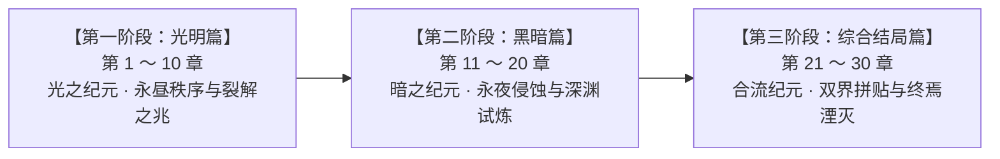

# 全 30 章节架构与场景生成规则规范 (Chapter & Scene Generation Spec)

> **设计定位与核心法则**：  
> 本规范统摄游戏全 30 章节的宏观大篇章划分、微观章节光暗交替流转逻辑，以及基于此规则驱动的地图场景动态生成与渲染规范。  
> 游戏主线承载核心灵魂：光与暗双线视点交错并进、黄昏合流、终焉决战。

---

## 一、宏观三大阶段划分 (Macro Progression Eras)

整个游戏主线严格规划为 **全 30 章节**，划分为三大宏观篇章阶段：



| 阶段 | 章节区间 | 篇章名称 | 世界舞台 | 核心叙事主题与世界状态 |
| :--- | :--- | :--- | :--- | :--- |
| **阶段一** | **第 1 ～ 10 章** | **光明篇** (Light Era) | 第一世界<br/>（永昼大陆） | 晨辉王命、神殿异变、世界一分为二。光之战士启程，暗之战士突围；初探龙栖岭、迷雾林、海角港口与烬堡废墟，秩序开始摇摇欲坠。 |
| **阶段二** | **第 11 ～ 20 章** | **黑暗篇** (Dark Era) | 第二世界<br/>（永夜大陆） | 帝国黑甲兵团压境、言昭表面牺牲、织造城工坊人体核心试验、沙月城游击与地下剧场、古王国遗迹挖掘与影乡寄生。暗之深渊与背叛交织。 |
| **阶段三** | **第 21 ～ 30 章** | **综合结局篇** (Merged & Finale Era) | 第三世界<br/>（融合世界 / 虚无裂隙） | 浮空秘法都米希迪亚、半面真相昭示、黄昏重逢（八人正式合流）；双界地貌拼贴、收集暗物质、铸造新原初晶石、突入永曜空甲帝都，终决战直面真凶言昭与虚无混沌。 |

---

## 二、微观章节交替与场景生成规则 (Micro Interleaved Generation Rules)

为避免单一阵营叙事的审美疲劳，并在关卡与地图生成中呈现强烈的视听对比，游戏在推进中遵循固定的**光暗场景交替生成算法**：

### 2.1 轮替法则公式

$$\mathbf{Pattern:}\quad [1 \text{ 光明}] \;\longrightarrow\; [2 \text{ 黑暗}] \;\longrightarrow\; [2 \text{ 光明}] \;\longrightarrow\; [2 \text{ 黑暗}] \;\longrightarrow\; \cdots$$

- **起点**：第 1 章为 **光明篇** 场景（1 章）。
- **后续周期**：以 **2 章黑暗 $\longleftrightarrow$ 2 章光明** 循环轮替驱动场景生成。
- **转折与终章**：进入第 21 章起，正式步入 **综合结局篇**，场景由单一的“纯光”或“纯暗”演化为**双界融合、黄昏合流与虚无裂隙**复合场景。

### 2.2 全 30 章节光暗属性与场景生成映射总表

| 章号 | 宏观篇章 | 交替轮次 | 章节篇章属性 | 队伍视点 | 场景环境与地貌类型 | 渲染色盘规范 | 核心地图 ID 范例 |
| :---: | :---: | :---: | :---: | :---: | :--- | :--- | :--- |
| **01** | 光明篇 | 轮次 1 (光 1) | **光明篇** | 光之队 | 晨辉王都、神殿原野、启程通路 | 永昼暖金调 (`PALETTE_LIGHT`) | `chen_hui_palace`, `origin_temple` |
| **02** | 光明篇 | 轮次 1 (暗 2) | **黑暗篇** | 暗之队 | 谐律囚牢、外城废墟、帝国边境哨站 | 永夜幽紫调 (`PALETTE_DARK`) | `harmonia`, `harmonia_camp` |
| **03** | 光明篇 | 轮次 1 (暗 2) | **黑暗篇** | 暗之队 | 潜行荒原、帝国飞空艇甲板渗透 | 永夜幽紫调 (`PALETTE_DARK`) | `harmonia_airship` |
| **04** | 光明篇 | 轮次 2 (光 2) | **光明篇** | 光之队 | 龙栖险岭、苍茫山道、飞龙巢穴 | 永昼暖金调 (`PALETTE_LIGHT`) | `longqi_ridge`, `longqi_nest` |
| **05** | 光明篇 | 轮次 2 (光 2) | **光明篇** | 光之队 | 高风之塔、北脊天险、晨曦哨所 | 永昼暖金调 (`PALETTE_LIGHT`) | `gaofeng_tower`, `north_ridge` |
| **06** | 光明篇 | 轮次 2 (暗 2) | **黑暗篇** | 暗之队 | 迷雾幽林、永夜世界树根须通路 | 永夜幽紫调 (`PALETTE_DARK`) | `maze_wood`, `yggdrasil` |
| **07** | 光明篇 | 轮次 2 (暗 2) | **黑暗篇** | 暗之队 | 枯枝密营、仙林西径、隐秘树窟 | 永夜幽紫调 (`PALETTE_DARK`) | `yggdrasil_roots`, `withered_camp` |
| **08** | 光明篇 | 轮次 3 (光 2) | **光明篇** | 光之队 | 海角港镇、远洋码头、阳光海岸 | 永昼暖金调 (`PALETTE_LIGHT`) | `cape_town` |
| **09** | 光明篇 | 轮次 3 (光 2) | **光明篇** | 光之队 | 人鱼之湾、南湾船闸、蔚蓝浅海 | 永昼暖金调 (`PALETTE_LIGHT`) | `mermaid_bay`, `mermaid_undersea` |
| **10** | 光明篇 | 轮次 3 (暗 2) | **黑暗篇** | 暗之队 | 焦黑残骸、烬堡废墟、焦土前哨 | 永夜幽紫调 (`PALETTE_DARK`) | `ash_keep` |
| **11** | 黑暗篇 | 轮次 3 (暗 2) | **黑暗篇** | 暗之队 | 火矶城外围、黑甲军阵、熔岩暗室 | 永夜幽紫调 (`PALETTE_DARK`) | `ash_keep_inner`, `fire_rock_city` |
| **12** | 黑暗篇 | 轮次 4 (光 2) | **光明篇** | 光之队 | 帝国飞空艇夹层、浮云甲板（表面牺牲）| 永昼暖金调 (`PALETTE_LIGHT`) | `empire_airship`, `airship_deck` |
| **13** | 黑暗篇 | 轮次 4 (光 2) | **光明篇** | 光之队 | 织造城西门、魔导轻工外围、斗技场 | 永昼暖金调 (`PALETTE_LIGHT`) | `factory_city`, `factory_gate` |
| **14** | 黑暗篇 | 轮次 4 (暗 2) | **黑暗篇** | 暗之队 | 织造机密工坊、人体记忆回廊、深层冷库 | 永夜幽紫调 (`PALETTE_DARK`) | `factory_lab`, `memory_hall` |
| **15** | 黑暗篇 | 轮次 4 (暗 2) | **黑暗篇** | 暗之队 | 巨型战舰核心动力室、舰底管道 | 永夜幽紫调 (`PALETTE_DARK`) | `heliogabalus` |
| **16** | 黑暗篇 | 轮次 5 (光 2) | **光明篇** | 光之队 | 沙漠绿洲外围、治外法权都市外街 | 永昼暖金调 (`PALETTE_LIGHT`) | `sand_moon_gate`, `sand_moon_outer` |
| **17** | 黑暗篇 | 轮次 5 (光 2) | **光明篇** | 光之队 | 喧闹市集、沙月华丽舞厅与舞台 | 永昼暖金调 (`PALETTE_LIGHT`) | `sand_moon_stage` |
| **18** | 黑暗篇 | 轮次 5 (暗 2) | **黑暗篇** | 暗之队 | 沙月贫民黑街、地下赌场下水道 | 永夜幽紫调 (`PALETTE_DARK`) | `sand_moon_slum`, `sand_moon_drain` |
| **19** | 黑暗篇 | 轮次 5 (暗 2) | **黑暗篇** | 暗之队 | 古王国废都边陲、风化石林 | 永夜幽紫调 (`PALETTE_DARK`) | `old_kingdom` |
| **20** | 黑暗篇 | 阶段过渡收束 | **黑暗篇** | 暗之队 | 古王陵寝深处、圣堂占领军据点 | 永夜幽紫调 (`PALETTE_DARK`) | `old_kingdom_tomb` |
| **21** | 综合结局篇 | 终局合流篇 | **综合篇** (暗启) | 暗之队 | 影之孤岛、静谧渔村、黑水浅滩 | 永夜幽紫调 (`PALETTE_DARK`) | `shadow_isle` |
| **22** | 综合结局篇 | 终局合流篇 | **综合篇** (暗终) | 暗之队 | 影乡禁地深渊、寄生寄宿石窟 | 幽暗裂变调 (`PALETTE_DARK`) | `shadow_isle_cave` |
| **23** | 综合结局篇 | 终局合流篇 | **综合篇** (合流) | 全队合流 | 浮空秘法都米希迪亚、古代星台 | 黄昏融合调 (`PALETTE_TWILIGHT`) | `mysidia` |
| **24** | 综合结局篇 | 终局合流篇 | **综合篇** (合流) | 全队合流 | 鲁菲尼亚浮岛遗迹、半面镜殿 | 黄昏融合调 (`PALETTE_TWILIGHT`) | `lufenia_ruins` |
| **25** | 综合结局篇 | 终局合流篇 | **综合篇** (合流) | 全队合流 | 黄昏之界断裂带、双界交界原野 | 黄昏融合调 (`PALETTE_TWILIGHT`) | `twilight_world` |
| **26** | 综合结局篇 | 终局决战篇 | **综合篇** (决战) | 自由组队 | 世界八大裂口、撕裂虚空地带 | 裂隙混沌调 (`PALETTE_VOID`) | `world_rifts` |
| **27** | 综合结局篇 | 终局决战篇 | **综合篇** (决战) | 自由组队 | 原初祭坛、新晶石重铸神域 | 超然圣辉调 (`PALETTE_CRYSTAL`) | `new_crystal` |
| **28** | 综合结局篇 | 终局决战篇 | **综合篇** (决战) | 自由组队 | 永曜空甲帝都、魔导主炮核心防线 | 钢铁焦土调 (`PALETTE_EMPIRE`) | `empire_capital` |
| **29** | 综合结局篇 | 终局决战篇 | **综合篇** (决战) | 自由组队 | 次元之隙裂隙海、非之神殿王座 | 虚无深渊调 (`PALETTE_VOID`) | `rift`, `nil_palace` |
| **30** | 综合结局篇 | 终局决战篇 | **综合篇** (决战) | 自由组队 | 终焉虚无核心 $\longrightarrow$ 恢复的始源世界 | 虚无 $\to$ 晨辉重生 | `nil_world` $\to$ `restored_world` |

---

## 三、场景生成与渲染技术标准 (Scene Generation Technical Specs)

根据章节所赋予的属性（`LIGHT` / `DARK` / `MERGED` / `VOID`），场景加载与生成器严格按以下规则对地图实例（如 `story_map.tscn`）应用环境策略：

### 3.1 环境色盘与光影参数 (Visual Palettes)

```gdscript
# 场景生成器色彩调制定义 (CanvasModulate & Lighting)
const PALETTE_CONFIGS := {
    "LIGHT": {
        "modulate": Color(1.05, 1.02, 0.95, 1.0),    # 永昼暖金调，明亮清澈
        "shadow_color": Color(0.18, 0.16, 0.25, 0.45),
        "ambient_light": 1.1,
        "vignette": false,
        "bgm": "res://assets/audio/bgm/world_map_light.mp3",
        "hud_theme": "gold_classic"
    },
    "DARK": {
        "modulate": Color(0.70, 0.68, 0.88, 1.0),    # 永夜幽紫调，神秘幽冷
        "shadow_color": Color(0.08, 0.06, 0.18, 0.70),
        "ambient_light": 0.8,
        "vignette": true,
        "bgm": "res://assets/audio/bgm/world_map_dark.mp3",
        "hud_theme": "dark_runic"
    },
    "TWILIGHT": {
        "modulate": Color(0.95, 0.82, 0.86, 1.0),    # 黄昏重逢调，双界渐变金紫
        "shadow_color": Color(0.14, 0.10, 0.22, 0.55),
        "ambient_light": 0.95,
        "vignette": false,
        "bgm": "res://assets/audio/bgm/twilight_theme.mp3",
        "hud_theme": "twilight_merged"
    },
    "VOID": {
        "modulate": Color(0.55, 0.50, 0.75, 1.0),    # 次元裂隙与虚无终局调
        "shadow_color": Color(0.02, 0.01, 0.08, 0.85),
        "ambient_light": 0.65,
        "vignette": true,
        "bgm": "res://assets/audio/bgm/final_battle_void.mp3",
        "hud_theme": "chaos_abyss"
    }
}
```

### 3.2 场景生成器挂载与执行逻辑

1. **地图根场景承载**：
   - 除专属根场景（宁静村、始源神殿、大地图世界）外，所有章节地图均由 `scene/map/story_map.tscn` 统一动态生成与复用。
2. **章节驱动的自动换肤机制**：
   - 当地图加载时，查询当前章节号对应的 `chapter_type`：
     - 若为 `LIGHT`：自动载入草地绿、暖白石板瓦片贴图，启用朝阳方向光；
     - 若为 `DARK`：自动载入冷紫地衣、深黑玄武岩瓦片贴图，开启夜光薄雾与暗角着色器；
     - 若为 `MERGED`（综合结局篇）：开启拼贴碰撞层，生成浮空断崖与交错陆桥。
3. **队伍视点与控制权切换**：
   - 光明章节：激活 **光之队** 成员与前排模型；
   - 黑暗章节：激活 **暗之队** 成员与前排模型；
   - 综合结局篇（第 21~30 章）：解除队伍锁定，开放 8 人全阵容自由组合。
4. **剧情战役不可逃跑约束**：
   - 任何章节中的剧情 Boss 战役（标有 `encounter_id`），严格锁定不可逃跑（`can_escape = false`），并赋予剧情 Boss 专属光环与高亮血条。

---

## 四、文档与代码对应关系

| 规范项目 | 落地文件 / 配置路径 | 说明 |
| :--- | :--- | :--- |
| **章节与地图总表** | `game/world/STORY_PROGRESSION_AND_MAP_CATALOG.md` | 30 章主线节拍、Boss 与地图定义对照 |
| **运行时剧情与地图** | `gdscripts/scene/world/story_map_data.gd` | 负责根据章号与节拍解析地图入口与状态 |
| **地图配置目录** | `gdscripts/scene/world/story_map_catalog.gd` | 提供每张地图的具体 NPC、传送光圈与地貌类型 |
| **色盘与大地图渲染** | `gdscripts/scene/world/world_map_data.gd` | `get_palette` 负责永昼与永夜色盘切换 |
| **章节与剧情数据** | `json/story/story.json` | 承载各章节主线任务、支线与对话节拍 |
| **自动化章节生成脚本** | `tools/generate_story_chapters.py` | 批量生成/维护 30 章节 JSON 结构的工具 |
