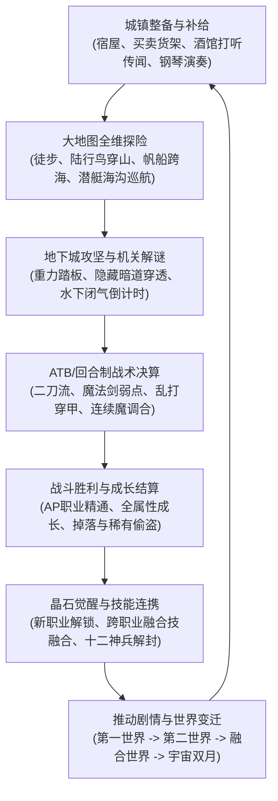

# 最终幻想风格 2D 回合制角色扮演游戏设计总纲大纲 (Master Game Design Document)

## 1. 顶层设计哲学与三大核心支柱 (Core Design Pillars)

本游戏以《最终幻想：传奇 / 时空之轮》(Final Fantasy Dimensions) 与《最终幻想5》(Final Fantasy V) 为核心范本，深度融合《最终幻想4》的宇宙双月宏大叙事与现代 Godot 4.6 2D 引擎技术架构。

```
                    ┌──────────────────────────────────────┐
                    │    核心支柱一：深度晶石与职业进化    │
                    │  48类职业分支 + 跨职业融合技 + 自由人│
                    └──────────────────┬───────────────────┘
                                       │
                    ┌──────────────────┴───────────────────┐
                    │    核心支柱二：全维立体探索与地貌变迁│
                    │  海陆空深海宇宙五维交通 + 世界融合浩劫│
                    └──────────────────┬───────────────────┘
                                       │
                    ┌──────────────────┴───────────────────┐
                    │    核心支柱三：高策略机制Boss战役    │
                    │  多阶段转换 + 属性克制 + 极致穿甲连携│
                    └──────────────────────────────────────┘
```

---

## 2. 核心游玩主循环 (Core Gameplay Loop)



---

## 3. 新世界主干白皮书矩阵与导航索引 (Master Whitepapers Index)

为了彻底解决旧文档体系中 77 份 Markdown 文档存在的碎片化、同题割裂与标准不一问题，新世界架构体系（`news-world/new-world/`）全面重组为 12 大专业白皮书：

| 规范白皮书 | 核心涵盖主题 | 整合的旧世界文档源 (olds-world) |
|---|---|---|
| [`01_WORLD_BIBLE_AND_NARRATIVE_DESIGN.md`](./01_WORLD_BIBLE_AND_NARRATIVE_DESIGN.md) | 双月宇宙观、光暗双线、世界三阶段演变、全 12 章 96 节拍主线大纲、全域 NPC 行为树与过场演出 | `FINAL_FANTASY_DIMENSIONS_DESIGN_DOCUMENT.md`, `STORY_PROGRESSION_AND_MAP_CATALOG.md`, `WORLD_MERGE_AND_LANDSCAPE_SPEC.md`, `WORLD_MAP_COLLISION_AND_TRAVEL_SPEC.md`, `NPC_GUIDE.md`, `DIALOGUE_SCRIPT_AND_CUTSCENE_SPEC.md` |
| [`02_DUNGEON_TOPOLOGY_AND_GLOBAL_LOCATIONS.md`](./02_DUNGEON_TOPOLOGY_AND_GLOBAL_LOCATIONS.md) | 地下城拓扑导航（含后来增补的地狱/冥界层）、水下氧气倒计时、城堡 10 分钟脱出、双子分歧之塔两翼分队、熔岩陷阱。细则以 olds-world 专规为准，不能覆盖 30 章主线原稿 | `WIND_SHRINE_AND_TITAN_PASS_SPEC.md`, `TORNA_CANAL_AND_KARLABOS_SPEC.md`, `WALSE_TOWER_AND_WATER_CRYSTAL_SPEC.md`, `KARNAK_CASTLE_AND_FIRE_SHIP_SPEC.md`, `ANCIENT_LIBRARY_SEALED_VAULT_SPEC.md`, `RONKA_RUINS_AND_EARTH_CRYSTAL_SPEC.md`, `EXDEATH_CASTLE_AND_KELGER_SPEC.md`, `ELDER_TREE_AND_MOORE_FOREST_SPEC.md`, `FORK_TOWER_AND_SPLIT_PARTY_SPEC.md`, `GREAT_SEA_TRENCH_AND_DEEP_OCEAN_SPEC.md`, `SUNKEN_TOWER_AND_OXYGEN_SPEC.md`, `SUBMERSIBLE_TRENCH_AND_UNDERWATER_SPEC.md`, `FLYING_FORTRESS_AND_SKY_SANCTUARY_SPEC.md`, `LUNAR_SUBTERRANE_AND_TWIN_MOONS_SPEC.md`, `DIMENSIONAL_RIFT_AND_VOID_DUNGEON_SPEC.md`, `VOID_CORE_AND_FINAL_BOSS_SPEC.md`, `NETHERWORLD_AND_PANDEMONIUM_HELL_SPEC.md` 等 |
| [`03_BOSS_TACTICS_AND_BESTIARY_ENCYCLOPEDIA.md`](./03_BOSS_TACTICS_AND_BESTIARY_ENCYCLOPEDIA.md) | 14 场核心 Boss 战役多阶段转换与反击轴、吉尔伽美什 8 次宿命战役、欧米茄与神龙隐藏双首领、八岐大蛇破头、怪物 AI 决策树 | `BOSS_GUIDE.md`, `BESTIARY_AND_ENEMIES_CATALOG.md`, `COMBAT_AI_AND_TACTICS_SPEC.md`, `GILGAMESH_ENCOUNTERS_AND_GENJI_SPEC.md`, `SECRET_EX_DUNGEON_AND_SUPERBOSS_SPEC.md`, `ONI_ISLE_AND_YAMATA_DUNGEON_SPEC.md`, `SEALED_TEMPLE_EX_DUNGEON_SPEC.md` |
| [`04_JOB_SYSTEM_AND_GROWTH_ARCHITECTURE.md`](./04_JOB_SYSTEM_AND_GROWTH_ARCHITECTURE.md) | 48 类职业进阶树、二刀流/乱打/连续魔/魔法剑核心被动、全谱系融合技、青魔法 30 门研习、回忆士记忆碎片、突破 255 级平滑成长 | `JOB_SYSTEM_SPEC.md`, `JOB_CAP_BREAK_AND_GROWTH_SPEC.md`, `MEMORIST_SPEC.md`, `FUSION_ABILITIES_SPEC.md`, `BLUE_MAGIC_LEARNING_SPEC.md`, `SUMMONS_AND_EIDOLONS_SPEC.md`, `BEASTMASTER_CAPTURE_AND_RELEASE_SPEC.md`, `THIEF_STEAL_AND_LOOT_SPEC.md`, `TREASURE_HUNTER_AND_STEAL_TABLE_SPEC.md` |
| [`05_EQUIPMENT_REPRESENTATION_AND_MACRO_ECONOMY.md`](./05_EQUIPMENT_REPRESENTATION_AND_MACRO_ECONOMY.md) | 库扎封印之城十二传说神兵、四大远古石板、药师调合配方矩阵、宏观经济金币产销平衡、城镇商店阶梯货架、幻影之村禁忌黑市 | `EQUIPMENT_AND_SHOP_GUIDE.md`, `LEGENDARY_WEAPONS_AND_RELICS_SPEC.md`, `SEALED_TEMPLE_AND_WEAPONS_SPEC.md`, `ANCIENT_SEALS_AND_FOUR_TABLETS_SPEC.md`, `ITEM_CRAFTING_AND_ALCHEMY_SPEC.md`, `ECONOMIC_SYSTEM_AND_DROP_RATES_SPEC.md`, `WANDERING_MERCHANTS_AND_BLACK_MARKET_SPEC.md`, `MIRAGE_VILLAGE_BLACK_MARKET_EXPEDITION_SPEC.md` |
| [`06_TRAVEL_VEHICLES_AND_EXPLORATION_MATRIX.md`](./06_TRAVEL_VEHICLES_AND_EXPLORATION_MATRIX.md) | 全维交通网络（步行、帆船、黄白黑胖四色陆行鸟、潜艇海沟潜航、高空飞空艇机动基地）、迷宫半透暗道穿透、勘探者宝箱雷达、野外宿营 | `AIRSHIP_AND_VEHICLES_EXPEDITION_SPEC.md`, `CHOCOBO_ECOLOGY_AND_TRANSIT_SPEC.md`, `CHOCOBO_FOREST_AND_RANCH_SPEC.md`, `SECRET_CHOCOBO_FORESTS_SPEC.md`, `HIDDEN_PASSAGES_AND_EXPLORATION_SPEC.md`, `TREASURE_RADAR_AND_COMPASS_SPEC.md`, `REST_AND_RECOVERY_SYSTEM_SPEC.md`, `DUNGEON_PUZZLE_AND_MECHANISMS_SPEC.md`, `DUNGEON_TRAPS_AND_ENVIRONMENTAL_HAZARDS_SPEC.md`, `PUZZLE_SYSTEM_AND_DUNGEON_SPEC.md` |
| [`07_SIDEQUESTS_MINIGAMES_AND_LORE_SECRETS.md`](./07_SIDEQUESTS_MINIGAMES_AND_LORE_SECRETS.md) | 全球 10 大史诗剧情支线公会悬赏看板、酒馆买醉打听情报、莫古利通信网 Mognet 全 16 封信件、八大城镇钢琴大师考级、古代斗技场自律单挑下注、娱乐城博彩小游戏 | `SIDE_QUESTS_AND_BOUNTY_SPEC.md`, `TAVERN_RUMORS_AND_INTEL_SPEC.md`, `MOGNET_LETTER_AND_POSTMAN_SPEC.md`, `MOGNET_EXPEDITION_AND_LETTERS_SPEC.md`, `PIANO_MASTERY_AND_SONGS_SPEC.md`, `CASINO_AND_GAMBLING_SPEC.md`, `MINIGAMES_AND_CASINO_SPEC.md`, `ANCIENT_COLISEUM_LADDER_SPEC.md` |
| [`08_GAME_SYSTEM_ARCHITECTURE_AND_PERSISTENCE.md`](./08_GAME_SYSTEM_ARCHITECTURE_AND_PERSISTENCE.md) | 1280×1080 蓝金视口规范、血条阻尼缓冲与跳字、动态混音与 Boss 音轨解耦、3 槽位全量持久化原子写入防卡模、四大图鉴百科、多语言国际化 i18n、S 级通关评价与二周目继承规则 | `SAVE_LOAD_AND_PERSISTENCE_SPEC.md`, `UI_UX_INTERACTION_SPEC.md`, `AUDIO_AND_SOUNDTRACK_SPEC.md`, `DYNAMIC_AUDIO_AND_FANFARE_SPEC.md`, `LOCALIZATION_AND_TEXT_SYSTEM_SPEC.md`, `ENCYCLOPEDIA_AND_SETTINGS_SPEC.md`, `ACHIEVEMENTS_AND_TROPHY_SPEC.md`, `PERFORMANCE_AND_MEMORY_SPEC.md`, `NEW_GAME_PLUS_AND_POSTGAME_SPEC.md`, `CLEAR_RATING_AND_DEV_ROOM_SPEC.md` |
| [`09_VOID_CASTLE_AND_CELESTIAL_SOLAR_SPEC.md`](./09_VOID_CASTLE_AND_CELESTIAL_SOLAR_SPEC.md) | 皇帝决战后剧情、次元虚空城极难生态与削血诅咒、八大水晶探索单挑、五行不可避群战、九大行星星轨决战与终焉太阳（25形态/5动/拟态心控） | `VOID_CORE_AND_FINAL_BOSS_SPEC.md`, `DIMENSIONAL_RIFT_AND_VOID_DUNGEON_SPEC.md`, `COMBAT_AI_AND_TACTICS_SPEC.md` |
| [`10_THIRTY_CHAPTERS_CRYSTALS_AND_FIVE_ELEMENTS_SPEC.md`](./10_THIRTY_CHAPTERS_CRYSTALS_AND_FIVE_ELEMENTS_SPEC.md) | 全 30 章主线水晶地空立体分布（4 地面天空 + 4 地下深渊）、地球正五行（金木水火地）与月球逆五行（地火水木金）镜像宇宙学矩阵 | `STORY_PROGRESSION_AND_MAP_CATALOG.md`, `01_WORLD_BIBLE_AND_NARRATIVE_DESIGN.md`, `09_VOID_CASTLE_AND_CELESTIAL_SOLAR_SPEC.md` |
| [`11_BOSS_AND_CHEST_TURN_LIMIT_SPEC.md`](./11_BOSS_AND_CHEST_TURN_LIMIT_SPEC.md) | 剧情 Boss 战限回合决算与等级动态压制递减（最低默认为 2 次，最高 9999 次）、宝箱怪统一定格 3 回合绝杀与超时强制 Game Over 败北规范 | `COMBAT_AI_AND_TACTICS_SPEC.md`, `03_BOSS_TACTICS_AND_BESTIARY_ENCYCLOPEDIA.md`, `08_GAME_SYSTEM_ARCHITECTURE_AND_PERSISTENCE.md` |
| [`12_BATTLE_EVENTS_CHOICE_RPS_SLIME_AND_MISS_EVASION_SPEC.md`](./12_BATTLE_EVENTS_CHOICE_RPS_SLIME_AND_MISS_EVASION_SPEC.md) | 第 6~30 章特殊场景突发怪物问答四选一极刑体系、生死剪刀石头布三局两胜决斗、软泥怪系（黑/黄/红/紫）99%物抗穿透门槛与特种魔法克制、全局 MISS 浮字及站位朝向自适应后撤闪避身法规范 | `COMBAT_AI_AND_TACTICS_SPEC.md`, `03_BOSS_TACTICS_AND_BESTIARY_ENCYCLOPEDIA.md`, `08_GAME_SYSTEM_ARCHITECTURE_AND_PERSISTENCE.md` |

---

## 4. 架构一致性与工程边界承诺

1. **零代码侵入原则**：本轮文档体系的集约化与升华完全隔离于 `news-world/` 目录中，不修改、不污染现有引擎运行代码（`gdscripts/`）、场景文件（`scene/`）及现有 SQLite 数据库。
2. **完全可追溯性**：原 `game/world/` 下的 77 份全部历史文档已完整迁移归档至 `news-world/olds-world/`，并建立了详尽的文档对照目录索引，随时可回溯对照。
3. **前瞻指导性**：本 8 大白皮书构建了游戏未来全部内容（全 12 章战役、所有职业、全装备与终局 Boss）的唯一权威技术规格与设计准绳。
